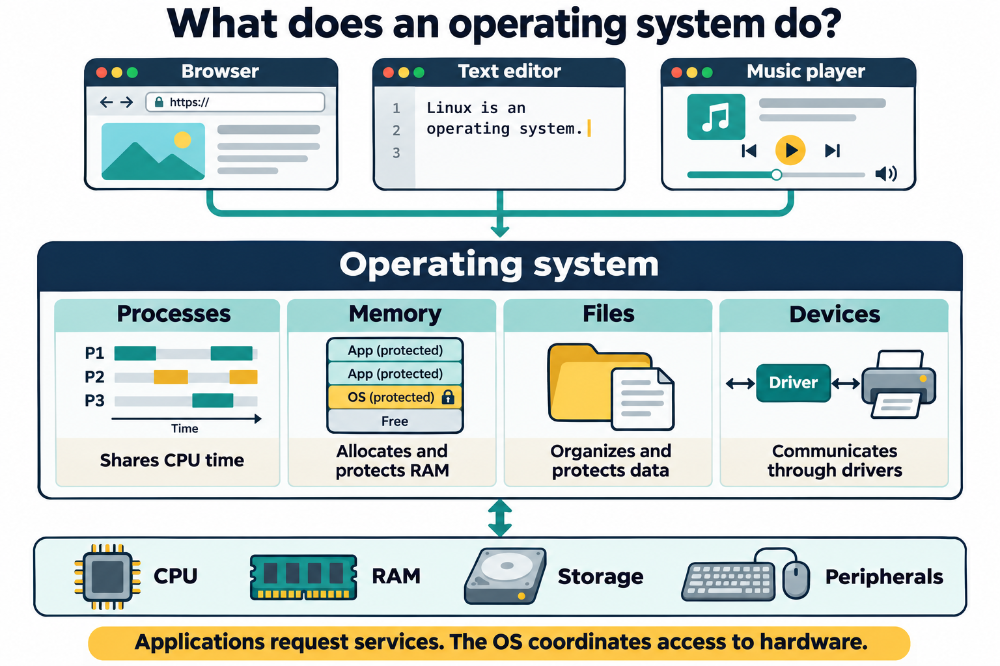

# Lesson 1 graphics

[Course graphics index](../README.md) · [Source chapter](../../lesson-01-prototype.md)

## Figure 1.1 — What does an operating system do?

- **File:** [01-os-responsibilities.png](01-os-responsibilities.png)
- **Status:** Draft for instructional review; embedded in the chapter.
- **Learning purpose:** Connect applications, the four introductory OS responsibilities, and the hardware they share.
- **Placement:** Section 1, after the introduction to the four responsibilities and before “Process management.”
- **Caption:** **Figure 1.1.** The operating system provides services to applications and coordinates access to hardware. Process, memory, file-system, and device management work together to support a running system.
- **Alt text:** Browser, text editor, and music player applications request services from an operating system that manages processes, memory, files, and devices and coordinates access to CPU, RAM, storage, and peripherals.
- **Production:** AI-generated illustration using the built-in image_gen tool; created November 4, 2026. [Original prompt](generation-prompt.txt).
- **Review note:** Conceptual overview. The four responsibilities cooperate; their column positions do not imply exclusive mappings to the hardware beneath them. The memory blocks are illustrative, not a physical memory map.

## Figure 1.2 — Linux system structure

- **File:** [02-linux-system-structure.png](02-linux-system-structure.png)
- **Status:** Draft for instructional review; embedded in the chapter.
- **Learning purpose:** Distinguish user space, the system-call boundary, kernel subsystems, and hardware.
- **Placement:** Section 4, following the text-based layer overview and before “Hardware.”
- **Caption:** **Figure 1.2.** Linux separates user-space programs from the privileged kernel. Programs request protected services through system calls; the kernel coordinates access to hardware. The shell is one user-space program, not a required intermediary for every application.
- **Alt text:** Applications, shells and desktop components, and background services run in user space. They request protected services through the system call interface. Kernel subsystems manage processes, memory, file systems, networking, drivers, and architecture-specific support, and communicate with hardware.
- **Production:** AI-generated illustration using the built-in image_gen tool; created November 4, 2026. [Original prompt](02-generation-prompt.txt).
- **Review note:** Simplified conceptual map. Libraries and utilities are user-space components, not a mandatory stage for every system call. Kernel subsystems cooperate rather than forming a serial pipeline.

## Figure 1.3 — What is a Linux distribution?

- **File:** [03-linux-distribution-components.png](03-linux-distribution-components.png)
- **Status:** Draft for instructional review; embedded in the chapter.
- **Learning purpose:** Explain why the Linux kernel alone is not a complete distribution and why distributions differ.
- **Placement:** Section 5, following the introductory definition and before the discussion of shared components.
- **Caption:** **Figure 1.3.** A distribution combines the Linux kernel with selected software, installation and update tools, and an integrated release and support model. Different selections suit desktop, server, and special-purpose systems; a graphical desktop is optional.
- **Alt text:** A Linux distribution combines the Linux kernel, libraries and utilities, package tools and repositories, system services, installer and configuration, and optional desktop applications. Maintainers integrate, test, release, and support these components for desktop, server, or special-purpose use.
- **Production:** AI-generated illustration using the built-in image_gen tool; created November 4, 2026. [Original prompt](03-generation-prompt.txt).
- **Review note:** Typical component categories, not a claim that every distribution ships the same installer, services, desktop, or support arrangement. Repositories may be accessed over a network rather than bundled in an installation image.

## Future screenshots

Installer screenshots should be captured from the lab's actual Ubuntu release when that environment is available.
