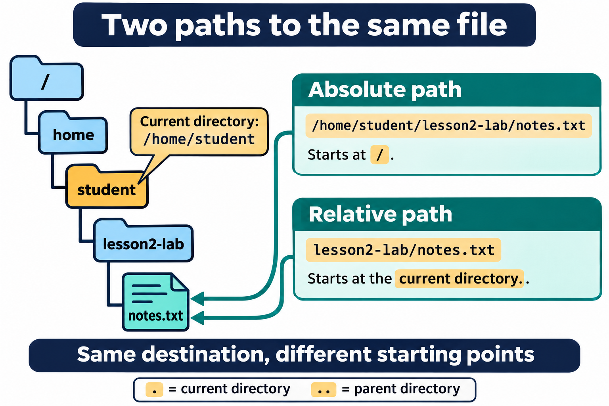
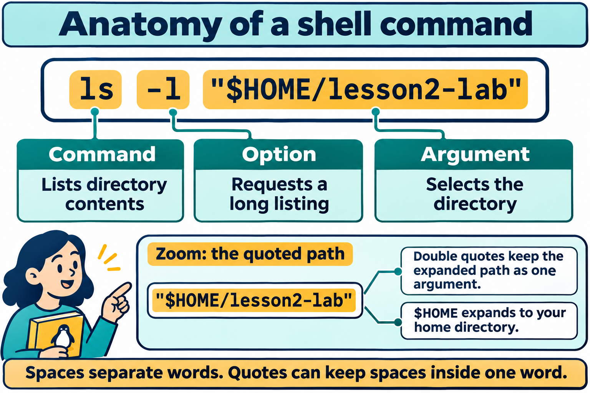

# Lesson 2 graphics

[Course graphics index](../README.md) · [Source chapter](../../lesson-02-linux-shell.md)

These AI-generated illustrations use the built-in image_gen tool and continue Lesson 1's navy, teal, and amber textbook style. All are drafts for instructional review. Numbering follows chapter order.

## Figure 2.1 — Two paths to the same file

- **File:** [01-absolute-relative-paths.png](01-absolute-relative-paths.png)
- **Placement:** Section 4, after the paragraph defining a relative path.
- **Learning purpose:** Make the starting point of each path type visible.
- **Caption:** **Figure 2.1.** An absolute path starts at root (`/`); a relative path starts at the current directory. Here both paths identify `notes.txt` because the current directory is `/home/student`.
- **Alt text:** A directory tree runs from root through home, student, and lesson2-lab to notes.txt. With /home/student as the current directory, the absolute path /home/student/lesson2-lab/notes.txt and relative path lesson2-lab/notes.txt identify the same file.
- **Prompt:** [01-generation-prompt.txt](01-generation-prompt.txt).
- **Review note:** Changing the current directory changes the interpretation of a relative path. Root `/` and a user's home directory are different locations.

## Figure 2.2 — Anatomy of a shell command

- **File:** [02-command-anatomy.png](02-command-anatomy.png)
- **Placement:** Section 5, following the explanation of the `ls -l` example.
- **Learning purpose:** Connect command syntax to the lesson's concrete directory-listing example.
- **Caption:** **Figure 2.2.** `ls` identifies the command, `-l` requests a long listing, and the quoted path selects the directory. Bash expands `$HOME` inside double quotes while preserving the path as one argument.
- **Alt text:** The command ls -l "$HOME/lesson2-lab" is divided into ls, the command name; -l, the long-listing option; and the quoted path, the directory argument. Double quotes permit HOME expansion while keeping the path together.
- **Prompt:** [02-generation-prompt.txt](02-generation-prompt.txt).
- **Review note:** Quotes are shell syntax and are removed before the argument reaches `ls`. Options are also arguments in the program's argument list; the figure distinguishes their roles for beginners.

## Figure 2.3 — Streams, redirection, and pipelines

- **File:** [03-streams-redirection-pipelines.png](03-streams-redirection-pipelines.png)
- **Placement:** Section 9, after the introductory definition of a pipeline.
- **Learning purpose:** Distinguish standard streams, file redirection, and a pipe between cooperating commands.
- **Caption:** **Figure 2.3.** Programs read standard input and write results and diagnostics to separate streams. Redirection changes a stream's source or destination; an ordinary pipe connects one command's standard output to the next command's standard input. Sorting first groups duplicate lines so `uniq -c` can count them.
- **Alt text:** Standard input, descriptor 0, flows into a program; standard output, descriptor 1, carries results out; standard error, descriptor 2, carries diagnostics separately. A pipeline sends sorted words from sort words.txt to uniq -c, producing counts of two alpha, one beta, and one zeta.
- **Prompt:** [03-generation-prompt.txt](03-generation-prompt.txt).
- **Review note:** An ordinary `|` does not carry standard error unless it is explicitly redirected. `>` normally creates a file or truncates an existing one; `>>` creates or appends. The sample output omits `uniq`'s display padding.

## Additional opportunities

- Terminal versus shell versus kernel: distinguish the window from the interpreter and protected OS services.
- Exported-variable inheritance: contrast shell-local values with a copied child environment; child changes do not update the parent.

These are optional future additions, not existing assets.
