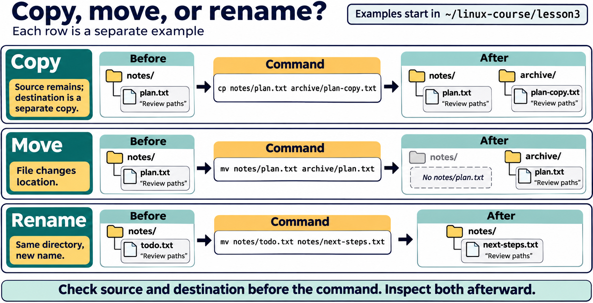
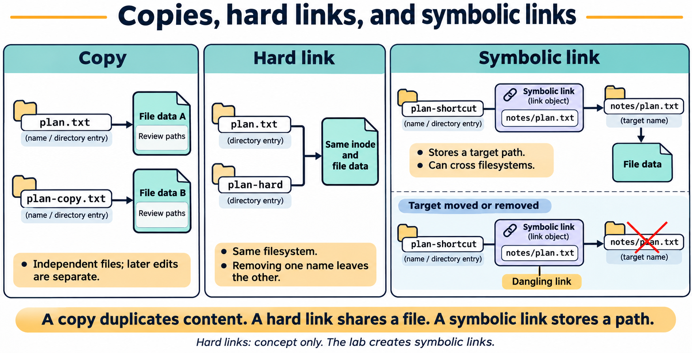

# Lesson 3 graphics

[Course graphics index](../README.md) · [Source chapter](../../lesson-03-files-directories.md)

Production: AI-generated illustrations using the built-in image_gen tool, continuing the course's navy, teal, and amber style. All figures are drafts for instructional review.

## Figure 3.1 — One filesystem tree, different purposes

- **Placement:** Section 1, after the FHS directory table and before the paragraph “These are roles, not permissions.”
- **Learning purpose:** Organize the chapter's directory reference around memorable purposes while retaining one tree rooted at `/`.
- **Caption:** **Figure 3.1.** Common Linux locations serve different purposes within one filesystem tree. The groups summarize roles rather than additional directories. `/usr/local` is below `/usr`; `/root` is the administrator's home, not the root of the tree. Student work stays in the lesson workspace.
- **Alt text:** The Linux root directory connects to common locations grouped by purpose: personal work, system software and configuration, changing data, and kernel and device interfaces. A student's practice directory is highlighted beneath /home. The administrator's /root home is distinct from the tree root /.
- **Prompt:** [01-generation-prompt.txt](01-generation-prompt.txt).
- **Review note:** Selected common locations, not a complete FHS chart. Layout and contents vary by distribution. Virtual filesystems such as `/proc` and `/sys` expose runtime interfaces; their entries are not ordinary stored documents. Directory roles do not grant write permission.

## Figure 3.2 — Copy, move, or rename?

- **Placement:** Section 4, after the explanation of moving and renaming and before the practice-path guidance.
- **Learning purpose:** Help students predict which names exist after `cp` and `mv`.
- **Caption:** **Figure 3.2.** Copying leaves the source in place and creates a separate copy. Moving changes a location; moving to a different name within the same directory renames the file. Each row is independent and assumes a destination that does not already exist.
- **Alt text:** Three independent before-and-after examples show cp preserving notes/plan.txt and creating archive/plan-copy.txt, mv relocating notes/plan.txt to archive/plan.txt, and mv renaming notes/todo.txt to notes/next-steps.txt.
- **Prompt:** [02-generation-prompt.txt](02-generation-prompt.txt).
- **Review note:** Relative paths assume the current directory is `~/linux-course/lesson3` and the `notes` and `archive` directories exist. Existing destination files can change the result or be overwritten. The examples explain visible behavior, not guarantees about inode preservation when moving across filesystems.

## Figure 3.3 — Copies, hard links, and symbolic links

- **Placement:** Section 5, after the conceptual explanation and before the paragraph limiting lab work to symbolic links.
- **Learning purpose:** Distinguish duplicated contents, multiple names for a file, and a separate link object storing a target path.
- **Caption:** **Figure 3.3.** A copy contains independent data. Hard links are directory entries referring to the same underlying file. A symbolic link is a separate object storing a path, so it may remain after its target disappears. Hard links normally stay within one filesystem; symbolic links can refer across filesystems.
- **Alt text:** A copy has separate file data. Two hard-link names refer to the same inode and file data. A symbolic link stores notes/plan.txt as a path to its target; the link remains dangling if the target is moved or removed.
- **Prompt:** [03-generation-prompt.txt](03-generation-prompt.txt).
- **Review note:** Hard links are conceptual only in this lesson. The relative path in a symbolic link is resolved from the link's containing directory, not the shell's current directory. Removing one hard-link name does not remove the other name; space reclamation also depends on remaining links and open references. The copy comparison is conceptual and does not describe storage-level copy-on-write optimizations.
