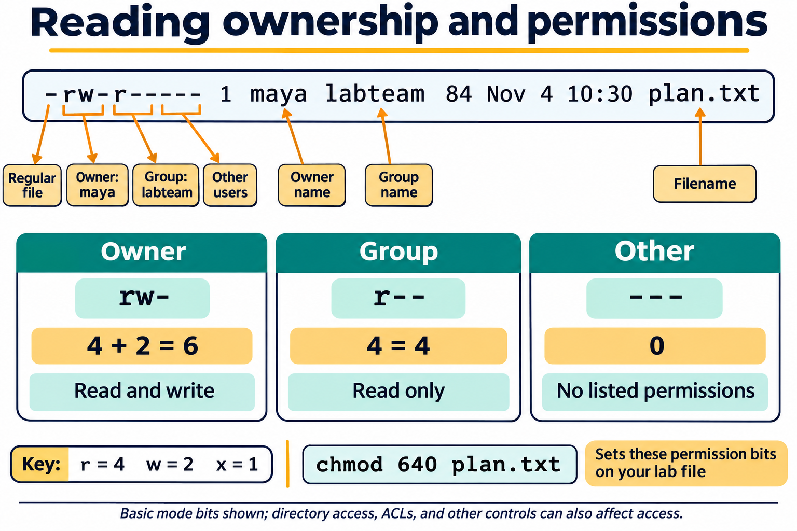
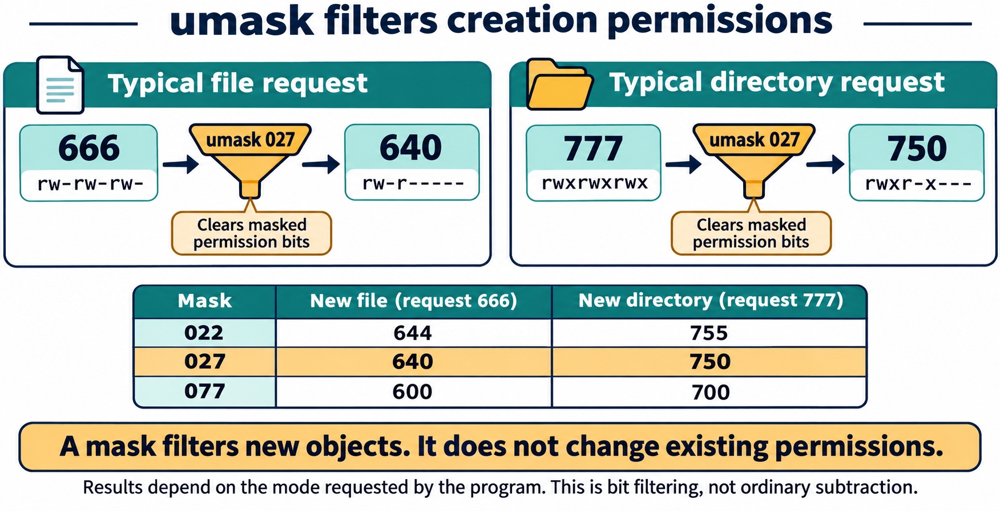

# Lesson 4 graphics

[Course graphics index](../README.md) · [Source chapter](../../lesson-04-users-groups-permissions.md)

Production: AI-generated illustrations using the built-in image_gen tool, continuing the course's navy, teal, and amber style. All figures are drafts for instructional review.

## Figure 4.1 — Reading ownership and permissions

- **Placement:** Section 2, after the explanation of the example listing.
- **Learning purpose:** Connect listing fields, ownership, permission classes, and octal notation using the chapter's example.
- **Caption:** **Figure 4.1.** The type character precedes three permission triplets: owner, group, and other. For `plan.txt`, `rw-`, `r--`, and `---` correspond to `6`, `4`, and `0`. Names identify ownership; permission bits describe the access allowed to each class in the basic model.
- **Alt text:** A long listing for plan.txt identifies the regular-file marker, owner maya, group labteam, and owner rw-, group r--, and other --- permission triplets. Read is worth 4, write 2, and execute 1; these triplets correspond to mode 640.
- **Prompt:** [01-generation-prompt.txt](01-generation-prompt.txt).
- **Review note:** For ordinary discretionary access without extended ACLs, the applicable class is selected; owner, group, and other permissions are not simply combined. Parent-directory permissions and other controls can still prevent access. `chmod` changes bits, not ownership; the command is for an owned lab file.

## Figure 4.2 — Same permission letters, different effects

- **Placement:** Section 3, after the explanation of directory permissions and path traversal.
- **Learning purpose:** Separate file content permissions from directory-entry and traversal permissions.
- **Caption:** **Figure 4.2.** Read, write, and execute have different effects on files and directories. Accessing a file requires traversal through each directory in its path. Removing a filename generally depends on write and traversal permissions on its parent directory, subject to additional restrictions.
- **Alt text:** A table contrasts read, write, and execute for regular files and directories. Files can be read, changed, or executed; directories can have names listed, entries changed, or paths traversed. Reading private.txt also requires traversal through every parent directory, starting at root.
- **Prompt:** [02-generation-prompt.txt](02-generation-prompt.txt).
- **Review note:** Directory read alone lists names; accessing entries and their metadata usually also requires traversal. File execute is not sufficient by itself to guarantee successful execution. Sticky bits, ACLs, immutable attributes, mount settings, and other controls may restrict operations. This is a conceptual comparison, not a command sequence.

## Figure 4.3 — umask filters creation permissions

- **Placement:** Section 5, after the paragraph comparing common masks and before the student inspection guidance.
- **Learning purpose:** Explain permission filtering and why typical file and directory creation modes differ.
- **Caption:** **Figure 4.3.** A process's `umask` clears permission bits from a program's creation request. Typical requests are `666` for ordinary files and `777` for directories; with mask `027`, these become `640` and `750`. Existing objects are unaffected, and programs may request more restrictive modes.
- **Alt text:** A typical file creation request of 666 passes through umask 027 and becomes 640; a directory request of 777 becomes 750. A table compares masks 022, 027, and 077, yielding files 644, 640, and 600 and directories 755, 750, and 700.
- **Prompt:** [03-generation-prompt.txt](03-generation-prompt.txt).
- **Review note:** This illustrates the basic mode-bit model without a parent default ACL. The operation is requested mode AND the complement of the mask, not arithmetic subtraction. Default ACLs can change how creation access is determined. The student activity inspects the mask; it does not change startup configuration.
