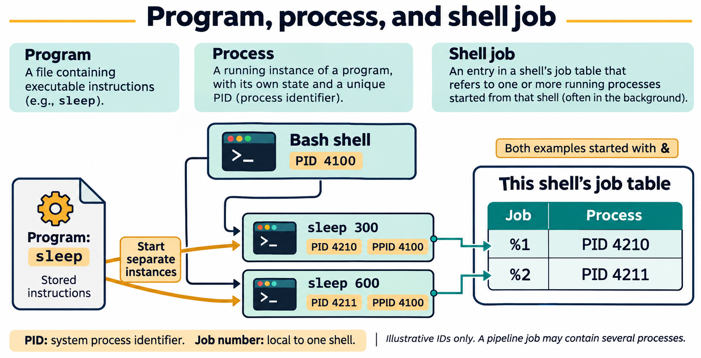
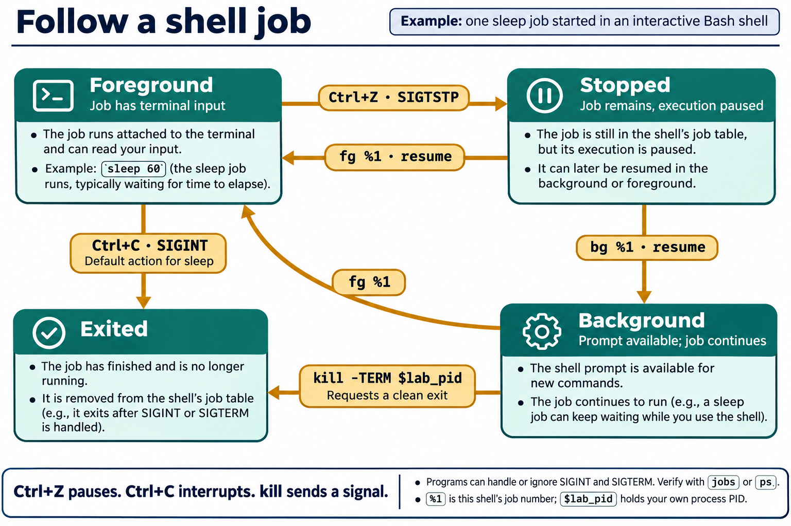

# Lesson 5 graphics

[Course graphics index](../README.md) · [Source chapter](../../lesson-05-processes-job-control.md)

Production: AI-generated illustrations using the built-in image_gen tool, continuing the course's navy, teal, and amber style. All figures are drafts for instructional review.

## Figure 5.1 — Program, process, and shell job

- **Placement:** Section 1, following the explanation of user and system processes.
- **Learning purpose:** Distinguish stored instructions, running instances, parent relationships, and shell-local job identifiers.
- **Caption:** **Figure 5.1.** Starting the same program twice creates separate processes. Their PPIDs identify the parent shell in this example, while the shell tracks the two background commands with its own job numbers. A job can include more than one process, as with a pipeline.
- **Alt text:** A stored sleep program is started twice by Bash PID 4100, producing processes PID 4210 and 4211 with PPID 4100. The shell's job table assigns them local job numbers %1 and %2. A pipeline job may contain multiple processes.
- **Prompt:** [01-generation-prompt.txt](01-generation-prompt.txt).
- **Review note:** All IDs are illustrative, not targets for commands. A PID may be reused after exit, a process's parent relationship may change, and job numbers apply only in the shell that tracks them. The stored executable is not a parent process.

## Figure 5.3 — Follow a shell job

- **Placement:** Section 7, following the distinction between Ctrl+C and Ctrl+Z.
- **Learning purpose:** Connect foreground placement, suspension, background continuation, interruption, and termination requests.
- **Caption:** **Figure 5.3.** `Ctrl+Z` normally suspends a foreground job. `bg` resumes a stopped job in the background; `fg` brings a job to the foreground and resumes it if needed. `Ctrl+C` sends an interrupt, while `kill -TERM` requests termination. Check the resulting state rather than assuming every program responds identically.
- **Alt text:** A foreground sleep job stops after Ctrl+Z and SIGTSTP. bg resumes it in the background; fg brings a background or stopped job to the foreground. Ctrl+C normally interrupts sleep with SIGINT, and kill -TERM requests termination of the captured lab process.
- **Prompt:** [02-generation-prompt.txt](02-generation-prompt.txt).
- **Review note:** The diagram uses job-control placement, not the kernel's R/S/T state taxonomy. A background sleep process normally waits in S, rather than consuming CPU continuously. Terminal-generated signals target the foreground process group. `%1` is an example job number; `$lab_pid` must contain the PID captured from the student's own process. The exit arrows show ordinary behavior of sleep; other programs may handle or ignore SIGINT or SIGTERM.

## Figure 5.2 — Niceness: higher number, lower preference

- **Placement:** Section 6, after the command examples and before the job-control section.
- **Learning purpose:** Make the direction of the niceness scale clear and distinguish a nice adjustment from a renice target value.
- **Caption:** **Figure 5.2.** Higher niceness values generally reduce scheduling preference. `nice -n 10` adds 10 to inherited niceness, while `renice 15 -p PID` sets the selected process's niceness to 15. These settings influence scheduling rather than reserving a fixed CPU share.
- **Alt text:** A Linux niceness scale runs from -20, higher scheduling preference, through the common default 0 to 19, lower preference. Raising a lab process from 10 to 15 lowers preference. nice -n 10 adjusts inherited niceness; renice 15 -p PID sets an existing process's value to 15.
- **Prompt:** [03-generation-prompt.txt](03-generation-prompt.txt).
- **Review note:** The scale describes ordinary Linux niceness, not all scheduling policies or real-time priorities. Scheduling also depends on runnable work, load, policy, and grouping. The sleep example is a low-impact way to inspect NI, not a CPU benchmark. Students adjust only their own lab process.
