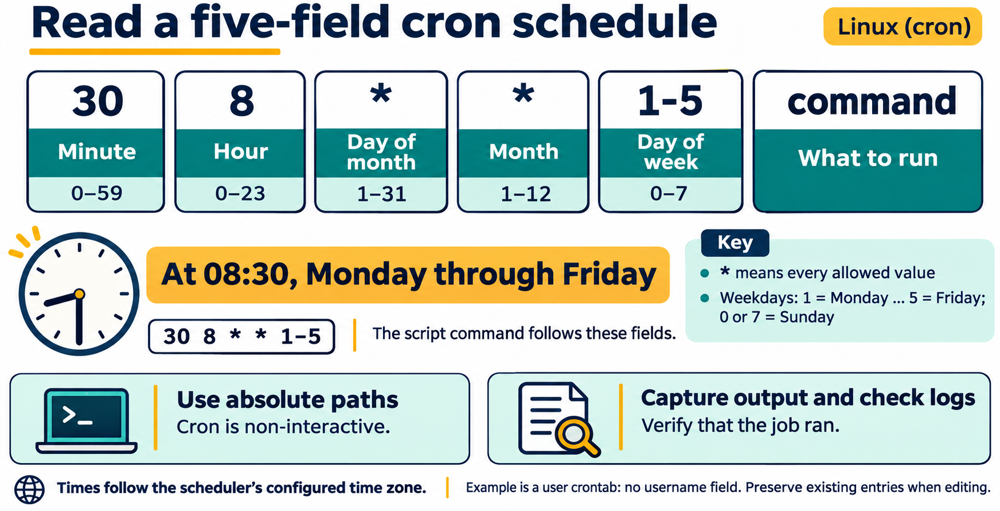

# Lesson 7 graphics

[Course graphics index](../README.md) · [Source chapter](../../lesson-07-shell-scripting-automation.md)

Production: AI-generated illustrations using the built-in image_gen tool, continuing the course's navy, teal, and amber style. All figures are drafts for instructional review.

## Figure 7.1 — Check a script, then choose how to run it

- **Placement:** Section 3, following the paragraph on syntax checking.
- **Learning purpose:** Distinguish checking from execution and explicit-interpreter launch from direct execution.
- **Caption:** **Figure 7.1.** `bash -n` checks syntax without executing commands. `bash system-report.sh` explicitly chooses Bash, while direct execution requires executable permission and uses the shebang. Both launch methods still require a reviewed script and appropriate input.
- **Alt text:** After reviewing and syntax-checking system-report.sh with bash -n, either invoke bash with the readable script or add the owner's executable bit and run it directly. Direct execution uses the shebang to select the interpreter. OUTPUT_FILE stands for a new path within the lesson workspace.
- **Prompt:** [01-generation-prompt.txt](01-generation-prompt.txt).
- **Review note:** `OUTPUT_FILE` is a placeholder, not text to type literally. The lesson's `#!/usr/bin/env bash` asks env to locate Bash using PATH. Direct execution can also depend on directory traversal, mount settings, and other controls. The `.sh` filename suffix does not select an interpreter, and the syntax check cannot establish that the script is safe or correct.

## Figure 7.2 — Read a five-field cron schedule

- **Placement:** Section 9, following the explanation of the weekday example and time zone.
- **Learning purpose:** Make field order and the interpretation of the lesson's recurring schedule visible.
- **Caption:** **Figure 7.2.** In a user crontab, five time fields precede the command. `30 8 * * 1-5` selects 08:30 on Monday through Friday. Use absolute paths, capture useful output, and check that the job ran in the prepared VM.
- **Alt text:** The user-crontab schedule 30 8 * * 1-5 divides into minute, hour, day of month, month, and day of week. It means 08:30 Monday through Friday in the scheduler's configured time zone, followed by the command to execute.
- **Prompt:** [02-generation-prompt.txt](02-generation-prompt.txt).
- **Review note:** Traditional five-field user-crontab format is shown; it has no username field. The example leaves day-of-month unrestricted and does not illustrate the special matching behavior when both day fields are restricted. Runtime depends on cron availability, the VM being active, configuration, and clock/time-zone behavior. This is a schedule explanation, not an instruction to create a new scheduled task in Codex.

## Figure 7.3 — Follow the system-report script

- **Placement:** Student lab Part A, after the explanation of grouped output and before the paragraph on the output path.
- **Learning purpose:** Trace validation, branching, grouped redirection, and the distinction between output text and exit status in the actual lab script.
- **Caption:** **Figure 7.3.** The script checks its first parameter before gathering information. Only the grouped block's standard output goes to the report; the final message goes to the terminal. Printed messages and numeric exit status are different results, and the report contents still need inspection.
- **Alt text:** A missing or empty first argument leads to a usage message and exit status 2. Otherwise the script stores the output path, gathers system information into a grouped block redirected to the report file, then prints its final message to the terminal outside that block.
- **Prompt:** [03-generation-prompt.txt](03-generation-prompt.txt).
- **Review note:** This traces the supplied sample, not an improved error-handling implementation. Usage is printed to standard output. Standard error is not redirected by the block's `>` operator. The final printf's status does not prove all report commands or the report redirection succeeded; the sample can print its final message even after an earlier failure. The output file is created or truncated when the group redirection is opened. The date is captured through command substitution, and function calls write section headings within the block.
