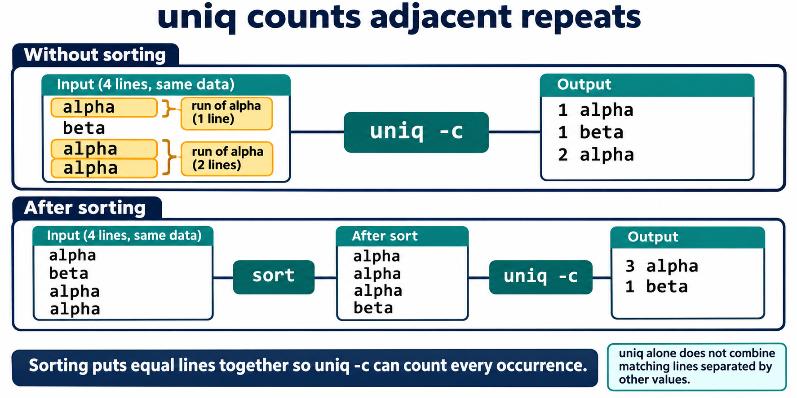
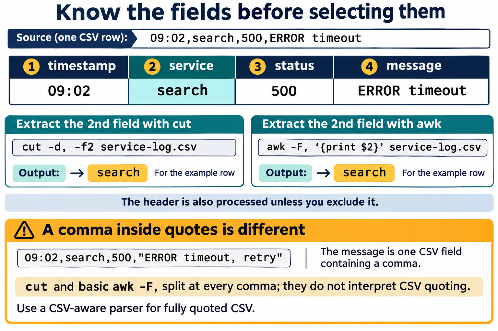
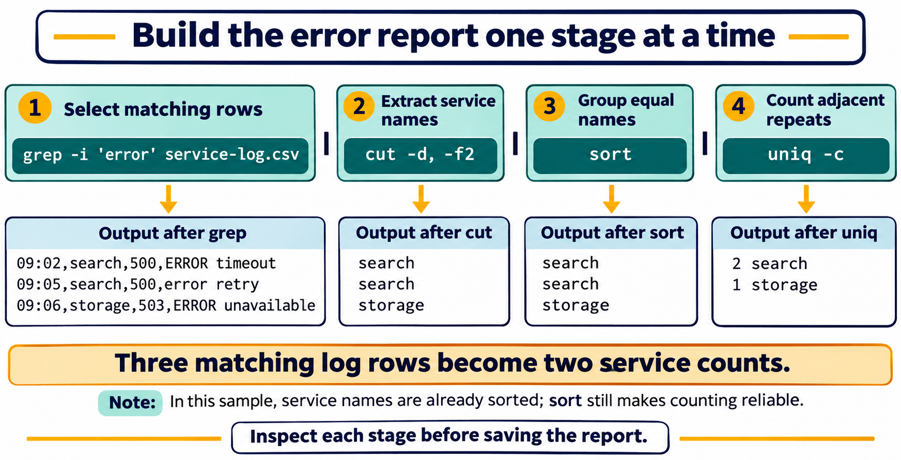

# Lesson 8 graphics

[Course graphics index](../README.md) · [Source chapter](../../lesson-08-text-processing-pipelines.md)

Production: AI-generated illustrations using the built-in image_gen tool, continuing the course's navy, teal, and amber style. All figures are drafts for instructional review.

## Figure 8.1 — uniq counts adjacent repeats

- **Placement:** Section 4, after the explanation of sorting before counting and handling the header.
- **Learning purpose:** Make adjacency visible and explain why separated duplicates remain separate without sorting.
- **Caption:** **Figure 8.1.** `uniq -c` counts runs of adjacent equal lines. Sorting groups all equal lines together, allowing one count for each distinct value. This four-line example is separate from the service log.
- **Alt text:** For alpha, beta, alpha, alpha, uniq -c reports separate runs: one alpha, one beta, and two alpha. Sorting first produces alpha, alpha, alpha, beta, allowing uniq -c to report three alpha and one beta.
- **Prompt:** [01-generation-prompt.txt](01-generation-prompt.txt).
- **Review note:** Sorting changes input order and follows the current locale. For these simple lowercase values, the shown ordering is expected. Counts omit uniq's display padding. Both branches must begin with identical data and preserve all four occurrences.

## Figure 8.2 — Know the fields before selecting them

- **Placement:** Section 5, after the explanation of cut and quoted CSV limitations.
- **Learning purpose:** Connect field numbers and delimiters to the sample record and distinguish simple field splitting from CSV parsing.
- **Caption:** **Figure 8.2.** Number fields from one and identify the delimiter before selecting data. Both examples select the service field from this simple row. Quoted CSV can contain commas inside a single field, so `cut` and basic `awk -F,` are not general CSV parsers.
- **Alt text:** A simple log row has fields timestamp, service, status, and message. cut -d, -f2 and awk -F, with print $2 both select search from this row. A quoted CSV message containing a comma illustrates why splitting at every comma is not complete CSV parsing.
- **Prompt:** [02-generation-prompt.txt](02-generation-prompt.txt).
- **Review note:** Output shown is for the single example row, not the complete lab file. The full commands also process the header. The quoted-comma caution demonstrates record-parsing limitations; it does not imply that selecting field 2 fails for that particular record. The chapter introduces awk syntax in Section 8; this preview connects its shared field-selection role.

## Figure 8.3 — Build the error report one stage at a time

- **Placement:** Section 9, after the explanation of the focused error-service pipeline and before the warning about obscured errors.
- **Learning purpose:** Trace actual intermediate text and verify the sample's error counts.
- **Caption:** **Figure 8.3.** Filter matching rows, select service names, group equal values, then count them. The lab data contains three case-insensitive error matches: two for `search` and one for `storage`. Inspect intermediate output before saving a report.
- **Alt text:** grep -i selects the three error rows in the lab service log. cut extracts search, search, storage; sort keeps these grouped; uniq -c produces two search and one storage. Each stage's output becomes the next stage's input.
- **Prompt:** [03-generation-prompt.txt](03-generation-prompt.txt).
- **Review note:** The pattern matches error anywhere in a row, not a specific numeric status or field. The header is excluded here because it does not match. The selected service names already happen to be sorted; keep sort to ensure reliable adjacency for other input orders. Standard error is separate from a normal pipe, and output alone does not prove every command succeeded.
