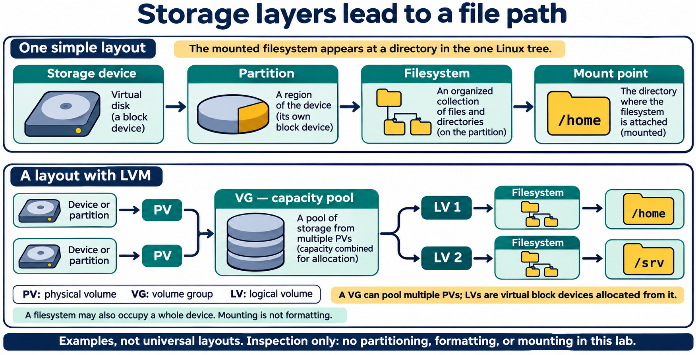
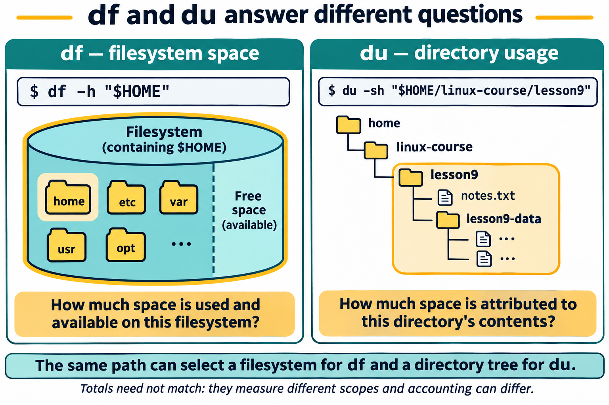
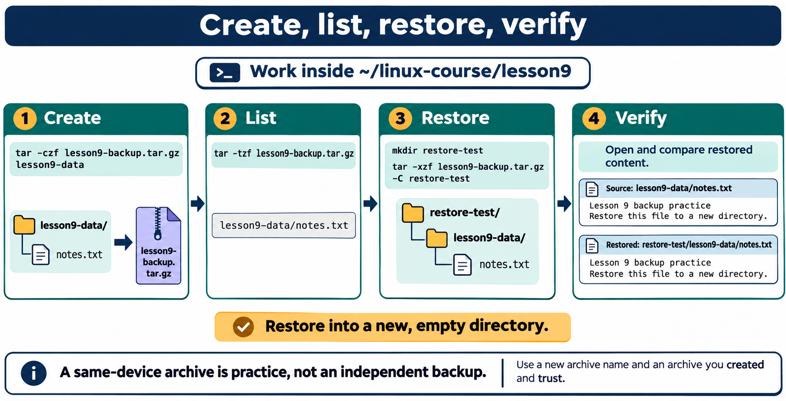
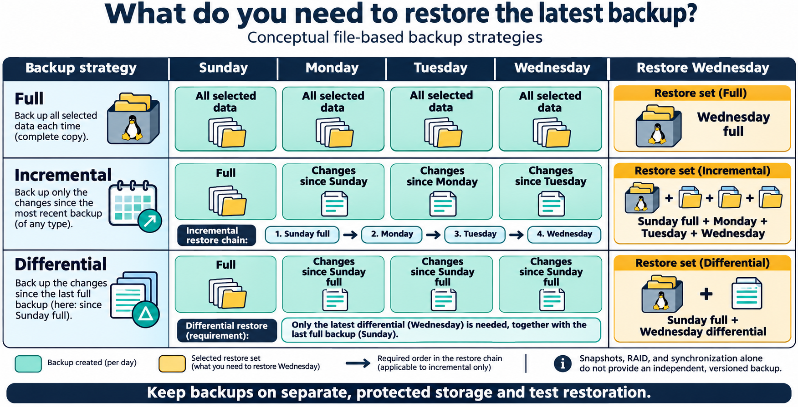

# Lesson 9 graphics

[Course graphics index](../README.md) · [Source chapter](../../lesson-09-storage-filesystems-backups.md)

Production: AI-generated illustrations using the built-in image_gen tool, continuing the course's navy, teal, and amber style. All figures are drafts for instructional review. Storage diagrams are conceptual; the lab does not provision, format, mount, or unmount storage.

## Figure 9.1 — Storage layers lead to a file path

- **Placement:** Section 2a, after the explanation of physical volumes, volume groups, and logical volumes and before snapshots.
- **Learning purpose:** Connect device vocabulary to mount points and show how LVM adds a storage-allocation layer.
- **Caption:** **Figure 9.1.** A filesystem makes storage accessible through a mount point. LVM adds physical volumes (PVs), a pooled volume group (VG), and logical volumes (LVs) that can hold filesystems. These are example layouts; filesystems can also occupy whole devices or other storage layers.
- **Alt text:** A simple layout connects a storage device, partition, filesystem, and mount point. An LVM layout combines two physical volumes in one volume group, then allocates logical volumes holding filesystems mounted at /home and /srv.
- **Prompt:** [01-generation-prompt.txt](01-generation-prompt.txt).
- **Review note:** Arrows express conceptual layer relationships, not commands or a copying sequence. LVs are block devices, not directories. LVM pooling alone does not imply RAID redundancy or independent backups. Mount points shown are examples, not the class VM's actual configuration. Other layouts can add encryption, RAID, network storage, or virtual filesystems.

## Figure 9.2 — df and du answer different questions

- **Placement:** Section 4, after the comparison of filesystem and directory accounting and before the bounded-inspection guidance.
- **Learning purpose:** Make the different measurement scopes visible without implying the totals should agree.
- **Caption:** **Figure 9.2.** `df` reports space on the filesystem containing a path. `du` estimates usage beneath the selected directory. They answer different questions, and filesystem accounting, metadata, links, snapshots, permissions, and other factors can make their totals differ.
- **Alt text:** df -h with HOME selects the entire filesystem containing the home path, including used and available space. du -sh with the lesson9 directory estimates space attributed to that directory and its descendants, rather than free space on the whole filesystem.
- **Prompt:** [02-generation-prompt.txt](02-generation-prompt.txt).
- **Review note:** No invented numeric readings are shown. By default du reports allocated usage and may cross mounted filesystems encountered under the chosen directory; the simple tree assumes no nested mounts. HOME need not be on a separately mounted home filesystem. Keep scans within the lab directory.

## Figure 9.4 — Create, list, restore, verify

- **Placement:** Section 6, after the paragraph describing listing, test extraction, and comparison.
- **Learning purpose:** Tie the lab commands to their visible effects and distinguish listing from actual restoration.
- **Caption:** **Figure 9.4.** Create an archive, inspect its stored paths, extract to a new empty directory, and compare restored content with the original. The archived `lesson9-data` directory is preserved beneath `restore-test`. A successful listing alone is not a restore test.
- **Alt text:** A lesson9-data folder containing notes.txt is archived, its stored paths are listed, and the archive is extracted into a new empty restore-test directory. The restored path is restore-test/lesson9-data/notes.txt; its two lines are compared with the source.
- **Prompt:** [03-generation-prompt.txt](03-generation-prompt.txt).
- **Review note:** Commands run from `~/linux-course/lesson9` and use the student's own trusted archive. The archive filename and restore directory must be new. A same-device archive remains exposed to many of the same failures as the source. The two-line comparison is suitable for the tiny practice file, not a complete integrity-verification plan for large backups.

## Figure 9.3 — What do you need to restore the latest backup?

- **Placement:** Section 5, after the full/incremental/differential definitions and before synchronization guidance.
- **Learning purpose:** Make each strategy's reference point and required restore set clear.
- **Caption:** **Figure 9.3.** A full backup can restore its own selected data. A conventional incremental chain needs the starting full backup and each subsequent increment in order. A differential restore needs the starting full backup and the chosen latest differential. Separate, protected storage and tested restores remain essential for all three.
- **Alt text:** Four days compare full, incremental, and differential backups. Wednesday restoration uses only Wednesday's full backup, or Sunday's full plus every following incremental in order, or Sunday's full plus Wednesday's differential.
- **Prompt:** [04-generation-prompt.txt](04-generation-prompt.txt).
- **Review note:** This is a simplified conventional file-based model, not a guarantee about a particular backup product. Modern tools may manage block-level increments, synthetic fulls, deduplication, catalogs, or deletion tracking differently. The days are examples rather than a scheduled task.
