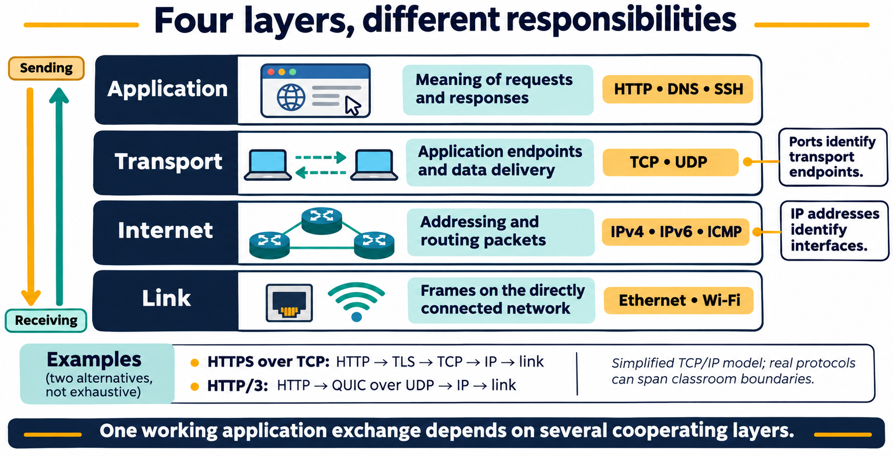
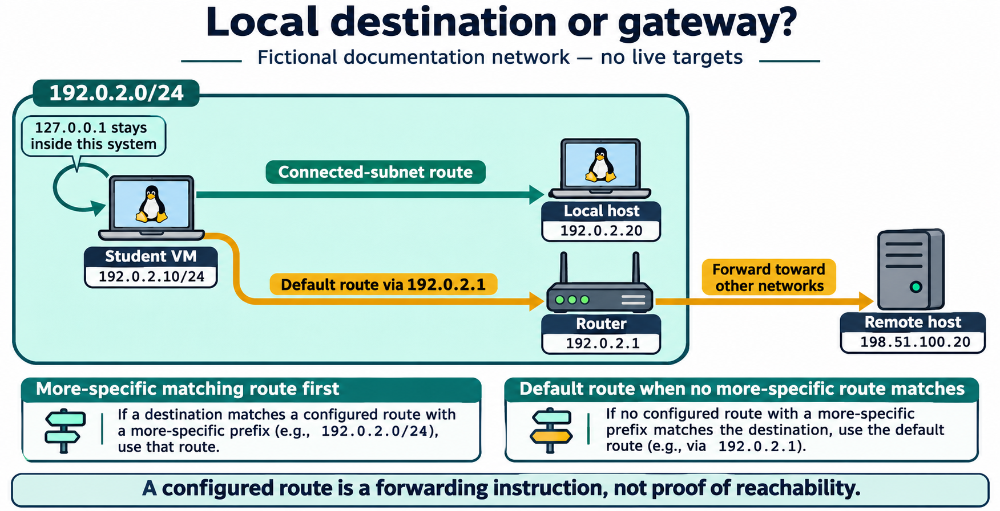

# Lesson 10 graphics

[Course graphics index](../README.md) · [Source chapter](../../lesson-10-networking-fundamentals.md)

Production: AI-generated illustrations using the built-in image_gen tool, continuing the course's navy, teal, and amber style. All figures are drafts for instructional review. Network examples are conceptual and contain no captured personal or institutional network details.

## Figure 10.1 — Four layers, different responsibilities

- **Placement:** Section 1, after the explanation of a web request and the limits of lower-layer evidence.
- **Learning purpose:** Connect each layer to its responsibilities and avoid assuming all web traffic uses TCP.
- **Caption:** **Figure 10.1.** Application, transport, Internet, and link responsibilities cooperate in a network exchange. Ports identify transport endpoints and IP addresses identify interfaces. The examples show HTTPS over TCP and HTTP/3 over QUIC/UDP; the four-layer model is a simplified guide rather than an exhaustive protocol map.
- **Alt text:** The TCP/IP model places HTTP, DNS, and SSH at the application layer; TCP and UDP at transport; IPv4, IPv6, and ICMP at Internet; and Ethernet and Wi-Fi at link. Example HTTPS stacks distinguish TCP with TLS from HTTP/3 using QUIC over UDP.
- **Prompt:** [01-generation-prompt.txt](01-generation-prompt.txt).
- **Review note:** Protocols listed within a row are examples, not a sequence that every request uses. TLS provides security rather than replacing IP routing, and QUIC incorporates TLS-based security. Name resolution may precede the web exchange and can use caches or non-DNS sources. Port numbers alone do not identify an application conclusively.

## Figure 10.2 — Local destination or gateway?

- **Placement:** Section 3, after the explanation of default routes, reachability, and virtual gateways.
- **Learning purpose:** Distinguish directly connected delivery, a default gateway, and loopback without exposing real network information.
- **Caption:** **Figure 10.2.** A connected-subnet route serves the local example; traffic with no more-specific matching route uses the default gateway. Loopback remains within the system. A route describes where to send traffic, not whether delivery will succeed.
- **Alt text:** A fictional VM at 192.0.2.10/24 sends local-subnet traffic directly toward 192.0.2.20. A separate path uses gateway 192.0.2.1 toward remote documentation address 198.51.100.20. Loopback 127.0.0.1 remains inside the VM.
- **Prompt:** [02-generation-prompt.txt](02-generation-prompt.txt).
- **Review note:** The addresses are documentation examples, not live lab targets. The diagram assumes a simple connected subnet and ordinary route selection; policy routing, VPNs, address resolution, link switches, NAT, and multiple routing tables are omitted. “Direct” means no IP router is required for the illustrated local delivery, not necessarily a physical cable between hosts. Actual VM gateways and prefixes may differ.

## Figure 10.3 — Troubleshoot with evidence, one check at a time

- **Placement:** Section 8, following the numbered troubleshooting sequence and before its limitations paragraph.
- **Learning purpose:** Tie commands to defensible observations rather than a single online/offline verdict.
- **Caption:** **Figure 10.3.** Inspect local state, routes, reachability, name lookup, and the application response. Each check establishes only part of the path: ICMP can be filtered, name lookup can use cached or local data, and an HTTP error status still represents an application response. Record uncertainty alongside evidence.
- **Alt text:** Five checks inspect interface state and addresses, routes, bounded ICMP reachability, system name lookup, and an approved HTTPS response. Each row states the limited observation and what remains unknown. Failed ping does not prove a web service is unavailable; HTTP status responses need interpretation.
- **Prompt:** [03-generation-prompt.txt](03-generation-prompt.txt).
- **Review note:** TARGET, NAME, and URL are placeholders to replace only with approved destinations. The tools shown are display forms or bounded requests, not authorization to scan. The interface-row semicolon separates two independent display commands. Proxies, caches, address families, policy, and server behavior can affect interpretation; an HTTP response may come from an intermediary. Local listeners can additionally be inspected with `ss -tuln`, as taught in the chapter. No network tests were performed to create these conceptual graphics.
