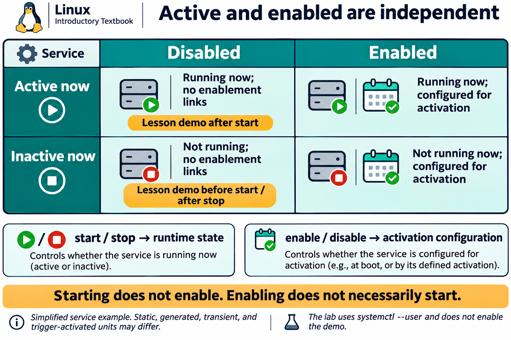

# Lesson 11 graphics

[Course graphics index](../README.md) · [Source chapter](../../lesson-11-services-system-administration.md)

Production: AI-generated illustrations using the built-in image_gen tool, continuing the course's navy, teal, and amber style. All figures are drafts for instructional review. Hardware and boot graphics are conceptual; service changes in the lab are limited to the provided user unit.

## Figure 11.1 — A common Linux boot path

- **Placement:** Section 2a, after the high-level text sequence and before the firmware explanation.
- **Learning purpose:** Locate boot responsibilities and distinguish early startup failures from a later individual service failure.
- **Caption:** **Figure 11.1.** A common bootloader-based path moves from firmware through the kernel and early userspace to the installed system and its target units. The initramfs helps prepare access to the real root filesystem. Hardware, boot software, and distribution configuration can change the details.
- **Alt text:** Power-on proceeds through BIOS or UEFI, a bootloader, the Linux kernel and initramfs early userspace, the real root filesystem handoff, and systemd target activation before a login or service-ready system. Some early-userspace environments also use systemd.
- **Prompt:** [01-generation-prompt.txt](01-generation-prompt.txt).
- **Review note:** A conceptual path, not a universal implementation sequence. UEFI can boot a kernel without a separate bootloader, and systemd can run in both initramfs and the installed userspace. PID 1 may execute a new image during handoff rather than a second independent init process being created. A target being reached does not prove every application is healthy.

## Figure 11.2 — Discover hardware without changing it

- **Placement:** Section 2b, after driver and module inspection and before the IRQ/DMA discussion.
- **Learning purpose:** Connect device discovery tools to user space, kernel drivers, modules, sysfs, and udev.
- **Caption:** **Figure 11.2.** Inventory tools read information exposed through kernel interfaces. Drivers may be built in or provided by modules; `lsmod` lists only loaded modules. User-space udev responds to device events and manages device-node rules. A loaded module alone does not establish which device it handles.
- **Alt text:** User-space tools inspect bus inventories, modules, sysfs views, and udev properties through kernel interfaces. Kernel drivers may be built in or loadable modules and handle hardware. User-space udev processes kernel events and manages device-node rules; /dev entries are interfaces to drivers.
- **Prompt:** [02-generation-prompt.txt](02-generation-prompt.txt).
- **Review note:** Logical relationships are simplified, not a complete event or API trace. Device nodes are filesystem interfaces, not ordinary hardware files; not every device has a /dev node. The kernel creates nodes through devtmpfs on typical Ubuntu systems, while udev applies properties, permissions, rules, and symlinks. Many modules are not device drivers. Guest-visible hardware may differ from physical host hardware. Placeholders are for inspection only, not module loading or device reconfiguration.

## Figure 11.3 — Active and enabled are independent

- **Placement:** Section 3, following the explanation of active/disabled and enabled/inactive combinations.
- **Learning purpose:** Separate runtime state from unit enablement using the exact behavior expected in the user-service lab.
- **Caption:** **Figure 11.3.** Active describes a unit's current runtime state; enabled describes activation configuration. The lab service can run while remaining disabled. Starting and stopping affect runtime, while enabling and disabling affect activation links; neither property alone proves application availability.
- **Alt text:** A two-by-two matrix combines active or inactive runtime state with enabled or disabled activation configuration. The lesson demo is inactive and disabled before start, active and disabled after start, and inactive and disabled after stop.
- **Prompt:** [03-generation-prompt.txt](03-generation-prompt.txt).
- **Review note:** This uses the lab's long-running simple service. Other service types can be active without a continuously running process, and static/generated/transient units have other unit-file states. Disabled is not masked: a disabled unit can still be started manually, by dependencies, or through an applicable trigger. Enabled does not guarantee successful or immediate activation. Students do not enable the demonstration unit.

## Figure 11.4 — Restart, reload, or daemon-reload?

- **Placement:** Section 4, after the explanation of unit-file changes and daemon-reload and before the lab scope reminder.
- **Learning purpose:** Prevent confusion between reloading application configuration, reloading unit definitions, and restarting a process.
- **Caption:** **Figure 11.4.** Restart replaces the running service instance. Reload asks the application to reread its configuration when supported. Daemon-reload updates the manager's unit definitions and dependency information; starting or restarting a service is a separate action. The sample sleep unit has no application reload operation.
- **Alt text:** Restart stops and starts a service process. Reload asks a supporting application to reread application configuration. Daemon-reload makes the systemd manager reread unit definitions without itself restarting services. The lab copies its user unit, reloads the user manager, starts the demo, then checks status and logs.
- **Prompt:** [04-generation-prompt.txt](04-generation-prompt.txt).
- **Review note:** The comparison targets a running, simple service and normal lifecycle behavior. Daemon-reload also reruns generators and rebuilds the dependency tree. Reload support is service-specific; it does not promise every changed setting can be applied without restart. In the lab, all manager changes use --user and only lesson11-course-demo.service is controlled. A unit's ExecStart is not interpreted as a shell command by default.
