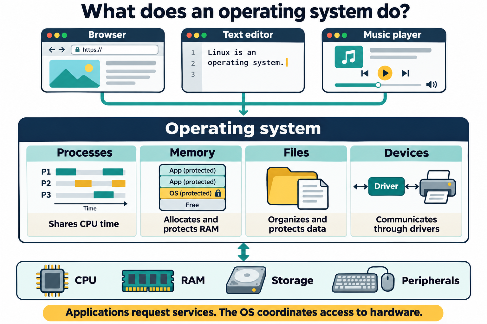

# Lesson 1 — Operating Systems and Linux Fundamentals

**Course position:** 1 of 14  
**Prototype status:** Draft for review  
**Suggested duration:** 2–3 hours, including installation lab  
**Default environment:** Ubuntu Desktop LTS in a virtual machine or dedicated lab computer  
**Assessment format:** Moodle XML question bank containing multiple-choice and true/false questions

## Lesson purpose

This lesson establishes the conceptual foundation for the course. Students learn what an operating system does, how Linux developed, how a Linux system is organized, and why there are many Linux distributions. They then install Ubuntu and complete a basic post-installation inspection.

## Learning objectives

By the end of the lesson, students will be able to:

1. Explain what an operating system is and describe its roles in process, memory, file-system, and device management.
2. Distinguish between CLI and GUI user interfaces and identify situations where each is useful.
3. Summarize the relationship among Unix, the GNU Project, the Linux kernel, and complete Linux distributions.
4. Describe the major layers of a Linux system: hardware, kernel, shell/user environment, and applications.
5. Compare Linux distributions by purpose, package ecosystem, support model, and target audience.
6. Install Ubuntu in an approved lab environment and complete basic post-installation tasks.

## Instructor preparation

- Prepare one Ubuntu Desktop LTS installer image and verify its checksum.
- Provide either virtual machines or machines approved for operating-system installation.
- Confirm that students can access firmware/boot settings or the virtualization console.
- Explain whether the lab uses a disposable virtual disk. Students should not repartition a personal computer without explicit authorization and a verified backup.
- Prepare a working network connection or an offline alternative for the installation exercise.
- Import and review the Lesson 1 Moodle XML question bank before class, adjusting point values or feedback to match the course grading policy.

## Suggested lesson sequence

| Time | Activity |
|---:|---|
| 10 min | Opening discussion: what does an OS do? |
| 25 min | OS functions: processes, memory, files, and devices |
| 15 min | CLI and GUI interfaces |
| 25 min | Unix, GNU, Linux, and open-source development |
| 20 min | Linux system layers and distributions |
| 10 min | Installation safety briefing |
| 45–60 min | Ubuntu installation lab |
| 15 min | Post-installation inspection and debrief |
| 10 min | Knowledge check and exit ticket |

---

# Textbook chapter

## 1. What is an operating system?

When you turn on a computer, the hardware is present, but it is not yet a useful working environment. The processor can execute instructions, memory can hold data, and a storage device can preserve information, but none of those resources automatically knows how to work together for a person sitting at the keyboard. An **operating system (OS)** is the software that organizes this activity.

An operating system manages the computer's hardware and provides common services for application programs. It is useful to think of the OS as both a manager and an interpreter. As a manager, it decides which programs may use a resource, for how long, and under what conditions. As an interpreter, it gives applications consistent ways to request services without requiring each application to understand the details of every possible processor, disk, display, or network adapter.

For example, a word processor can ask the operating system to save a document without knowing the physical location of the disk sectors that will hold the data. A web browser can ask to send information over a network without directly controlling the electrical signals on the network adapter. The operating system translates these general requests into the hardware-specific operations required by the computer.

This arrangement provides convenience, efficiency, and protection. Programs can share resources, users can work with several applications at once, and a normal application is prevented from freely changing another application's memory or damaging the entire storage system. The four operating-system responsibilities introduced in this lesson are process management, memory management, file-system management, and device management.



**Figure 1.1.** The operating system provides services to applications and coordinates access to hardware. Process, memory, file-system, and device management work together to support a running system.

### Process management

A program is a collection of instructions stored on a storage device. A **process** is that program after it has been loaded and started so that the processor can execute it. This distinction matters because one program can be started more than once, and each running instance may have its own state, open files, and permissions.

The operating system keeps track of processes and coordinates their access to the processor. It:

- starts and stops processes;
- assigns processor time to competing processes;
- tracks process ownership and permissions;
- isolates processes from one another; and
- provides mechanisms for processes to communicate.

Although a computer may have only a few processor cores, users routinely run many programs at once. The OS rapidly schedules processor time among active processes. On a multicore system, some processes may genuinely run at the same time; on a single core, the system switches among them so quickly that the result appears simultaneous. This scheduling allows a browser, music player, terminal, and background service to coexist while preventing one program from automatically taking over the machine.

Process management is also a matter of control. A process has an identity, an owner, and a set of permissions. These details allow the operating system to distinguish between a user's program, a system service, and an unauthorized process. Later in the course, students will inspect processes and learn how to control them from the command line.

### Memory management

The processor performs its work by reading instructions and data from memory. Because many processes need memory at the same time, the operating system must allocate memory carefully. It gives each process the memory it needs, records which areas are in use, protects one process from another, and reclaims memory when a process ends.

Modern operating systems use **virtual memory** to give each process an organized address space. A program can behave as though it has its own private range of memory, while the kernel maps those virtual addresses to physical memory behind the scenes. This abstraction improves safety and makes it easier for many programs to run together. A defective application should not be able to overwrite the working data of an unrelated application merely because both happen to be running on the same computer.

When physical RAM becomes scarce, the operating system may move less-active data to storage and bring it back when needed. This can extend the amount of memory the system can manage, but storage is much slower than RAM. Virtual memory therefore improves flexibility; it does not make insufficient RAM equivalent to sufficient RAM. Heavy reliance on storage for memory is commonly experienced as system slowdown.

### File-system management

Most of the information people care about must survive a restart. Documents, photographs, programs, configuration settings, and logs are stored persistently on devices such as solid-state drives and hard disks. The operating system provides a structure for naming, storing, finding, and protecting this information.

The OS organizes persistent data into **files** and **directories**, tracks ownership and permissions, and coordinates access to the underlying storage device. A file system also records metadata such as file size, timestamps, and access permissions. These details allow the system to answer questions such as who may read a file, who may change it, and whether a file is newer than a backup copy.

Linux presents users with a single hierarchical directory tree. Rather than requiring users to know which physical device contains a particular file, Linux provides a consistent path-based view. Later lessons will develop the commands and concepts needed to navigate this tree, create files, manage directories, and control permissions.

A file system is therefore more than a collection of folders. It is a set of rules and data structures that connect human-readable names with the actual blocks of data stored on a device. When an application saves a document, the operating system and file system work together to turn that request into durable storage.

### Device management

Computers are assembled from hardware made by many manufacturers. A keyboard, storage controller, network adapter, and graphics processor may all require different technical instructions. Applications should not need to contain a separate set of instructions for every model of hardware they might encounter. The operating system solves this problem through device drivers and kernel subsystems.

The kernel communicates with hardware and presents more consistent interfaces to the rest of the system. Examples include keyboards, displays, disks, network adapters, USB devices, and audio hardware. In Linux, much of this work is coordinated by the kernel, while user-space services help detect devices, apply configuration, and make them available to applications.

This is one reason an operating system is so valuable: it hides unnecessary hardware-specific complexity while still allowing the computer to use that hardware effectively.

## 2. User interfaces: GUI and CLI

A user interface is the part of a system through which a person gives instructions and receives results. A **graphical user interface (GUI)** uses windows, menus, icons, buttons, and pointing devices. GUIs make many tasks discoverable: a new user can often find a file manager, open a document, or adjust a setting by recognizing familiar visual elements. GUIs are especially useful for visual work, desktop applications, and tasks where direct manipulation is helpful.

A **command-line interface (CLI)** accepts text commands through a shell and displays textual output. At first, a CLI can seem less approachable because it requires the user to learn command names and syntax. Its strength is that commands can be precise, recorded, repeated, combined, and automated. A system administrator can perform the same operation on one computer or many computers, often without needing a graphical desktop at all.

Neither interface is inherently superior. They are different ways of requesting services from the same underlying operating system. Linux professionals commonly use both. A graphical desktop may provide the user session, while a terminal is used to inspect the system, install software, troubleshoot problems, or automate tasks. Learning the CLI does not mean abandoning the GUI; it means gaining another tool and learning how to choose the appropriate interface for a task.

## 3. A short history of Linux

### Unix

Linux did not appear in isolation. Its history is connected to a longer tradition of operating-system design, particularly the Unix family. Unix was developed at Bell Labs in the early 1970s by a team that included Ken Thompson and Dennis Ritchie. Unix became influential not only because it was an operating system, but because it embodied a style of working with computers.

That style included a hierarchical file system, multitasking, portability, and small tools that could be combined to perform larger tasks. Unix also helped establish the idea that many system resources could be represented through consistent interfaces. These ideas influenced later systems, including Linux and the BSD family, even though Linux was not derived from the original Unix source code.

### The GNU Project

The **GNU Project**, launched by Richard Stallman in 1983, aimed to create a complete Unix-compatible operating system composed of software that users could study, modify, and share. The project developed important components including compilers, libraries, shells, and command-line utilities. These components supplied much of the user-space environment that people associate with a Unix-like system.

The GNU story also introduced an important cultural and legal dimension to Linux. The project treated software freedom as a central concern and developed licenses intended to preserve users' ability to inspect and share software. The open-source ecosystem that students encounter today includes many licenses and development models, but the GNU Project is a major part of the historical foundation.

### The Linux kernel

In 1991, Linus Torvalds began developing the Linux kernel as a personal project. The kernel manages hardware and provides core operating-system services, but a kernel alone is not a complete user-facing operating system. It needs programs that allow people to log in, run commands, edit files, install software, configure networks, and use applications.

Linux distributions commonly combine the Linux kernel with GNU utilities, libraries, package-management tools, installers, desktop environments, documentation, and other software. For this reason, the full system is sometimes called **GNU/Linux**, although “Linux” is widely used as the shorter name. In this course, “Linux” will usually refer to the broader family of operating systems, while “Linux kernel” will refer specifically to the kernel.

### Open-source development

Linux is developed through a distributed, community-driven model involving individual contributors, nonprofit organizations, universities, hardware vendors, cloud providers, and commercial companies. People can contribute code, documentation, testing, translations, bug reports, design work, and support. Different parts of the ecosystem have different maintainers and governance structures, but they interact through shared standards and published source code.

Open-source licensing allows people to inspect, modify, share, and redistribute source code according to the terms of the relevant license. This does not mean that software has no maintainers, no standards, or no quality controls. Projects still use review processes, release engineering, issue tracking, automated testing, security response procedures, and documented governance.

For students, the practical result is that Linux is not a single product controlled by one vendor. It is an ecosystem. That ecosystem offers flexibility and transparency, but it also requires users to understand which project, distribution, release, and support channel they are working with.

Linux systems also commonly follow standards such as POSIX, a family of standards describing operating-system interfaces and utilities. Standards do not make all Linux and Unix-like systems identical, but they help software and administrative knowledge transfer between systems. A command or script may still require adaptation, yet the underlying concepts are often recognizable across distributions.

## 4. Linux system structure

A Linux system becomes easier to understand when it is viewed as a set of cooperating layers. The layers are not completely independent, and real systems contain additional components, but this model gives beginners a reliable map:

```text
Applications and services
Shells, desktop environment, and other user-space tools
System libraries and utilities
Linux kernel
Hardware
```


**Figure 1.2.** Linux separates user-space programs from the privileged kernel. Programs request protected services through system calls; the kernel coordinates access to hardware. The shell is one user-space program, not a required intermediary for every application.

### Hardware

At the foundation is **hardware**: the physical processor, RAM, storage, display, network interfaces, and peripherals. Hardware performs the actual electrical and mechanical work, but it exposes technical details that would be difficult for ordinary applications to manage directly.

### Kernel

The **kernel** is the privileged core of the operating system. It manages processor scheduling, memory, filesystems, networking, security boundaries, and device interaction. Because the kernel operates with extensive privileges, an error in kernel code can affect the entire system. For that reason, the kernel carefully controls how ordinary programs reach protected operations.

Linux uses a modular design. Some functionality is built into the kernel, while other functionality can be provided by loadable kernel modules, such as many device drivers. This allows a running system to support a wide range of hardware and features without requiring every possible component to be permanently built into the core kernel image.

### System calls and user space

Applications normally run in **user space**, where their access is restricted. When an application needs a protected service—such as opening a file, creating a process, or sending data over a network—it requests that service through a **system call**. The system call crosses the boundary between the application and the kernel in a controlled way.

This separation improves reliability and security. A normal application should not be able to overwrite arbitrary memory, read another user's private data, or directly control hardware without authorization. The boundary also provides a stable contract: applications can request services using documented interfaces while the kernel handles the hardware-specific implementation.

### Major kernel subsystems

The kernel is often described as one component, but it contains several cooperating subsystems. Understanding these subsystems gives students a more useful mental model than treating the kernel as a mysterious block of code.

The **system call interface** provides the controlled connection between user space and kernel space. When a program opens a file, creates a process, or communicates over a network, it normally reaches the kernel through this interface. The **process-management subsystem** creates, schedules, pauses, and terminates processes and provides mechanisms for processes to communicate. The **memory-management subsystem** allocates memory, implements virtual memory, and handles paging when appropriate.

The **virtual file system**, often called the VFS, provides a common interface for different file-system types. An application can use familiar file operations without needing to know whether the underlying data is stored on an ext4 file system, a network file system, or another supported format. The **network stack** implements the protocols and mechanisms used for network communication. **Device drivers** translate general operating-system requests into operations understood by specific hardware. Finally, architecture-dependent code handles details that vary among processor architectures.

These subsystems illustrate an important design principle: Linux can support many kinds of hardware and storage while presenting consistent interfaces to users and applications.

### Shell and user environment

A **shell** is a program that interprets commands. When a user types `ls`, for example, the shell reads the command, determines which program should handle it, and starts that program. Bash is a common Linux shell, but other shells are available. The shell is part of the user environment; it is not the kernel.

The user environment also includes environment variables, configuration files, authentication services, desktop components, and background services. These components make the system usable without changing the kernel itself. A user can select a different shell or desktop environment while continuing to use the same kernel.

### Applications and services

Applications are programs used to perform user tasks, such as writing documents, browsing the web, or editing images. Services are programs that provide functions in the background, such as networking, printing, logging, or web hosting. Both depend on operating-system interfaces exposed through the kernel and supporting libraries.

The important idea is cooperation. An application does not usually speak directly to a disk. It asks a library or system utility to perform an operation, which eventually requests a kernel service, which communicates with a device driver and the physical hardware. When students later troubleshoot Linux, this layered model will help them ask where a failure is occurring.

Linux also appears in environments that do not look like a traditional desktop computer. It powers servers, supercomputers, embedded devices, network equipment, cloud infrastructure, and many container hosts. Android uses the Linux kernel as part of its operating-system platform. These examples demonstrate that Linux is a flexible foundation whose surrounding user-space software can be adapted to very different purposes.

## 5. Linux distributions

A **Linux distribution** is a packaged operating system built around the Linux kernel. A distribution combines the kernel with an installer, software repositories, package-management tools, system utilities, documentation, default configuration, and often a desktop environment. In other words, a distribution is the form in which most people actually receive and use Linux.


**Figure 1.3.** A distribution combines the Linux kernel with selected software, installation and update tools, and an integrated release and support model. Different selections suit desktop, server, and special-purpose systems; a graphical desktop is optional.

Distributions differ because users have different goals. A desktop user may want a polished graphical environment and convenient hardware support. A server administrator may prioritize predictable releases, automation, security updates, and long-term support. A container image may prioritize a very small footprint. A learner may want extensive documentation and a large community. Distribution choice is therefore less about selecting a winner and more about matching a system to a job.

Examples of distribution families include:

- **Ubuntu:** general-purpose desktop, server, cloud, and educational use; based on Debian.
- **Debian:** community-oriented, broad architecture support, and a strong emphasis on stable releases.
- **Fedora:** newer technologies and close alignment with the upstream Red Hat ecosystem.
- **Red Hat Enterprise Linux:** commercial enterprise support and long-term lifecycle management.
- **Arch Linux:** user-controlled installation and a rolling-release model, often chosen by experienced users.
- **Alpine Linux:** small footprint and security-conscious design, common in containers and embedded environments.

When comparing distributions, consider more than appearance. Important questions include:

1. target audience and intended workload;
2. package manager and software repositories;
3. release and support lifecycle;
4. default desktop or server configuration;
5. hardware and architecture support;
6. documentation and community or commercial support; and
7. administrative conventions and compatibility requirements.

There is no universally best distribution. The appropriate choice depends on the task, constraints, support needs, and experience of the users. Ubuntu is used in this course because it provides a practical entry point with a graphical desktop, broad hardware support, extensive documentation, and a large software ecosystem. Learning Ubuntu also teaches concepts that transfer to many other Linux distributions.

### Package management

One of the most visible differences among distributions is the package-management system. A **package manager** installs, removes, upgrades, and tracks software while consulting repositories of signed packages and metadata. This is safer and more maintainable than downloading unrelated program files and copying them into arbitrary directories.

Ubuntu and Debian use the Debian package format, commonly identified by the `.deb` extension, and provide the APT package-management tools. Fedora and Red Hat Enterprise Linux use the RPM package format and commonly use DNF. Arch Linux uses its own package format and the `pacman` package manager. The commands differ, but the administrative goal is similar: obtain software from trusted sources, resolve dependencies, record what was installed, and apply updates consistently.

### Comparing distributions by purpose

Distribution comparisons are most useful when they connect features to real operating needs. Ubuntu Desktop is designed to provide a general-purpose graphical environment suitable for beginners, workstations, and everyday applications. Debian emphasizes a carefully tested community distribution and serves as a foundation for other projects. Fedora is commonly chosen by users who want newer technologies and close alignment with the Red Hat ecosystem. Arch Linux gives experienced users extensive control through a minimalist, user-assembled system.

Other distributions are optimized for specialized environments. Small distributions may be useful on older hardware, embedded devices, or container images. Enterprise-oriented distributions emphasize predictable maintenance, security updates, lifecycle planning, and professional support. A distribution designed for security testing or multimedia production may include specialized tools and defaults that would be unnecessary on a general office workstation.

When choosing a distribution, begin with purpose: desktop, server, embedded system, development workstation, cloud image, or another role. Then consider the desired balance between stability and newer software, the package-management system, the default desktop environment, hardware compatibility, release model, documentation, and available support. This approach is more reliable than choosing solely on popularity or appearance.

## 6. Installing Ubuntu Desktop

Installing an operating system is both a technical procedure and a data-safety exercise. The installer changes storage structures, copies system files, creates user accounts, and configures the computer to start the new system. A successful installation is not simply one that reaches the desktop; it is one performed on the correct target with the consequences of each storage choice understood.

Linux can be installed in several ways. A graphical installer guides the user through language, keyboard, network, storage, and account settings. A text-based installer is useful on systems with limited graphics or for administrators who prefer a terminal-oriented workflow. A network installation obtains installation components over a network and can support centralized deployments. A live USB allows a distribution to run temporarily without changing the internal disk and can be used for testing hardware or repairing an installed system.

This course uses the graphical Ubuntu Desktop installer in a disposable virtual machine or on an instructor-approved computer. Before installation, obtain the Ubuntu ISO from an approved source, verify its checksum when required by the instructor, create approved installation media or attach the ISO to the virtual machine, and back up any data that must be preserved. In a classroom environment, the virtual-machine disk should be treated as disposable.

During installation, the student selects the language and keyboard layout, configures networking if available, chooses the installation type, and creates a local user account. Storage choices require particular care. An option such as “erase disk and install” is appropriate only when the selected disk is explicitly approved for erasure. Installing alongside another operating system or manually partitioning a disk introduces additional complexity and should be performed only when the instructor has provided specific guidance.

After the installer completes, reboot and confirm that the computer starts from the installed system rather than the installation media. Sign in, verify the network connection, apply system updates, install only the software needed for the course, and review basic system settings. On Ubuntu, the initial update workflow can be performed with:

```bash
sudo apt update
sudo apt upgrade -y
```

The `sudo` command requests administrative privileges for an approved command. `apt update` refreshes the local information about available packages; it does not itself install updates. `apt upgrade -y` then applies available upgrades and automatically answers yes to the confirmation prompt. Students should understand each command before running it and should never assume that a command is harmless merely because it is common.

---

# Guided demonstrations

## Demonstration 1: Identify the current system

After Ubuntu is installed, open a terminal and run:

```bash
whoami
hostname
uname -srm
```

Explain that `whoami` identifies the current user, `hostname` identifies the computer, and `uname` reports selected kernel information. Emphasize that commands produce output from the running system; students should read the output rather than memorize a particular value.

## Demonstration 2: Observe hardware and system resources

```bash
lscpu
free -h
lsblk
```

Connect each command to an OS responsibility: processor information, memory information, and storage-device information. Avoid presenting the output as a list of facts to memorize.

## Demonstration 3: Compare GUI and CLI

Open a file manager and create a directory graphically. Then create a separate directory in the terminal:

```bash
mkdir -p ~/lesson1-demo/cli-created
```

Use the file manager to verify that the directory exists. Explain that both interfaces ultimately request services from the same operating system.

---

# Student lab: Install and inspect Ubuntu

## Safety and scope

Complete this lab only on the virtual machine or physical computer assigned by the instructor. Do not select options that erase a personal computer or an unapproved disk. If the installer presents an unfamiliar storage choice, stop and ask the instructor.

## Part A: Installation

1. Start the assigned virtual machine or boot the approved installer media.
2. Select the appropriate language, keyboard layout, and network option.
3. Choose the normal or minimal installation option according to instructor guidance.
4. Use the assigned test username and a strong lab password.
5. When selecting storage, use only the disposable virtual disk or instructor-approved disk.
6. Complete the installation and reboot when prompted, removing or disconnecting installation media if required.
7. Sign in and confirm that the Ubuntu Desktop loads.

## Part B: Post-installation tasks

Record the following in a lab worksheet:

```bash
whoami
hostname
uname -a
cat /etc/os-release
```

Then complete these tasks:

1. Confirm the system date and time shown by the desktop.
2. Connect to the lab network, if required.
3. Open the terminal and create `~/lesson1-lab`.
4. Create a text file named `system-notes.txt` inside that directory.
5. Record the distribution name, kernel release, hostname, and username in the file.
6. Refresh package information and apply available upgrades:

   ```bash
   sudo apt update
   sudo apt upgrade -y
   ```

7. Use the graphical file manager to locate the directory and file.
8. Shut down or suspend the virtual machine according to instructor directions.

## Lab reflection

Answer in two or three sentences each:

1. Which installation step could cause data loss if performed on the wrong disk?
2. Which tasks did you complete through the GUI and which through the CLI?
3. Which part of the Linux system is responsible for interacting directly with hardware?
4. Why is Ubuntu considered a distribution rather than merely a kernel?

## Lab success criteria

The student can:

- sign in to the installed Ubuntu system;
- identify the current user, host, kernel, and distribution;
- create and locate a directory and file using both interfaces; and
- explain the storage safety decision made during installation.

---

# Knowledge check

1. What is the main purpose of an operating system?
2. What is a process?
3. Name two responsibilities of the kernel.
4. How does a CLI differ from a GUI?
5. What is the relationship between Unix and Linux?
6. What did the GNU Project contribute to many Linux systems?
7. Why is the Linux kernel not, by itself, a complete desktop operating system?
8. What is a Linux distribution?
9. Name two factors that could influence a distribution choice.
10. Why should an operating-system installation be performed only on an approved disk?

## Answer key

1. To manage hardware/resources and provide services and abstractions for applications and users.
2. A running instance of a program.
3. Examples include process scheduling, memory management, filesystem support, networking, security, and device management.
4. A CLI accepts text commands; a GUI uses graphical controls such as windows, menus, and icons.
5. Linux was influenced by Unix design and interfaces but is a separate kernel developed later.
6. Important utilities, libraries, compilers, shells, and other components of a Unix-like user environment.
7. The kernel provides core services but needs user-space tools, libraries, applications, and often an installer or desktop environment.
8. A packaged operating system combining the Linux kernel with software, tools, configuration, and release processes.
9. Intended workload, support lifecycle, package ecosystem, hardware support, release model, and available expertise are valid examples.
10. Incorrect storage selection can overwrite or destroy existing data.

## Moodle test bank

The reusable question bank for this chapter is provided in a separate Moodle XML file. It contains multiple-choice and true/false questions covering the chapter's essential concepts. Questions are written so that they can be imported into Moodle and reused in quizzes, practice activities, or review tests.

## Exit ticket

Complete this sentence before leaving:

> “The most important distinction I learned today is the difference between ______ and ______ because ______.”

---

# Chapter glossary

**Application:** A program intended to perform a user task.  
**CLI:** Command-line interface; an interface operated by typed commands.  
**Distribution:** A complete packaged operating system built around the Linux kernel.  
**File system:** The structures and rules used to store and organize files.  
**GUI:** Graphical user interface.  
**Kernel:** The privileged core of an operating system.  
**Linux:** The name of a kernel and, commonly, the complete family of systems built around it.  
**Process:** A running instance of a program.  
**Shell:** A command interpreter that provides a text-based user environment.  
**System call:** A controlled request from a user-space program for a kernel service.  
**Unix:** An influential family and design tradition of operating systems originating at Bell Labs.

---

# Instructor materials

## Instructor notes

- Do not let the history section become a list of dates. Keep returning to the distinction between kernel, user-space tools, and distribution.
- Use the installation lab to establish safe operational habits: verify targets, read prompts, and stop when consequences are unclear.
- Students may use “Linux” to mean the kernel, the complete operating system, or the distribution. Accept common usage while teaching the more precise distinctions.
- Avoid implying that distributions are merely different desktop themes. Package management, release engineering, defaults, support, and administration practices are significant differences.
- If installation cannot be completed during class, provide a prebuilt VM and treat installation as a demonstration while preserving the inspection and reflection tasks.

## Suggested slide outline

1. Lesson goals and lab safety
2. What an operating system does
3. Process, memory, file, and device management
4. GUI and CLI
5. Unix and the GNU Project
6. The Linux kernel and open-source development
7. Linux system layers
8. What is a distribution?
9. Distribution comparison
10. Ubuntu installation workflow
11. Post-installation inspection
12. Review and exit ticket

# Prototype review questions

Before using this structure for the remaining lessons, review:

- Is the assumed class duration appropriate?
- Should installation be required in Lesson 1 or moved to a separate setup session?
- Will the course standardize on Ubuntu Desktop, Ubuntu Server, or both?
- Should assessments be graded, ungraded, or competency-based?
- Should each lesson include slides and a student handout in addition to the textbook chapter?
