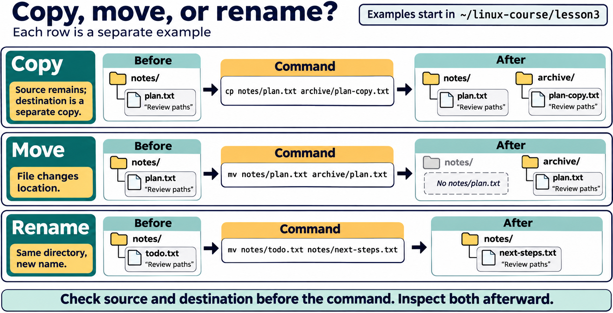
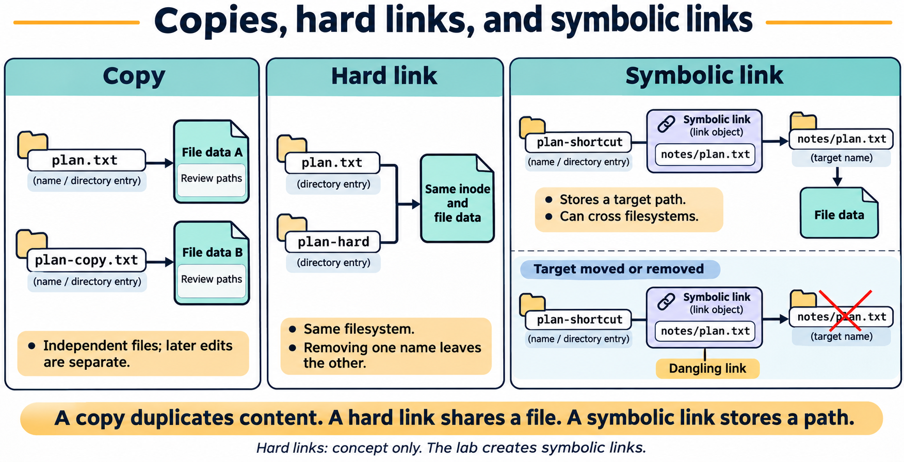

# Lesson 3 — Files, Directories, and Paths

[PowerPoint presentation](Presentation/lesson-03-files-directories.pptx)

## Lesson purpose

Linux stores configuration, programs, and user data in a single directory tree. This lesson helps students read that tree and manage files deliberately. It builds on Lesson 2's shell, command syntax, paths, and help resources. All operations in the lab take place in a dedicated practice directory.

## Learning objectives

By the end of the lesson, students will be able to:

- explain the roles of `/`, a user's home directory, and the current working directory;
- explain the purposes of common Filesystem Hierarchy Standard (FHS) locations and recognize distribution-specific variations;
- distinguish absolute paths, relative paths, hidden names, and filename patterns;
- create, inspect, copy, move, rename, and remove files in a bounded practice area;
- distinguish regular files, directories, and symbolic links, and create a symbolic link;
- use `find` and, when available, `locate` to find names and `file` to identify content types;
- inspect text a page or a few lines at a time with `less`, `head`, and `tail`; and
- preview the effect of a command and verify its result before continuing.

## Instructor preparation

Use Ubuntu Desktop LTS or the course VM. Confirm that `find`, `file`, and `less` are available. Prepare a disposable home-directory workspace for demonstrations. Remind students that commands such as `rm` do not normally provide a recycle bin and that examples must stay inside the lab directory.

## Suggested lesson sequence

| Segment | Time |
|---|---:|
| Review and objectives | 10 min |
| Textbook and demonstrations | 45 min |
| Guided practice | 15 min |
| Student lab | 45 min |
| Knowledge check and reflection | 15 min |

# Textbook chapter

## 1. One tree, many locations

Linux presents files through a directory tree. The tree begins at `/`, called the root directory. A path such as `/home/lee/notes.txt` starts at that root and names each directory along the way. The root directory `/` is not the same as the administrator account's home directory, commonly `/root`.

Each user normally has a home directory, often `/home/username`. The shell expands `~` to the current user's home directory. The current working directory is the location from which relative paths are interpreted. Lesson 2 introduced `pwd` for displaying it and `cd` for changing it. The `.` path means the current directory; `..` means its parent.

The filesystem tree includes system areas as well as personal files. Students should learn to recognize locations without changing system-owned content. For this lesson, work under `~/linux-course/lesson3`; the lab does not require administrator privileges.

The **Filesystem Hierarchy Standard (FHS)** describes a shared layout for important directories and their expected roles. It makes Linux systems more predictable, but does not require every distribution to have identical contents. Package choices, release history, and merged-directory layouts can make details vary. Learn each location's role and inspect the system in use rather than assuming every example looks exactly the same.

| Path | Common purpose | What students should know |
|---|---|---|
| `/` | Root of the entire directory tree | This is the filesystem root, not the administrator account's home directory. |
| `/home` | Home directories for regular users | Personal files normally belong in the user's own home directory, not beside system files. |
| `/root` | Home directory for the root administrator account | It is distinct from `/` and regular users' homes; students do not need to enter it. |
| `/etc` | Host-specific system configuration | Configuration affects system behavior. Inspect only as directed; do not edit it in this lesson. |
| `/usr` | Most distribution-managed programs, libraries, and shared read-only data | Common subdirectories include `/usr/bin`, `/usr/sbin`, `/usr/lib`, and `/usr/share`. Do not edit or remove package-managed files by hand. |
| `/usr/local` | Software and data installed locally by an administrator, outside the distribution's normal package-managed layout | Common subdirectories include `bin`, `sbin`, `lib`, and `share`. |
| `/opt` | Optional add-on application software, often grouped by vendor or product | It is not a general place for student files or a substitute for a home directory. |
| `/var` | Variable data that changes during system operation | Examples include logs in `/var/log`, application state in `/var/lib`, and caches in `/var/cache`. |
| `/tmp` | Temporary files, often intended for short-lived use | Contents may be cleared at reboot or by cleanup policy. Do not keep the only copy of valuable work here. |
| `/var/tmp` | Temporary files intended to remain available across reboots, unlike typical `/tmp` files | A local cleanup policy may still remove older files; this is not a backup location. |
| `/boot` | Files used during boot, such as kernel images, bootloader support files, and initramfs images | Recognize its role; do not edit or remove its contents. The boot sequence is treated in a later administration lesson. |
| `/dev` | Device nodes through which programs access devices | These are special filesystem objects, not ordinary files to edit or remove. |
| `/proc` | A virtual filesystem exposing process and kernel information | Much of its content is generated by the running kernel, not stored as ordinary documents. |
| `/sys` | A virtual filesystem exposing device, driver, and kernel interfaces | It provides structured information and controls; do not write to it in this lesson. |
| `/run` | Volatile runtime data for the current boot, such as process IDs and sockets | It is commonly cleared at startup, so it is not long-term storage. |
| `/media` | Common mount location for removable media attached through a desktop environment | A device may appear below a user- or device-specific subdirectory. |
| `/mnt` | Conventional mount point for temporary or manually managed mounts | It is a location convention, not a command to mount or format storage. |
| `/srv` | Data served by services provided by the system | It may be empty or unused on a desktop installation. |
| `/bin`, `/sbin`, `/lib`, `/lib64` | Historically, essential commands and libraries | On many modern Ubuntu systems these may be links into matching `/usr` directories (a merged-/usr layout). Follow the links and distribution documentation rather than assuming separate physical stores. |


**Figure 3.1.** Common Linux locations serve different purposes within one filesystem tree. The groups summarize roles rather than additional directories. `/usr/local` is below `/usr`; `/root` is the administrator's home, not the root of the tree. Student work stays in the lesson workspace.

These are roles, not permissions. A directory's name does not mean a student may modify it. Course exercises stay in `~/linux-course/lesson3`; system locations are read-only examples. Never create practice files in `/etc`, `/usr`, `/var`, `/boot`, `/dev`, `/proc`, `/sys`, or `/run`.

The hierarchy also helps answer “where should this file go?” Personal work belongs under a user's home directory. Configuration belongs in the appropriate configuration location and is managed by an administrator. Package-managed applications belong to distribution-managed locations, while locally installed administrator software may use `/usr/local` or `/opt` depending on the software. Logs and changing service state belong in suitable `/var` subdirectories. Temporary scratch files belong in temporary locations only when their lifetime and cleanup policy are understood.

Linux also records account and group information in system files. `/etc/passwd` contains account metadata such as names, numeric user IDs, home directories, and login shells; `/etc/group` records groups and group IDs. Password hashes and aging data are kept separately in `/etc/shadow`, which has restricted access. `/etc/sudoers` and related configuration control delegated administrative privileges. These are not ordinary lab files and must not be edited in this lesson. Lesson 4 will cover identities, groups, and permissions in depth.

## 2. Names, hidden files, and patterns

Names may contain spaces, so quote a path such as `"reading notes.txt"` to keep it one argument. A name beginning with a dot, such as `.draft`, is hidden from the ordinary `ls` listing. `ls -a` includes hidden names. Hidden does not mean protected or secret; it is only a display convention.

The shell expands filename patterns before starting a program. `*.txt` matches names ending in `.txt` in the current directory. `?` matches one character. Patterns are useful, but a broad pattern can select more files than intended. Use `printf '%s\n' *.txt` or `ls *.txt` to inspect a match set before applying a file-changing command. If a pattern matches nothing, behavior can depend on the shell and its settings.

## 3. Create and inspect files

`touch report.txt` creates an empty file when it does not exist. If it already exists, `touch` updates its modification time without replacing its contents. This makes it useful for placeholders, but not for writing text.

Use `ls -l` to inspect names, sizes, and timestamps, and `ls -la` to include hidden entries. A long listing also shows permission information; permissions are the subject of Lesson 4. `file report.txt` examines the content and reports a likely type. Its description is based on content signatures and heuristics, not just the filename extension.

The first character in an `ls -l` permission listing indicates a broad filesystem object type: `-` for a regular file, `d` for a directory, and `l` for a symbolic link. Linux also supports special objects such as named pipes, character devices, block devices, and sockets. Students may see these in system listings; they should recognize that these are not ordinary documents and should not manipulate device entries as if they were personal files.

For small text files, Lesson 2's `cat` prints the complete content. `less report.txt` opens an interactive pager so a large file can be read a screen at a time; press `q` to leave. `head -n 5 report.txt` displays the first five lines. `tail -n 5 report.txt` displays the last five. These commands inspect content without editing it.

## 4. Copy and move carefully

`cp source destination` copies a file, leaving the source in place. To copy a directory and its contents, use `cp -r source-directory destination-directory`. Recursive operations affect every item below the named directory, so keep the source and destination visible and bounded. A destination that already exists may be overwritten; consult `cp --help` or `man cp` before using options that change this behavior.

`mv source destination` moves a file or directory to another location. When the destination is in the same directory, `mv old-name new-name` renames it. Moving onto an existing file may replace it, depending on options and system settings. Avoid guessing: inspect both names first, and use interactive options such as `-i` where appropriate.



**Figure 3.2.** Copying leaves the source in place and creates a separate copy. Moving changes a location; moving to a different name within the same directory renames the file. Each row is independent and assumes a destination that does not already exist.

For this course, use explicit paths under the lab directory. Do not use wildcards with `cp` or `mv` until the selected set has been inspected. A command can be syntactically correct while acting on the wrong current directory.

## 5. Links: another name or a path to a target

The `ln` command creates links. A hard link is another directory entry for the same underlying file data; it is limited to the same filesystem and normally cannot be made for directories. A symbolic link, created with `ln -s target link-name`, stores a path to another file or directory. It can point across filesystems and can become dangling if its target is moved or removed. For beginners, treat a symbolic link as a pointer that needs a valid target. Create links only inside the practice tree, use clear names, and inspect them with `ls -l` and `file`.



**Figure 3.3.** A copy contains independent data. Hard links are directory entries referring to the same underlying file. A symbolic link is a separate object storing a path, so it may remain after its target disappears. Hard links normally stay within one filesystem; symbolic links can refer across filesystems.

The lab introduces symbolic links only. Hard links are discussed conceptually because their behavior depends on filesystem details and can confuse the distinction between a filename and file data.

## 6. Remove only known lab data

`rm filename` removes a file. It usually does not move the file to a graphical trash folder, and recovery may not be possible. `rmdir directory` removes a directory only when it is empty. These different behaviors are useful safeguards: `rmdir` refuses a nonempty directory.

Recursive removal options can erase a directory tree. They are intentionally excluded from the student lab. Before any removal, check `pwd`, name the exact target, and inspect it with `ls`. Never practice removal against `/`, a home directory, or a path copied from an example without understanding it. The lab asks students to remove only a single, newly created file and an empty directory.

## 7. Search and classify

`find` walks a directory tree and reports entries that match conditions. For example, `find ~/linux-course/lesson3 -type f -name '*.txt'` searches only the lesson workspace for regular files with names ending in `.txt`. Quote the pattern so the shell passes it to `find`; otherwise, the shell may expand it in the current directory first. Begin with a search that only prints results. Do not add deletion actions to a `find` command in this introductory lesson.

The `-type f` condition selects regular files; `-type d` selects directories. `-name` compares names and is case-sensitive on typical Linux filesystems. Search only a directory you are authorized to inspect, and prefer a narrow starting location over searching the entire system.

`locate` is another filename search tool. It searches a prepared index, so it can return results quickly but may not include files created or moved since the index was last refreshed. On Ubuntu, the command may not be installed by default. Index updates are an administrator-managed task and are outside this lab. Use `find` when you need a current search within a known practice directory; use `locate` only when available and account for its index freshness.

## 8. A reliable file-work routine

Before changing files, confirm the current directory with `pwd`, inspect the relevant names with `ls`, and read help if an option is unfamiliar. After an operation, inspect the destination and source again. This short verify-before-and-after routine catches many mistakes while the change is still small. In the lab, students will create a small tree, copy and rename selected files, locate them, inspect their contents, and clean up only the specific empty items they made.

# Guided demonstrations

## Demonstration 1: Relative paths in a known workspace

```bash
mkdir -p ~/linux-course/lesson3/demo
cd ~/linux-course/lesson3/demo
pwd
touch first.txt
ls -l
```

Point out that the absolute path printed by `pwd` begins at `/`, while `first.txt` is relative to the current directory.

## Demonstration 2: Hidden names and quoted spaces

```bash
touch "reading notes.txt" .draft
ls
ls -la
file "reading notes.txt"
```

Explain that the shell passes the quoted name as one argument and that the leading dot affects ordinary display, not access control.

## Demonstration 3: Copy, rename, inspect

```bash
cp "reading notes.txt" "reading notes-copy.txt"
mv "reading notes-copy.txt" archived-notes.txt
ls -l
```

Ask students to state which name remains after each command before running it.

## Demonstration 4: Search and read a small file

```bash
printf 'alpha\nbeta\ngamma\n' > sample.txt
find . -type f -name '*.txt'
head -n 2 sample.txt
tail -n 1 sample.txt
less sample.txt
```

The redirection uses Lesson 2 material and replaces only the disposable `sample.txt` created for this demonstration. Press `q` to exit `less`.

## Demonstration 5: Remove a file and an empty directory

```bash
rm first.txt
mkdir empty-demo
rmdir empty-demo
ls -la
```

Before `rm`, verify the location and exact filename. `rmdir` succeeds only because the demonstration directory is empty.

## Demonstration 6: Inspect a symbolic link

```bash
ln -s sample.txt sample-link
ls -l sample-link
file sample-link
```

The link points to the relative path `sample.txt` in the same directory. Explain the arrow shown by `ls -l`. If `sample.txt` is removed, the symbolic link remains but no longer points to an existing target.

# Student lab: Lesson 3 — Files, Directories, and Paths

## Safety and scope

Create, change, and remove files only in `~/linux-course/lesson3`. Commands that inspect FHS directories are read-only examples; do not use `sudo`, redirect into system paths, or create, move, rename, or remove anything under `/etc`, `/usr`, `/var`, `/boot`, `/dev`, `/proc`, `/sys`, `/run`, `/root`, `/media`, `/mnt`, or `/srv`. If a command's result differs from expectation, stop and inspect the current directory and names before continuing.

## FHS map activity (read-only)

For each task, choose the most appropriate location from the textbook table. Do not create files there:

1. A regular student's personal course notes.
2. System-wide configuration for an installed service.
3. Logs that change as a service runs.
4. Kernel and initramfs files used during system startup.
5. A virtual view of current processes and kernel information.
6. Locally installed administrator software outside the normal package-managed layout.
7. A USB drive mounted by the desktop.
8. A short-lived scratch file that may be cleaned at reboot.

Inspect the directory entries and metadata for a few common locations:

```bash
ls -ld / /home /etc /usr /var /tmp /boot /dev /proc /sys /run
```

Explain that `-d` tells `ls` to list each named directory itself, not its contents. Directories may contain different files on different systems. Do not open or modify system files during this activity.

## Part A: Create and map a practice tree

```bash
mkdir -p ~/linux-course/lesson3/{notes,archive}
cd ~/linux-course/lesson3
pwd
ls -la
```

Write down the absolute path printed by `pwd`. Identify the two directories you created. Use `cd notes`, `pwd`, and `cd ..` to observe how a relative path changes the working directory.

## Part B: Create files and inspect names

```bash
touch notes/plan.txt notes/todo.txt notes/.private-draft
printf 'Review paths\nPractice safe copies\n' > notes/plan.txt
ls notes
ls -la notes
file notes/plan.txt
```

Explain why `.private-draft` is absent from the first listing and visible in the second. Use `cat notes/plan.txt` to confirm the text.

## Part C: Copy, move, and rename

```bash
cp notes/plan.txt archive/plan-copy.txt
mv notes/todo.txt notes/next-steps.txt
ls -l notes archive
```

Describe which operation preserved the source and which changed a name. Verify that `archive/plan-copy.txt` exists and `notes/todo.txt` no longer appears.

## Part D: Search and inspect content

```bash
find . -type f -name '*.txt'
head -n 1 notes/plan.txt
tail -n 1 notes/plan.txt
less notes/plan.txt
```

In `less`, navigate briefly and press `q`. Explain why the search starts at `.` and why the pattern is quoted.

## Part E: Remove only known items

First run `pwd` and `ls -la notes`. Remove the one hidden practice file, then confirm it is gone:

```bash
rm notes/.private-draft
ls -la notes
```

Create and remove an empty directory, then leave the remaining lab files in place for instructor review:

```bash
mkdir empty-check
rmdir empty-check
```

Do not remove the `notes` or `archive` directories; they contain lab work.

## Part F: Create and inspect a symbolic link

From the `~/linux-course/lesson3` directory, create a link to the plan file and inspect it:

```bash
ln -s notes/plan.txt plan-shortcut
ls -l plan-shortcut
file plan-shortcut
cat plan-shortcut
```

Explain that the link stores a path to the target and that reading through the link displays the target's content. Do not remove or move the target during this exercise.

## Lab reflection

1. How can you tell whether a path is absolute?
2. Why should you inspect a wildcard's matches before using it with a changing command?
3. What is the difference between `rm` and `rmdir`?
4. Why does quoting `'*.txt'` matter in the `find` command?
5. What checks did you perform before removing the hidden file?

## Lab success criteria

- The practice tree contains `notes/plan.txt`, `notes/next-steps.txt`, and `archive/plan-copy.txt`.
- The hidden practice file was removed and the empty check directory no longer exists.
- The student can explain the role of the current directory and the difference between copy and move.
- The student can locate files with `find` and inspect text with `head`, `tail`, and `less`.
- The student can identify a symbolic link and explain how it differs from a copy.

# Knowledge check

1. What does `/` represent in a Linux path?
2. What does `..` mean in a path?
3. How does `ls -a` differ from `ls`?
4. What does `touch new.txt` do when the file does not exist?
5. Which command copies a file while preserving the original?
6. What does `mv old.txt new.txt` do when both names are in the same directory?
7. Why is `rm` considered an operation to check carefully?
8. What condition must be true for `rmdir folder` to succeed?
9. What is the purpose of `find . -type f -name '*.txt'`?
10. What do `head` and `tail` display by default?
11. What does `file` use to estimate a file's type?
12. Why should a broad wildcard be inspected before use?
13. What does the first character in an `ls -l` listing show?
14. How does a symbolic link differ from a hard link?
15. Why might `locate` miss a file created moments ago?
16. Name one common purpose of `/etc` and one common purpose of `/var`.
17. Where do regular users' personal files usually belong?
18. What is the common role of `/usr`, and how might `/bin` relate to it on modern Ubuntu?
19. Name two kinds of changing data that commonly belong below `/var`.
20. How do the usual roles of `/tmp` and `/var/tmp` differ?
21. What kinds of information may be exposed through `/proc` and `/sys`?
22. What types of files may be found in `/boot`?
23. Which locations are commonly associated with removable media and manually managed mounts?
24. What is the common role of `/usr/local` or `/opt`?
25. Why does learning the FHS not mean a student should edit files under system directories?

## Answer key

1. The root directory, the starting point of the filesystem tree.
2. The parent of the current directory.
3. `ls -a` includes hidden names that begin with a dot.
4. It creates an empty file; if it exists, it updates its modification time.
5. `cp`.
6. It renames the file.
7. It generally removes the named file without sending it to a trash folder.
8. The directory must be empty.
9. It searches below the current directory for regular files whose names match the quoted pattern.
10. The first lines and last lines of a file, respectively.
11. It examines content signatures and heuristics; the extension alone does not determine the result.
12. To ensure the command acts on only the intended files.
13. The broad type of filesystem object, such as regular file (`-`), directory (`d`), or symbolic link (`l`).
14. A symbolic link stores a path to a target; a hard link is another directory entry for the same underlying file data.
15. It searches a prepared index that may not yet include recent filesystem changes.
16. `/etc` stores system-wide configuration; `/var` stores changing data such as logs.
17. In that user's home directory, commonly below `/home`.
18. `/usr` contains most distribution-managed programs, libraries, and shared data; `/bin` may be a link to `/usr/bin` on a merged-/usr system.
19. Logs, application or package state, and caches are examples.
20. `/tmp` is usually for short-lived temporary data and may be cleared at reboot; `/var/tmp` is intended to preserve temporary files across reboots, though local cleanup policy may later remove older data.
21. `/proc` exposes virtual process and kernel information; `/sys` exposes device, driver, and kernel interfaces.
22. Kernel images, bootloader support files, and initramfs images may be stored there.
23. `/media` is commonly used for desktop-mounted removable media; `/mnt` is a conventional location for temporary or manually managed mounts.
24. `/usr/local` is commonly for locally installed software outside normal distribution package management; `/opt` is commonly for optional add-on application software.
25. System paths contain configuration, package files, runtime interfaces, and other data that can affect the OS; the lab is confined to a practice directory and needs no administrative changes.

## Exit ticket

Name one check you will make immediately before a file-changing command and one check you will make afterward.

# Chapter glossary

**Absolute path:** A path that begins at the filesystem root `/`.  
**Current working directory:** The directory from which relative paths are interpreted.  
**Directory:** A filesystem object that contains names of files and other directories.  
**Filesystem Hierarchy Standard (FHS):** A convention describing common Linux directory locations and their expected purposes.  
**File pattern (glob):** Shell syntax such as `*.txt` that matches a set of names.  
**Hidden file:** A name beginning with a dot, conventionally omitted from ordinary listings.  
**Home directory:** A user's personal directory, commonly located under `/home`.  
**Hard link:** An additional directory entry referring to the same underlying file data.  
**Relative path:** A path interpreted from the current working directory.  
**Root directory:** The top of the Linux filesystem tree, written `/`.  
**Symbolic link:** A filesystem object containing a path to another file or directory.  
**Wildcard:** A pattern character such as `*` or `?` used to match filenames.  

# Instructor materials

## Instructor notes

- Keep all demonstrations under the student's home directory; no administrative access is needed.
- Ask learners to predict the source and destination state before `cp` and `mv`.
- Model a pause before `rm`: verify `pwd`, exact target spelling, and the target's purpose.
- Avoid `rm -r`, `rm -rf`, and `find -delete` in the student practice. Discuss their recursive effect conceptually only if relevant.
- Explain that `file` reports a best-effort classification and that extensions are conventions.
- Use `/etc/passwd`, `/etc/group`, `/etc/shadow`, and `/etc/sudoers` as examples of why directory purpose and access boundaries matter. Do not edit these files or demonstrate account creation here; those are covered in Lesson 4.
- Teach the FHS table as common conventions rather than a guarantee that distributions contain identical files or layouts. Mention merged-/usr links when appropriate for the lab image.
- Keep system-directory inspection read-only. Do not use `sudo` or ask students to write outside the practice tree.
- If `locate` is unavailable, teach its indexed-search model from an instructor demonstration. Do not ask students to install a package or run `updatedb` for this lab.
- Show special file types only from a read-only listing; do not ask students to open or change device files.
- If brace expansion in the lab's `mkdir` line is not enabled in a student's shell, create `notes` and `archive` with separate `mkdir` commands.

## Suggested slide outline

1. The filesystem tree and root
2. FHS locations and their common purposes
3. Home and current working directories
4. Absolute paths, relative paths, `.` and `..`
5. Hidden names, spaces, and quoting
6. Creating and inspecting files
7. Copying, moving, and renaming
8. Safe removal and empty directories
9. Links and targets
10. Searching with `find` and `locate`
11. Reading large and small text files
12. Verify before and after

## Commands introduced

`touch`, `ls -a`, `ls -l`, `ls -d`, `cp`, `mv`, `rm`, `rmdir`, `ln -s`, `find`, `locate` (optional if installed), `file`, `less`, `head`, and `tail`. The lesson reuses `pwd`, `cd`, `mkdir`, `printf`, and `cat` from earlier lessons. Account-management commands such as `useradd`, `usermod`, and `passwd` are deferred to Lesson 4 because they require administrative context and are not needed for filesystem practice.
