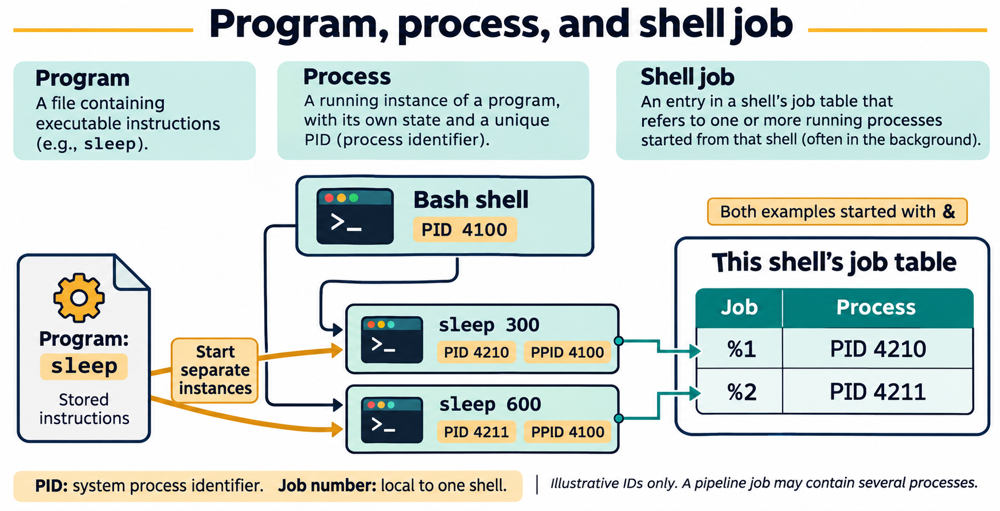
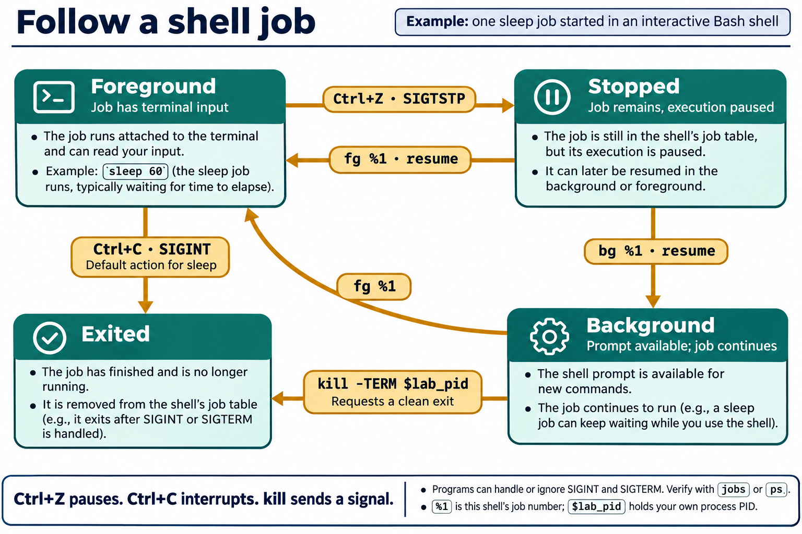

# Lesson 5 — Processes and Job Control

[PowerPoint presentation](Presentation/lesson-05-processes-job-control.pptx)

## Lesson purpose

Every running program is represented by one or more processes. Linux provides tools to inspect those processes and signals to request that they stop or exit. This lesson builds on the process concepts from Lesson 1 and the safe process inspection and termination introduced in Lesson 2. Students practice only with processes they start themselves.

## Learning objectives

By the end of the lesson, students will be able to:

- distinguish a program, a process, and a shell job;
- interpret process IDs, parent process IDs, users, and common process states;
- inspect processes with `ps`, `top`, `htop`, `btop`, and `pgrep`;
- explain process niceness and change the scheduling preference of a process they started;
- suspend, resume, foreground, and background a job in an interactive shell;
- explain how `Ctrl+C` and `Ctrl+Z` differ; and
- send a graceful termination request with `kill` and explain when forceful termination is inappropriate.

## Instructor preparation

Use an interactive Bash terminal in Ubuntu Desktop LTS or the course VM. Confirm that `ps`, `top`, `htop`, `btop`, and `pgrep` are available. Ubuntu provides `htop` and `btop` packages, but they may need to be installed in the course image before class; do not make package installation part of this lab. Ensure each student can run the harmless `sleep` command in a terminal. The activity must not require `sudo` or target system services. Demonstrate that process IDs can be reused and that a process name alone is not enough evidence to terminate a process.

## Suggested lesson sequence

| Segment | Time |
|---|---:|
| Review and objectives | 10 min |
| Textbook chapter and demonstrations | 45 min |
| Guided practice | 10 min |
| Student lab | 40 min |
| Knowledge check and reflection | 15 min |

# Textbook chapter

## 1. A running program becomes a process

A program is a set of instructions stored in a file. When the operating system loads and runs it, that active instance is a process. Starting the same program twice creates two processes, each with its own process state and process ID (PID). A process also has a parent process ID (PPID), which helps describe how it was started. The kernel tracks ownership, resource use, and state for each process.

Processes run with a user identity and can access only what that identity and the applicable security rules permit. A normal student's process inspection does not require administrator privileges. Do not use elevated access to inspect or control unrelated system processes in this lesson.

Some processes are started by users to perform their work; others are started by the operating system or system services to support the computer. System processes may run under dedicated service accounts and may have no interactive terminal. Students should recognize this distinction when viewing process lists. This lesson's process-control practice uses only user processes started by the student.



**Figure 5.1.** Starting the same program twice creates separate processes. Their PPIDs identify the parent shell in this example, while the shell tracks the two background commands with its own job numbers. A job can include more than one process, as with a pipeline.

## 2. Process IDs and states

A PID identifies a process while it exists. PIDs are assigned by the system and may be reused after a process exits, so an old PID should not be treated as a permanent identity. A PPID identifies the process's parent at the time of inspection.

Tools may show compact state codes. Common examples include `R` for running or runnable, `S` for interruptible sleep (waiting for an event), `T` for stopped or job-control suspended, and `Z` for a zombie awaiting collection by its parent. A process in `S` is not necessarily malfunctioning; many normal programs wait while idle. A process state is a momentary observation and can change immediately.

## 3. Inspect a snapshot with `ps`

`ps` displays a snapshot of selected process information. Without options, it commonly shows processes associated with the current terminal. Options vary across Unix command styles; on Linux, `ps -ef` and `ps aux` are common broader views. A focused query is easier for learning. For example, `ps -o pid,ppid,stat,comm -p "$PID"` requests selected columns for one known PID. A process may exit between starting the command and reading its output, so an empty result is possible.

Use `ps` to answer a specific question: what is the PID, who owns this process, what command is running, or what is its state? Avoid treating a long process list as a set of targets to stop.

## 4. Watch changing activity with `top`, `htop`, and `btop`

`top` refreshes a live summary of process and system activity. `htop` and `btop` provide interactive, screen-oriented views of processes and resource use. Their layouts and controls differ, but all three help students observe changing activity and inspect processes. A monitor can help identify what is using CPU or memory at that moment; it does not explain why a process is busy or guarantee that a brief snapshot captures a longer pattern.

Press `q` to quit each monitor. Students should use these tools to observe and inspect their own lab process rather than signal unfamiliar processes from inside the monitor. If `htop` or `btop` is not available in a student's environment, use the instructor-prepared course VM.

## 5. Find processes by name with `pgrep`

`pgrep` searches the process table for names that match a pattern and prints matching PIDs. `pgrep -a sleep` also displays each matching command line. A match is a clue for further inspection, not authorization to stop a process. Several unrelated processes can share a name, and a name can match more than expected. In the lab, students first start their own `sleep` process, then use `pgrep` to observe it, and use the PID saved by the shell to act only on that specific process.

## 6. Process scheduling preference with `nice` and `renice`

Linux schedulers decide which runnable processes receive CPU time. A niceness value influences scheduling preference: lower values indicate a higher preference, and higher values indicate a lower preference. On Linux the usual range is `-20` (highest preference) through `19` (lowest preference), with `0` as the common default. Niceness is not a guarantee of a fixed amount of CPU time; actual behavior depends on system load and scheduler policy.

`nice -n 10 command` starts a command with a niceness adjustment; for example, `nice -n 10 sleep 300` starts a low-impact waiting process with a higher niceness value than the usual default. `renice 15 -p PID` changes the niceness value of an existing process. Ordinary users can generally make their own processes less favored by raising the niceness value, but lowering the value to increase scheduling preference requires administrative authority. The lab only raises niceness for a process the student started. Do not use `sudo` or adjust system processes.


**Figure 5.2.** Higher niceness values generally reduce scheduling preference. `nice -n 10` adds 10 to inherited niceness, while `renice 15 -p PID` sets the selected process's niceness to 15. These settings influence scheduling rather than reserving a fixed CPU share.

## 7. Shell jobs, foreground, and background

An interactive shell can track commands it started as jobs. A foreground job has the terminal's attention; a background job runs without occupying the prompt. `jobs` lists jobs known to the current shell, often with job numbers such as `%1`. Job numbers belong to that shell and are not PIDs.

Pressing `Ctrl+Z` asks the terminal to suspend the foreground job, usually by sending `SIGTSTP`. The job remains present in a stopped state. `bg %1` resumes job 1 in the background, while `fg %1` brings it back to the foreground. These commands operate on jobs known to the current interactive shell; they do not select arbitrary processes from the system.

Pressing `Ctrl+C` sends an interrupt, usually `SIGINT`, to the foreground job. Programs can handle or ignore some signals, so the key does not guarantee immediate termination. The distinction is useful: `Ctrl+Z` suspends for later continuation, while `Ctrl+C` requests interruption.



**Figure 5.3.** `Ctrl+Z` normally suspends a foreground job. `bg` resumes a stopped job in the background; `fg` brings a job to the foreground and resumes it if needed. `Ctrl+C` sends an interrupt, while `kill -TERM` requests termination. Check the resulting state rather than assuming every program responds identically.

## 8. Signals and `kill`

Despite its name, `kill` sends a signal to a process or job; it does not always terminate it. `kill PID` sends `SIGTERM` by default, requesting that the process exit cleanly. A program may catch this signal, save state, or perform cleanup. `kill -TERM PID` states the request explicitly.

`SIGSTOP` pauses a process and cannot be caught or ignored; `SIGCONT` resumes a stopped process. `SIGKILL` ends a process immediately without allowing it to clean up. Use forceful termination only as a last resort, after identifying the exact process and trying a graceful request when appropriate. Never send signals to a PID copied from an unrelated example, and never practice against system services or processes you did not start.

For shell jobs, `kill %1` targets job 1 in the current shell. For process IDs, use the exact PID captured from a process you started. Verify the result with `jobs` or a focused `ps` query rather than assuming that a command succeeded.

## 9. A careful process-control routine

First identify the process or job and confirm it is yours and part of the task. Choose the least forceful action that meets the need: use `fg` or `bg` to change job placement, `Ctrl+Z` to suspend, or `SIGTERM` to request exit. Escalate only when there is a clear reason. After acting, check whether the job or process remains. This sequence turns process control into a reasoned decision instead of guesswork.

# Guided demonstrations

## Demonstration 1: Inspect the current shell

```bash
ps -o pid,ppid,stat,comm -p "$$"
```

Explain that `$$` is the current shell's PID in Bash. Read the PID, parent PID, state, and command columns.

## Demonstration 2: Inspect a process started by the student

```bash
sleep 300 &
lab_pid=$!
ps -o pid,ppid,user,stat,comm -p "$lab_pid"
pgrep -a sleep
```

The `&` starts the harmless sleep process in the background. `$!` stores its PID in the shell variable `lab_pid`. Compare the focused `ps` result with the name search. Do not send a signal to any other matching process.

Finish the demonstration with a graceful request and verify:

```bash
kill -TERM "$lab_pid"
jobs
```

## Demonstration 3: Suspend and resume a shell job

Run `sleep 300` in the foreground. Press `Ctrl+Z`, then enter:

```bash
jobs -l
bg %1
jobs
fg %1
```

Press `Ctrl+C` while the sleep is in the foreground. Explain that the job number `%1` is local to this shell and differs from the PID.

## Demonstration 4: Observe live system activity

```bash
top
```

Have students locate their own `sleep` or shell process, observe that values change, and press `q` to leave. Do not demonstrate signaling unfamiliar processes from `top`.

## Demonstration 5: Compare interactive process monitors

Open each monitor separately and exit with `q` before starting the next one:

```bash
htop
btop
```

Have students locate the `sleep` process they started and compare the information and layout with `top`. These are observation exercises; do not select or signal other processes.

## Demonstration 6: Lower the scheduling preference of a lab process

```bash
nice -n 10 sleep 300 &
priority_pid=$!
ps -o pid,ni,comm -p "$priority_pid"
renice 15 -p "$priority_pid"
ps -o pid,ni,comm -p "$priority_pid"
kill -TERM "$priority_pid"
```

The `NI` column shows niceness. The larger value lowers the process's scheduling preference; it does not guarantee a particular CPU share. The instructor changes only the harmless process started in this demonstration.

# Student lab: Lesson 5 — Processes and Job Control

## Safety and scope

Use an interactive terminal and control only the `sleep` processes you start in this lab. Do not use `sudo`, do not terminate processes based only on a name, and do not signal system services or another user's processes. If job numbers differ from the example, use the number shown by your own `jobs` output.

## Part A: Inspect your shell process

```bash
ps -o pid,ppid,stat,comm -p "$$"
```

Record the PID, PPID, and state. Explain why this is a snapshot and why the PID is not a permanent identifier.

## Part B: Start and inspect a background process

```bash
sleep 300 &
lab_pid=$!
jobs -l
ps -o pid,ppid,user,stat,comm -p "$lab_pid"
pgrep -a sleep
```

Identify your sleep process in each view. `pgrep` may also show unrelated sleep commands, if any. Use only `$lab_pid` for the next step.

## Part C: Request graceful termination

```bash
kill -TERM "$lab_pid"
jobs -l
```

Explain what `SIGTERM` requests. If the job is no longer listed, the request worked. If it remains, ask the instructor before taking any further action.

## Part D: Suspend, background, and foreground a job

Start a new foreground sleep:

```bash
sleep 300
```

While it is running, press `Ctrl+Z`. At the prompt, use the job number reported by `jobs`:

```bash
jobs -l
bg %1
jobs
fg %1
```

Replace `%1` if your shell shows a different job number. When the process is back in the foreground, press `Ctrl+C` to request interruption. Describe the difference between `Ctrl+Z` and `Ctrl+C`.

## Part E: Observe process activity

```bash
top
```

Observe the process list briefly and press `q`. Name one reason that `top` output should be treated as a changing snapshot rather than a complete diagnosis.

Then inspect the same activity with the other monitors:

```bash
htop
```

Press `q` to exit, then run:

```bash
btop
```

Press `q` to exit. Locate the `sleep` process started in Part B. Compare the displays, and do not signal processes from any monitor.

## Part F: Adjust niceness on your own process

```bash
nice -n 10 sleep 300 &
lab_pid=$!
ps -o pid,ni,comm -p "$lab_pid"
renice 15 -p "$lab_pid"
ps -o pid,ni,comm -p "$lab_pid"
kill -TERM "$lab_pid"
```

Compare the `NI` values before and after `renice`. Explain why increasing the niceness value lowers scheduling preference. This exercise uses only your own `sleep` process; do not use elevated privileges.

## Lab reflection

1. How is a shell job number different from a PID?
2. What does `pgrep -a sleep` help you find, and why should you inspect matches before acting?
3. What does `kill -TERM` request?
4. Which key suspends a foreground job, and which key requests an interrupt?
5. When is `SIGKILL` appropriate?

## Lab success criteria

- The student identifies a PID, PPID, owner, and state using a focused process listing.
- The student can use `jobs`, `bg`, and `fg` on a process started in the current shell.
- The student requests graceful termination of their own sleep process and verifies the result.
- The student can explain why a name match or process list alone is not a safe target for a signal.

# Knowledge check

1. What is the difference between a program and a process?
2. What does PID stand for?
3. What does PPID identify?
4. What kind of information does `ps` display?
5. What does `top` provide?
6. What do `htop` and `btop` provide?
7. How do you exit these interactive monitors in the lesson?
8. What does `pgrep -a sleep` display?
9. What is a shell job number such as `%1`?
10. What does `Ctrl+Z` normally do to a foreground job?
11. What does `bg %1` do?
12. What does `fg %1` do?
13. What signal does `kill PID` send by default?
14. What does `SIGTERM` request?
15. Why should `SIGKILL` be a last resort?
16. Why should a user verify a process before sending it a signal?
17. Why can a PID from an old example be unsafe to reuse?
18. What does a higher niceness value generally mean for scheduling preference?
19. What does `nice -n 10 sleep 300` do?
20. What does `renice 15 -p PID` change?
21. Why does a higher niceness value not guarantee an exact amount of CPU time?

## Answer key

1. A program is stored instructions; a process is a running instance of a program.
2. Process ID.
3. The process's parent process ID.
4. A snapshot of selected process information such as IDs, state, user, and command.
5. A live, refreshing view of system and process activity.
6. Interactive, screen-oriented views of processes and resource use.
7. Press `q`.
8. PIDs and command lines for processes whose names match `sleep`.
9. An identifier for a job tracked by the current interactive shell; it is not a PID.
10. It suspends the job, usually by sending `SIGTSTP`.
11. Resumes job 1 in the background.
12. Brings job 1 to the foreground.
13. `SIGTERM`.
14. It requests that the process terminate cleanly.
15. It ends a process immediately without allowing cleanup.
16. Multiple processes can have similar names, and a mistaken signal can interrupt unrelated work.
17. PIDs can be reused after a process exits.
18. It lowers the process's scheduling preference.
19. Starts `sleep 300` with a niceness adjustment of 10.
20. Sets the niceness value of the specified process to 15.
21. CPU scheduling also depends on system load and scheduler policy.

## Exit ticket

Before signaling a process, what evidence will you use to confirm it is the process you intend to control?

# Chapter glossary

**Background job:** A shell job that runs without occupying the terminal prompt.  
**Foreground job:** A shell job currently connected to the terminal for input and output.  
**Job control:** Shell features for tracking, suspending, foregrounding, and backgrounding jobs started by that shell.  
**Niceness:** A value that influences a process's relative CPU scheduling preference; higher values are generally less favored.  
**Parent process ID (PPID):** The identifier of a process's parent.  
**Process:** A running instance of a program, with its own process state and identifier.  
**Process ID (PID):** Numeric identifier assigned to a process while it exists.  
**Signal:** A notification sent to a process to request or cause an action.  
**SIGKILL:** A forceful signal that ends a process without allowing it to clean up.  
**SIGTERM:** A request for a process to terminate cleanly.  
**SIGTSTP:** A terminal-related signal commonly used to suspend a foreground job.  
**Zombie process:** A process that has exited but whose parent has not yet collected its exit status.  

# Instructor materials

## Instructor notes

- Students should signal only processes they started. Do not turn a broad process listing into a termination exercise.
- Explain the difference between a process PID and a shell-local job number.
- Emphasize that `kill` sends signals and that `SIGTERM` is the default request; the name does not mean every use instantly kills a process.
- Treat `SIGKILL` as an explanation topic, not a lab action. Discuss lost cleanup or unsaved state.
- Show that `pgrep` can return multiple matches. Have learners inspect a known process before taking action.
- Use the interactive terminal for `Ctrl+Z`, `bg`, and `fg`; job control may not behave the same in scripts or non-interactive shells.
- If a process does not respond as expected, stop the exercise and help the student inspect it rather than escalating signal strength automatically.
- Keep `nice` and `renice` practice to the student's own harmless process; demonstrate that normal users can raise niceness but may need administrative authority to lower it.
- Treat process services, startup configuration, and scheduled jobs as later course topics rather than adding them to this process-control lab.

## Suggested slide outline

1. Programs and running processes
2. PIDs, PPIDs, users, and process states
3. Process snapshots with `ps`
4. Live observation with `top`, `htop`, and `btop`
5. Name searches with `pgrep`
6. Foreground and background jobs
7. `Ctrl+C` and `Ctrl+Z`
8. Scheduling preference with `nice` and `renice`
9. Signals and graceful termination with `kill`
10. Safe verification before and after process control

## Commands introduced

`ps`, `top`, `htop`, `btop`, `pgrep`, `nice`, `renice`, `jobs`, `bg`, `fg`, and `kill`. `sleep` is reused as a harmless practice process. Students control or reprioritize only processes they started; forceful termination is discussed but not used in the lab.
