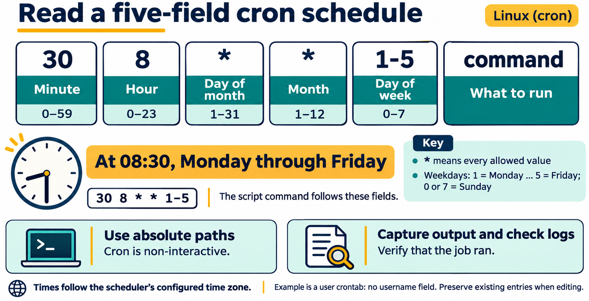

# Lesson 7 — Shell Scripting and Automation

[PowerPoint presentation](Presentation/lesson-07-shell-scripting-automation.pptx)

## Lesson purpose

The shell can do more than accept one command at a time. A Bash script records a sequence of commands and decisions so a person can repeat a task consistently, inspect what it will do, and improve it over time. This lesson introduces small, readable scripts that gather information and report results without changing system configuration.

## Learning objectives

By the end of the lesson, students will be able to:

- explain what a shell script is and how the shebang selects an interpreter;
- create, syntax-check, and run a Bash script with either `bash` or its executable bit;
- assign variables and expand them safely with quoting;
- accept and validate positional parameters and interactive input;
- use tests and `if`/`else` decisions to handle expected conditions;
- repeat a task with `for` and `while` loops and organize repeated work in a function;
- explain how a user crontab schedules a script and inspect or edit that schedule;
- distinguish a program's exit status from its printed output; and
- plan, test, and document a small script that gathers system information.

## Instructor preparation

Use a disposable Ubuntu Desktop LTS VM or student-owned lab VM with Bash. Confirm that a terminal editor is available; the examples below use `nano`, which students may already know, and can be adapted to another editor. Confirm that the `crontab` command and cron scheduler are available in the prepared VM if you plan to run the scheduling activity. ShellCheck may be demonstrated if installed, but it is an optional extra tool and is not required for the lab. Prepare a writable `~/lesson7-lab` directory. Keep the lab script read-only with respect to system settings and avoid `sudo`.

## Suggested lesson sequence

| Segment | Time |
|---|---:|
| Review, objectives, and script mental model | 10 min |
| Textbook and guided demonstrations | 45 min |
| Student lab | 45 min |
| Knowledge check and reflection | 15 min |

# Textbook chapter

## 1. From a command sequence to a script

A shell script is a text file containing instructions for a shell. A script can make a repeated procedure easier to follow and less likely to vary from one run to the next. A script is still a program: it can receive input, make decisions, repeat work, report errors, and return a status to the program that started it.

Automation does not make a procedure automatically safe. Before running a script, read it, understand which files or settings it can change, and test it with harmless inputs. This lesson's example reports information about the current system. It does not install software, alter accounts, change permissions, or stop processes.

## 2. The interpreter and the shebang

A Bash script commonly begins with this first line:

```bash
#!/usr/bin/env bash
```

This line is called the **shebang**. It tells the operating system to use Bash to interpret the file when it is run as a program. The rest of the file contains Bash syntax. A comment begins with `#` and continues to the end of that line; the shebang is a special comment interpreted when launching the script.

Save a script as plain text, for example `system-report.sh`. The `.sh` suffix is a naming convention, not a requirement for Bash to identify the file. An editor such as `nano` can create or change the text file; the editor does not run the script.

## 3. Run and check a script

There are two common ways to run a script. `bash system-report.sh` asks Bash to read the file; the file does not need its executable permission for this form. To run it directly as `./system-report.sh`, it needs an executable bit, which can be added for the current user with `chmod u+x system-report.sh`. The shebang then selects the interpreter.

Before running a script, use `bash -n system-report.sh` to ask Bash to check its syntax without executing its commands. A syntax check cannot prove that the script's logic is correct or safe, so read and test it as well. During development, make one small change at a time and run the script again with predictable input.


**Figure 7.1.** `bash -n` checks syntax without executing commands. `bash system-report.sh` explicitly chooses Bash, while direct execution requires executable permission and uses the shebang. Both launch methods still require a reviewed script and appropriate input.

## 4. Variables and quoting

Variables give names to values that a script will reuse. Assign a value with no spaces around the equal sign, then expand it by placing `$` before its name:

```bash
student_name="Avery Chen"
printf 'Welcome, %s!\n' "$student_name"
```

Quote variable expansions unless you intentionally need Bash to split the value into separate words or interpret wildcard characters. Without quotes, a name containing spaces may become several arguments, and wildcard characters may expand to filenames. Assignment syntax is `name=value`; writing `name = value` would try to run a command named `name`.

Use `printf` when a predictable format is useful. In the example, `%s` is a placeholder for text and `\n` ends the line. Quoting the format and the expansion makes the intended boundaries clear.

## 5. Parameters and interactive input

When a script is run with additional words, Bash makes them available as positional parameters: `$1` is the first, `$2` is the second, and so on. `$#` is the number of parameters. `"$@"` expands to all parameters while preserving each one as a distinct argument when quoted. This is useful when a script should pass along a list of names or paths.

A script can ask a person for input with `read`:

```bash
read -r -p 'Enter a label: ' label
```

The `-r` option prevents backslashes from being treated as escapes, and `-p` displays a prompt. The entered value is stored in `label`. Treat input as data, validate it when needed, and quote it when using it later. Avoid building and evaluating command text from user input.

## 6. Conditions and validation

Scripts often need to choose what to do. Bash's `if` statement runs commands and branches according to their exit status. `[[ ... ]]` performs a conditional test, such as checking whether a parameter is empty:

```bash
if [[ -z "${1:-}" ]]; then
    printf 'Usage: %s LABEL\n' "$0"
    exit 2
fi
```

`${1:-}` safely expands to an empty value if no first parameter was supplied. `-z` is true when the resulting text has zero length. `$0` is the script's name. `exit 2` ends this run with a nonzero status to indicate that the script was not used as expected. A successful run conventionally exits with status `0`.

An `if` statement can include `else` for the other case and `elif` for additional cases. Write conditions in plain language and handle the expected failure path; do not assume that every command or input will succeed.

## 7. Repetition with loops

A `for` loop repeats once for each item in a list:

```bash
for section in introduction objectives lab; do
    printf 'Preparing section: %s\n' "$section"
done
```

A `while` loop repeats as long as its condition succeeds. It is useful when the number of repetitions depends on input or a changing condition. Every `while` loop should have a clear path to make its condition false; otherwise, it can run indefinitely. Students should use short, bounded examples rather than loops that consume substantial resources.

Quote a list expansion such as `"$@"` when looping over script parameters so each supplied argument remains one item, including values that contain spaces.

## 8. Functions and exit status

A function gives a name to a reusable group of commands:

```bash
show_system_name() {
    hostname
}
```

Define a function before calling it in a straightforward introductory script. Keep each function focused and choose names that describe the work. A function's status is normally the status of its last command unless it explicitly returns a status.

Commands and scripts return an **exit status**: `0` conventionally means success, while a nonzero value signals some kind of failure or exceptional condition. This status is separate from text printed to the terminal. The special parameter `$?` contains the status of the most recently completed command, so use it immediately if inspecting it manually. In normal scripts, placing a command directly in an `if` condition is often clearer than checking `$?` afterward.

## 9. Schedule a script with cron

A script can be useful without a person starting it manually. On many Linux systems, the cron scheduler checks a user's **crontab** for tasks to run at specified times. A crontab entry has five time fields followed by the command:

```text
minute hour day-of-month month day-of-week command
```

For example, `30 8 * * 1-5` means 8:30 a.m. every weekday. An asterisk means every allowed value in that field; a range such as `1-5` selects values from 1 through 5. The weekday numbering is commonly 0 or 7 for Sunday through 6 for Saturday. Scheduling uses the system's configured time zone, so a time-zone change can affect when a job runs.



**Figure 7.2.** In a user crontab, five time fields precede the command. `30 8 * * 1-5` selects 08:30 on Monday through Friday. Use absolute paths, capture useful output, and check that the job ran in the prepared VM.

`crontab -l` lists the current user's scheduled entries. `crontab -e` opens that user's crontab for editing. A crontab belongs to the account that edits it, so run these commands as the student account; do not use `sudo` in this lesson. Do not use `crontab -r`, which removes the user's entire crontab.

Cron jobs run without an interactive terminal and may receive a smaller environment than a command typed at a prompt. Use absolute paths to the script and its files, quote paths within the script, and redirect output to a log file when useful. Start with a harmless task and verify that it ran. Remove the specific test entry from the crontab when finished; leave unrelated entries unchanged.

Cron schedules recurring tasks. One-time scheduling tools and system-wide timers are separate topics and are not needed for this introductory activity.

## 10. A readable and responsible scripting routine

Good beginner scripts have a small purpose, a clear name, quoted expansions, useful messages, and an obvious response when expected input is missing. Prefer several readable lines over a dense one-liner. Use comments to explain a decision that may not be obvious, not to restate every command.

Before running a script, inspect its contents and identify its effects. Check syntax, test normal input and at least one missing or unexpected input, and compare the results with what you intended. A static analyzer such as ShellCheck can point out common Bash mistakes when available; treat its output as advice to understand rather than a substitute for understanding the script.

# Guided demonstrations

## Demonstration 1: Create and syntax-check a small script

Create `hello.sh` in `~/lesson7-lab` with an editor:

```bash
#!/usr/bin/env bash
printf 'Hello from Bash.\n'
```

Check it with `bash -n hello.sh`, then run it with `bash hello.sh`. Point out that the syntax check produces no output on success and does not run the `printf` line.

## Demonstration 2: Add a parameter and validate it

Replace the contents with:

```bash
#!/usr/bin/env bash

if [[ -z "${1:-}" ]]; then
    printf 'Usage: %s NAME\n' "$0"
    exit 2
fi

name="$1"
printf 'Hello, %s.\n' "$name"
```

Run it once without a parameter and once with a name containing a space, for example `bash hello.sh "Avery Chen"`. Discuss the message, status, and why the parameter is quoted.

## Demonstration 3: Repeat a bounded list

Add a `for` loop to print three section names. Ask students to predict the output before running the script. Emphasize that the list is short and visible, so its work is easy to reason about.

## Demonstration 4: Run with the executable bit

From the directory containing the file, run:

```bash
chmod u+x hello.sh
./hello.sh "Avery Chen"
```

Connect the executable permission to Lesson 4. Explain that `./` means the file in the current directory, and that running an unknown script is not made safe simply by marking it executable.

## Demonstration 5: Read a crontab schedule

In the disposable VM, inspect the current user's entries:

```bash
crontab -l
```

If no crontab exists yet, the command may report that fact. Explain the five schedule fields and interpret `30 8 * * 1-5` as 8:30 a.m. each weekday. Do not edit or remove existing entries during the demonstration.

# Student lab: Lesson 7 — Shell Scripting and Automation

## Safety and scope

Work in `~/lesson7-lab` on the course VM. The script gathers a small system report and writes a text file inside this practice directory. It must not use `sudo`, install packages, change system configuration, alter accounts or permissions, or terminate processes. Read each command before running the script. If `system-report.txt` already exists and contains work you want to keep, choose a different report filename before running the sample that creates it.

## Part A: Create the report script

Create `system-report.sh` with the following contents. Use a text editor and preserve the quoting and punctuation:

```bash
#!/usr/bin/env bash

if [[ -z "${1:-}" ]]; then
    printf 'Usage: %s OUTPUT_FILE\n' "$0"
    exit 2
fi

output_file="$1"

show_section() {
    printf '\n--- %s ---\n' "$1"
}

{
    printf 'System information report\n'
    printf 'Generated: %s\n' "$(date)"

    show_section 'Host name'
    hostname

    show_section 'Kernel'
    uname -srm

    show_section 'Uptime'
    uptime

    show_section 'Current identity'
    id

    show_section 'Filesystem space'
    df -h /
} > "$output_file"

printf 'Report written to %s\n' "$output_file"
```

The braces group commands so their output is written to the named report file. `$(date)` runs `date` and substitutes its output into the `printf` line. `df -h /` displays human-readable space information for the filesystem containing `/`. The final message goes to the terminal because the grouped block's redirection ends before it.


**Figure 7.3.** The script checks its first parameter before gathering information. Only the grouped block's standard output goes to the report; the final message goes to the terminal. Printed messages and numeric exit status are different results, and the report contents still need inspection.

The file path comes from a parameter, so quoted use of `"$output_file"` keeps spaces in the path together. The script writes only to the output path supplied by the student. For this lab, supply a new filename inside `~/lesson7-lab`, not a system path or a file you need to preserve.

## Part B: Check before running

From `~/lesson7-lab`, run:

```bash
bash -n system-report.sh
```

If Bash prints an error, read its line number, inspect nearby punctuation, correct the file, and repeat the check. The command checks syntax; it does not create a report.

## Part C: Run and inspect the report

Run the script with a report filename in the practice directory:

```bash
bash system-report.sh "$HOME/lesson7-lab/system-report.txt"
```

Read the report in the terminal with `cat` or `less`, commands introduced in earlier lessons. Confirm that each section appears once and that the values are plausible for the current VM. Run the script with no parameter and observe the usage message; explain why it exits before creating a report.

## Part D: Make the script executable

Add execute permission for your user and run it directly using a second, new report filename:

```bash
chmod u+x system-report.sh
./system-report.sh "$HOME/lesson7-lab/system-report-second.txt"
```

Explain how this launch form uses the shebang. Confirm that both report files are in the practice directory and that the script did not change system settings.

## Part E: Extend the report with a loop

Add a short `for` loop that prints the names of three report sections to the terminal after the report is written. Use a fixed list you can inspect before execution. Syntax-check and run the script again with a third report filename. Record what repeated and what remained unchanged.

## Part F: Test and reflect

Answer in your own words:

1. What does the shebang do when the script is run as `./system-report.sh`?
2. Why are `"$1"` and `"$output_file"` quoted?
3. What does `bash -n` verify, and what does it not verify?
4. Which output goes into the report file, and which output stays in the terminal?
5. What did the script change, and how did you keep that change inside the practice directory?

## Part G: Schedule and remove a harmless test job

This activity changes your user crontab, so do it only in the disposable course VM. First record whether `crontab -l` shows existing entries. If there are existing entries, preserve them exactly. If the command is unavailable or cron is not active in the prepared VM, complete the schedule interpretation with the instructor rather than installing or enabling a system service.

Determine the VM's absolute practice-directory path and substitute it below. For example, the crontab command might point to `/home/avery/lesson7-lab/system-report.sh` rather than using a placeholder. Confirm that the script is executable from Part D and that the report and log filenames are new and located only in `lesson7-lab`.

Open the user crontab:

```bash
crontab -e
```

Add this single test entry, replacing `/home/student` with the actual home-directory path for the VM's student account:

```cron
* * * * * /home/student/lesson7-lab/system-report.sh /home/student/lesson7-lab/cron-report.txt >> /home/student/lesson7-lab/cron.log 2>&1
```

The five asterisks schedule this harmless report once each minute. The report is written inside the practice directory; the script's terminal message is appended to the lab log, with errors sent to the same log. Wait for a minute boundary, then check for the report and log using a file-inspection command from an earlier lesson. If the job does not run, check the path, executable bit, schedule service availability, and log before changing anything.

Reopen the crontab with `crontab -e` and delete only the test line you added. Save and exit. Run `crontab -l` again to confirm your entry is gone and any pre-existing entries remain. Do not clear the full crontab. The activity creates two disposable files; retain or remove them according to the instructor's lab cleanup directions.

## Lab success criteria

- The script has a Bash shebang and passes a syntax check.
- It prints a clear usage message when no output path is supplied.
- It gathers the required read-only system information.
- It writes the report to a student-selected file within the practice directory.
- It uses quoted expansions and a bounded loop.
- The student can explain the difference between interpreter launch and direct execution.

# Knowledge check

1. What is the purpose of the shebang line in an executable Bash script?
2. Which command runs `hello.sh` through Bash even if it is not executable?
3. What does `chmod u+x hello.sh` change?
4. What does `bash -n hello.sh` do?
5. In a script, what value does `$1` represent?
6. What does `$#` count?
7. Why is `"$name"` generally safer than `$name` when expanding a variable?
8. What is the role of `read -r`?
9. In `[[ -z "${1:-}" ]]`, what case is being tested?
10. What does `exit 2` communicate by convention?
11. When does a `for` loop run its body?
12. What must be true for a `while` loop to stop eventually?
13. What is a Bash function used for?
14. What does exit status `0` conventionally mean?
15. How does exit status differ from text printed by a command?
16. Why should a script be read before it is run?
17. What does `./hello.sh` mean when entered from the script's directory?
18. How does quoting `"$@"` help preserve parameters containing spaces?
19. Is a syntax check sufficient to show that a script is safe and logically correct? Explain.
20. Why should the lab output path stay in the practice directory?
21. What are the five time fields in a crontab entry, in order?
22. What does `30 8 * * 1-5` schedule?
23. What does `crontab -l` display?
24. What does `crontab -e` allow the current user to do?
25. Why should a scheduled job use absolute paths and write to a lab log?
26. Why should a student remove only the test line rather than deleting the entire crontab?

## Answer key

1. It identifies the interpreter used when the script is launched directly.
2. `bash hello.sh`.
3. It adds execute permission for the file's owning user.
4. It asks Bash to check syntax without running the script's commands.
5. The first argument supplied to the script.
6. The number of positional parameters supplied to the script.
7. Quoting prevents unintended word splitting and wildcard expansion.
8. It reads input while treating backslashes literally; it can also display a prompt with `-p`.
9. It tests whether the first parameter is absent or empty.
10. It signals that the script ended with a nonzero status, here for incorrect or missing usage.
11. Once for each item in its list.
12. The loop's condition must eventually become false, or the body must otherwise exit the loop.
13. To name and reuse a focused group of commands.
14. Successful completion.
15. Printed text is output a person or another program can read; status is a separate numeric result indicating success or failure.
16. A script can perform actions, and reading it reveals its effects and risks.
17. It runs the file named `hello.sh` in the current directory.
18. It keeps each argument as a separate item even when an argument contains spaces.
19. No. It checks syntax only; logic, effects, inputs, and safety still need review and testing.
20. It bounds the script's file-writing effect to disposable lab data rather than a system or valuable path.
21. Minute, hour, day-of-month, month, and day-of-week.
22. At 8:30 a.m. on weekdays (Monday through Friday).
23. The current user's scheduled cron entries.
24. It opens the current user's crontab for editing.
25. Cron has a limited non-interactive environment; absolute paths avoid relying on the current directory or interactive shell settings, and a lab log helps capture output and errors.
26. To preserve unrelated scheduled tasks and limit the change to the student's own test entry.

## Exit ticket

Write one sentence explaining one safeguard you will apply before running a script you did not write.

# Chapter glossary

**Bash:** A widely used command-line shell and scripting language on Linux.  
**Exit status:** A numeric result returned by a command or script; zero conventionally indicates success.  
**Function:** A named group of shell commands that can be called as one unit.  
**Loop:** A control structure that repeats commands while a condition holds or for each item in a list.  
**Parameter:** A value supplied to a script or function; positional parameters are available as `$1`, `$2`, and related forms.  
**Shebang:** The first line of an executable script that identifies the interpreter used to run it.  
**Shell script:** A text file containing commands and control structures interpreted by a shell.  
**Syntax check:** A check that looks for language-structure errors without executing the script's commands.  
**Variable:** A named value used by a script.  

# Instructor materials

## Instructor notes

- Keep the initial examples short and predict their output before running them.
- Emphasize the different launch behavior of `bash script.sh` and `./script.sh`.
- When demonstrating executable permissions, connect back to Lesson 4 and explain that permission changes apply to the script file.
- Model input with spaces so learners see why quoting matters.
- Explain that braces and redirection in the lab group output; defer broader pipeline and text-processing techniques to Lesson 8.
- Keep scripts read-only with respect to system state. Writing the named report in the lab directory is the only intended file change.
- If ShellCheck is installed, demonstrate one warning and have students explain it. Do not make installation of the analyzer part of this lesson.
- Treat the crontab activity as optional when the prepared VM does not have an active scheduler. Do not ask students to enable a system-wide service or edit another user's crontab.
- Before students edit a crontab, have them record existing entries and demonstrate how to remove only the new test line.
- Accept equivalent editors and formatting when behavior and safety remain clear.

## Suggested slide outline

1. From repeated commands to a readable script
2. Shebang, editor, and two launch methods
3. Variables, quoting, and output formatting
4. Parameters, interactive input, and validation
5. Conditions and exit status
6. Bounded loops and focused functions
7. Recurring schedules with cron and user crontabs
8. Syntax checks, review, and safe testing
9. Lab: generate and safely schedule a small system report

## Commands introduced

`bash`, `bash -n`, `chmod u+x`, `./script.sh`, `read`, `printf`, `exit`, `date`, `hostname`, `uname`, `uptime`, `id`, `df`, `crontab -l`, and `crontab -e`. The syntax `[[ ... ]]`, `for`, `while`, functions, variable expansion, positional parameters, command substitution, grouping with braces, output redirection, and cron schedule fields are shell or scheduler syntax rather than separate commands.
