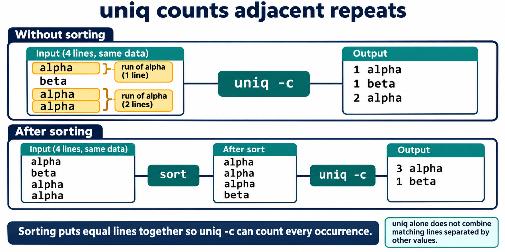
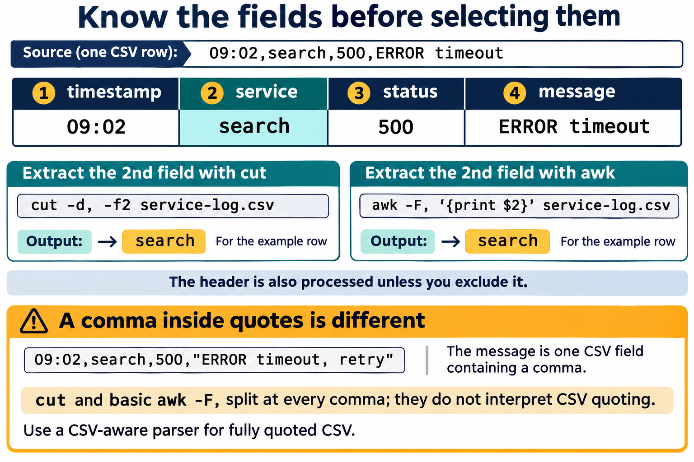
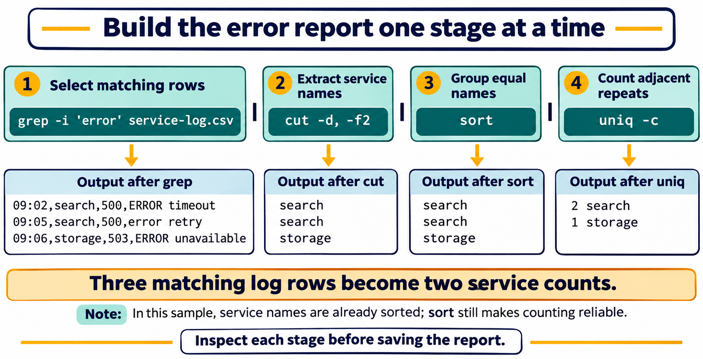

# Lesson 8 — Text Processing and Pipelines

## Lesson purpose

Linux commands often report useful information as lines of text. Text-processing tools can select relevant lines, choose fields, normalize values, count repeats, and summarize results. This lesson builds on the streams and pipeline basics from Lesson 2 and applies them to small, predictable data files. Students will construct a report in short, inspectable stages rather than rely on a long command they cannot explain.

## Learning objectives

By the end of the lesson, students will be able to:

- explain how standard input, standard output, and standard error flow through redirection and pipelines;
- filter lines with `grep` and select fields with `cut` or introductory `awk`;
- sort and count values with `sort` and `uniq`;
- count lines with `wc` and transform characters with `tr`;
- make simple, non-destructive substitutions with `sed`;
- build and explain a short pipeline one stage at a time;
- redirect results to a new lab report without overwriting source data; and
- recognize when simple text tools are unsuitable for fully quoted CSV.

## Instructor preparation

Use the disposable course VM or a student-owned practice directory. Prepare a plain-text service log with a header and comma-separated fields; values should not contain embedded commas or CSV quotation rules. Students saw pipes and redirection in Lesson 2 and `sort`, `uniq`, `wc`, and `tr` there. This lesson revisits those tools and adds `grep`, `cut`, `sed`, and introductory `awk`. No administrator access, third-party data, or system configuration changes are required.

## Suggested lesson sequence

| Segment | Time |
|---|---:|
| Review streams, objectives, and sample data | 10 min |
| Textbook and guided demonstrations | 45 min |
| Student lab | 45 min |
| Knowledge check and reflection | 15 min |

# Textbook chapter

## 1. Text streams are a useful interface

Many Linux commands communicate with readable text. A command can receive text through **standard input**, print normal results to **standard output**, and print diagnostic messages to **standard error**. Lesson 2 introduced these streams and the shell operators that connect them. Here, we use those connections to answer questions about logs and small delimited files.

A **pipeline** connects one command's standard output to the next command's standard input with `|`. Each command should do one understandable task. When a result is surprising, run the stages separately and inspect intermediate output. Pipelines are easier to troubleshoot when they are short, fields are understood, and results are checked before being saved.

## 2. Redirect input and output carefully

The shell reads input from a file with `<`, replaces a file's contents with `>`, and appends to a file with `>>`. Standard error can be redirected with `2>`. Lesson 2 introduced these forms; this lesson uses them to feed known data to tools and create a report.

```bash
wc -l < service-log.csv
grep -i 'error' service-log.csv > errors.txt
printf 'Reviewed service log\n' >> summary.txt
```

`>` replaces the destination's existing contents. Choose a new, disposable output filename and confirm that it is the intended target before using it. `>>` appends and can grow a file each time it runs. Keep original lab data separate from generated results. Redirection does not make a command safe; understand the command first.

## 3. Select lines with `grep`

`grep` prints lines that match a search pattern. A basic literal search can find a status or message in a log:

```bash
grep 'ERROR' service-log.csv
```

Use `-i` to ignore letter case, `-n` to display line numbers, and `-v` to select lines that do not match. For example, `grep -in 'error' service-log.csv` finds case-insensitive matches and includes line numbers. `grep -v 'INFO' service-log.csv` shows lines that do not contain that text.

By default, `grep` patterns use basic regular-expression rules, so some punctuation has special meaning. For a beginner exercise, choose simple words without regular-expression punctuation. A result with no matching lines is not automatically a system error: `grep` returns a nonzero status when there are no matches. Check the pattern and data before changing the command.

## 4. Sort values and count repeated lines

`sort` arranges input lines. By default it sorts text according to the current locale; `sort -n` sorts numeric values and `sort -r` reverses the order. For example, `sort -nr` displays numeric values from largest to smallest.

`uniq` identifies adjacent repeated lines. To count repeated values throughout a file, sort the values first, then use `uniq -c`:

```bash
cut -d, -f3 service-log.csv | sort | uniq -c
```

This selects the third comma-delimited field, sorts those values so equal statuses are adjacent, then prints each distinct line with its count. The header is a value too, so the output may include `status`; remove or handle the header deliberately if it should not be counted. `sort -u` can produce unique sorted lines, but `uniq -c` is needed when counts matter.



**Figure 8.1.** `uniq -c` counts runs of adjacent equal lines. Sorting groups all equal lines together, allowing one count for each distinct value. This four-line example is separate from the service log.

## 5. Count lines and select simple fields

`wc` counts lines, words, and bytes. Its options select a count: `wc -l` for lines, `wc -w` for words, and `wc -c` for bytes. With input redirection, `wc -l < service-log.csv` prints only the line count rather than repeating the filename. A header is included in the total.

`cut` selects columns or character positions from each line. For a simple comma-delimited file, `cut -d, -f2` selects the second field. `-d` names the delimiter and `-f` names the field number. `cut` does not parse general CSV quoting rules: if a value contains a quoted comma, use a CSV-aware tool instead of assuming every comma separates a field.



**Figure 8.2.** Number fields from one and identify the delimiter before selecting data. Both examples select the service field from this simple row. Quoted CSV can contain commas inside a single field, so `cut` and basic `awk -F,` are not general CSV parsers.

## 6. Transform characters with `tr`

`tr` translates or deletes individual characters from standard input. For example:

```bash
tr '[:lower:]' '[:upper:]' < labels.txt
```

This prints an uppercase version without modifying `labels.txt`. `tr` works on characters, not words or fields. First display a transformation and confirm it before redirecting its result to a new file.

## 7. Make a simple substitution with `sed`

`sed` reads text and applies editing instructions as it prints the result. A basic substitution uses the form `s/old/new/`:

```bash
sed 's/ERROR/ISSUE/' service-log.csv
```

This replaces the first `ERROR` on each line in displayed output; it does not change the source file. Adding `g` at the end, as in `s/ERROR/ISSUE/g`, replaces every match on each line. Avoid in-place editing options in this lesson. Review output first and redirect it only to a new file when a transformed copy is needed.

## 8. Select fields with introductory `awk`

`awk` can split each input line into fields and apply a small action. By default, it treats runs of whitespace as field separators. `-F,` sets the separator to a comma. This example prints the second and third fields from a simple comma-delimited file:

```bash
awk -F, '{print $2, $3}' service-log.csv
```

The expression in braces is an `awk` action; `$2` means the second field in the current input line. The heading is processed like any other line unless a rule tells `awk` otherwise. `awk` can do much more, but this lesson uses only field selection and short, readable actions. Like `cut`, this simple form does not parse fully quoted CSV values containing commas.

## 9. Combine tools into a readable report

The following pipeline counts status values:

```bash
cut -d, -f3 service-log.csv | sort | uniq -c | sort -nr
```

Read it left to right: select one field, group equal values together, count adjacent values, then sort the counts numerically from highest to lowest. The header appears as a value unless deliberately excluded. Build the pipeline one command at a time and compare intermediate results with the source file.

A focused pipeline can select error rows and count the services involved:

```bash
grep -i 'error' service-log.csv | cut -d, -f2 | sort | uniq -c
```

This filters rows first, extracts service names second, sorts names, and counts repeats last. Each stage has a single role. Save the final output to a new report only after confirming that the field choices and counts make sense.



**Figure 8.3.** Filter matching rows, select service names, group equal values, then count them. The lab data contains three case-insensitive error matches: two for `search` and one for `storage`. Inspect intermediate output before saving a report.

A pipeline can obscure a problem. If an early command prints an error, a later command may still display output. Do not assume that output proves every stage succeeded. Inspect commands and intermediate results, especially when processing valuable data.

# Guided demonstrations

## Demonstration 1: Inspect the sample file

Create or open the prepared `service-log.csv` and inspect its header and rows with `cat` or `less`. Confirm that it has four comma-separated fields and no values containing commas. Ask students which field identifies the service and status before using a command.

## Demonstration 2: Find matching and nonmatching lines

```bash
grep -in 'error' service-log.csv
grep -v 'INFO' service-log.csv
```

Compare selected lines with the source. Explain `-i`, `-n`, and `-v`. Try a pattern that is absent and discuss the empty result and nonzero exit status.

## Demonstration 3: Count status values step by step

Run each stage separately, then connect them:

```bash
cut -d, -f3 service-log.csv
cut -d, -f3 service-log.csv | sort
cut -d, -f3 service-log.csv | sort | uniq -c
cut -d, -f3 service-log.csv | sort | uniq -c | sort -nr
```

Ask what the header contributes to the count. Have students predict the final order before running the last command.

## Demonstration 4: Compare simple field tools

```bash
cut -d, -f2 service-log.csv
awk -F, '{print $2}' service-log.csv
```

Both examples select the second field in this simple file. Explain that `awk` can add conditions and calculations, but more complex is not automatically better for one-field selection. Neither example is a complete CSV parser.

## Demonstration 5: Transform output without editing the source

```bash
tr '[:lower:]' '[:upper:]' < service-log.csv
sed 's/ERROR/ISSUE/g' service-log.csv
```

Confirm that displayed transformations leave the original file unchanged. If saving a result, use a fresh filename in the lab directory.

# Student lab: Lesson 8 — Text Processing and Pipelines

## Safety and scope

Work only in `~/lesson8-lab` or the instructor-provided practice directory. Use a small sample file with simple comma-delimited fields and no embedded commas. Do not use `sudo`, edit system logs, alter source data in place, or run a pipeline against large or sensitive files. Use a new output filename for every redirected result. Remember that `>` replaces an existing destination.

## Part A: Create and inspect sample data

Create `service-log.csv` in the practice directory with a text editor:

```text
timestamp,service,status,message
09:00,portal,200,request complete
09:02,search,500,ERROR timeout
09:03,portal,200,request complete
09:05,search,500,error retry
09:06,storage,503,ERROR unavailable
09:08,portal,404,missing page
09:10,storage,200,recovered
```

Inspect the file. Count its rows, including the header, and identify the field number for service, status, and message.

## Part B: Filter and count

Find the error rows with a case-insensitive search. Select the service field and count how many error rows belong to each service:

```bash
grep -i 'error' service-log.csv
grep -i 'error' service-log.csv | cut -d, -f2
grep -i 'error' service-log.csv | cut -d, -f2 | sort | uniq -c
```

Run each line separately. Record the number of selected rows and service counts. Explain why the pipeline starts with `grep` and ends with `uniq -c`.

## Part C: Summarize status values

Select field 3, sort the values, count duplicates, then sort the counts from highest to lowest:

```bash
cut -d, -f3 service-log.csv | sort | uniq -c | sort -nr
```

The header contributes the word `status` to the output. Add `grep -v '^status$'` to exclude that exact line and compare the result. Describe what each stage contributes.

## Part D: Count and transform

Compare total rows, including the header, with the number of matching error lines:

```bash
wc -l < service-log.csv
grep -i 'error' service-log.csv | wc -l
```

Print the file in uppercase and make a non-destructive substitution in displayed output:

```bash
tr '[:lower:]' '[:upper:]' < service-log.csv
sed 's/ERROR/ISSUE/g' service-log.csv
```

The original sample should remain unchanged. Explain how you can tell.

## Part E: Select fields with `awk`

Print service and status fields from each row:

```bash
awk -F, '{print $2, $3}' service-log.csv
```

The header is printed too. Modify the command so the action only runs when `NR > 1`. Explain that `NR` is the current input record number.

## Part F: Save a concise report

Use one new report file inside the practice directory. First save a heading, then append the error service counts:

```bash
printf 'Error counts by service\n' > error-summary.txt
grep -i 'error' service-log.csv | cut -d, -f2 | sort | uniq -c >> error-summary.txt
```

Read the report and verify that the counts match Part B. Explain why the first command uses `>` and the second uses `>>`. If the destination exists and contains work you need, choose another new filename.

## Part G: Explain and reflect

Write a short explanation of your report pipeline. Name each stage, its input, and its output. Then answer:

1. Why must values be sorted before `uniq -c` can reliably count all repeats?
2. Why does `cut -d, -f2` have limitations with fully quoted CSV?
3. What happens if a report command uses `>` on an existing file?
4. What should you do if a pipeline result is unexpected?
5. How can an early-stage error be obscured by later stages in a pipeline?

## Lab success criteria

- The student identifies the sample file's fields and header.
- The student finds error lines without changing source data.
- The student explains each stage of a multi-command pipeline.
- The student obtains correct status and service counts and accounts for the header.
- The student uses `wc`, `tr`, `sed`, and `awk` for their taught purposes.
- The student saves and verifies a report in the practice directory.
- The student explains the limits of simple comma-delimited field extraction.

# Knowledge check

1. What are standard input, standard output, and standard error?
2. What does the pipe operator `|` connect?
3. What is the difference between `>` and `>>`?
4. What does `grep -i` change about a search?
5. What does `grep -v` select?
6. Why might `grep` return a nonzero status even when it ran correctly?
7. What does `sort -n` do?
8. Why should values usually be sorted before using `uniq -c`?
9. What does `wc -l` count?
10. What do `cut -d, -f2` options specify?
11. Why is `cut` not a complete parser for every CSV file?
12. What does `tr '[:lower:]' '[:upper:]'` do to input text?
13. What does `sed 's/ERROR/ISSUE/'` do by default in this lesson?
14. What does the `g` flag add to a `sed` substitution?
15. In `awk -F, '{print $2, $3}'`, what does `-F,` set?
16. In an `awk` action, what does `$2` refer to?
17. Why should a pipeline be built and inspected one stage at a time?
18. Why is redirecting transformed output to a new file safer than editing the original in place?
19. What should a student check if expected output is missing?
20. How can a header row affect a field-count summary?
21. In what order does `grep -i 'error' file | cut -d, -f2 | sort | uniq -c` work?
22. Why can an early command's error be missed when reading only the final pipeline output?

## Answer key

1. Standard input supplies command input, standard output carries normal results, and standard error carries diagnostic messages.
2. The left command's standard output to the right command's standard input.
3. `>` replaces destination contents; `>>` appends.
4. It makes matching case-insensitive.
5. Lines that do not match the pattern.
6. `grep` returns nonzero when there are no matches; that can be expected.
7. It sorts values numerically rather than lexicographically as text.
8. `uniq` counts adjacent duplicates, so sorting groups equal values.
9. Input lines.
10. `-d,` sets comma as delimiter; `-f2` selects field two.
11. Quoted values may contain commas that are data, and simple `cut` does not interpret CSV quoting.
12. It translates lowercase characters to uppercase in output.
13. It replaces the first `ERROR` on each line in displayed output without editing the source.
14. It replaces every matching occurrence on each line.
15. The comma field separator.
16. The second field in the current input record.
17. Intermediate inspection helps locate incorrect assumptions or stages.
18. The original remains available for comparison and recovery if the transformation is wrong.
19. Check the pattern, input file, field number, delimiter, intermediate output, and whether no matches are expected.
20. It is processed as another row and can be counted unless excluded deliberately.
21. Filter matching lines, extract field 2, sort values, then count adjacent repeats.
22. Later commands may still produce output; output alone does not prove earlier stages succeeded.

## Exit ticket

Describe one pipeline you built today and explain what one stage contributes.

# Chapter glossary

**Delimited text:** Text in which a consistent character separates fields or values.  
**Field:** One value or column within a delimited record or input line.  
**Filter:** A tool or operation that selects some input lines or values and leaves others out.  
**Pipeline:** A connection in which one command's standard output becomes another command's standard input.  
**Redirection:** A shell operation connecting command input or output to a file or another destination.  
**Standard error:** The stream commonly used for diagnostic messages.  
**Standard input:** The stream from which a command reads input.  
**Standard output:** The stream commonly used for normal results.  
**Text transformation:** A change to text values or characters, often written to a new output rather than altering the source.  

# Instructor materials

## Instructor notes

- Remind learners that Lesson 2 introduced stream redirection and pipes, plus `sort`, `uniq`, `wc`, and `tr`; Lesson 8 develops their use with new examples.
- Use small files with known results. Have students identify delimiters and headers before selecting fields.
- Model each pipeline stage independently. Ask learners what data each stage receives and produces.
- Show that `uniq` counts adjacent equal lines, which is why sorting often comes first.
- Explain that a no-match `grep` status differs from a failure such as a missing file.
- Keep sample data simple. `cut` and simple `awk -F,` do not parse all CSV formats.
- Show `sed` output without in-place editing and save to new filenames when redirecting.
- Do not use authentication logs, personal data, or large system logs in the student lab.
- Have students inspect each generated report and compare it with the source.

## Suggested slide outline

1. Review: streams, redirection, and pipelines
2. Search and filter lines with `grep`
3. Sort values and count duplicates
4. Count and select fields with `wc` and `cut`
5. Transform characters and text with `tr` and `sed`
6. Select fields with introductory `awk`
7. Build, inspect, and save a readable report pipeline
8. Limits, errors, and safe handling of source files

## Commands introduced or developed

`grep`, `sort`, `uniq`, `wc`, `cut`, `tr`, `sed`, and `awk`. Lesson 2 introduced `sort`, `uniq`, `wc`, and `tr`; this lesson reviews and extends those tools. It also develops the previously introduced `cat`, `printf`, pipes, input/output/error redirection, and quoting. The symbols `|`, `<`, `>`, `>>`, and `2>` are shell operators, not commands.
