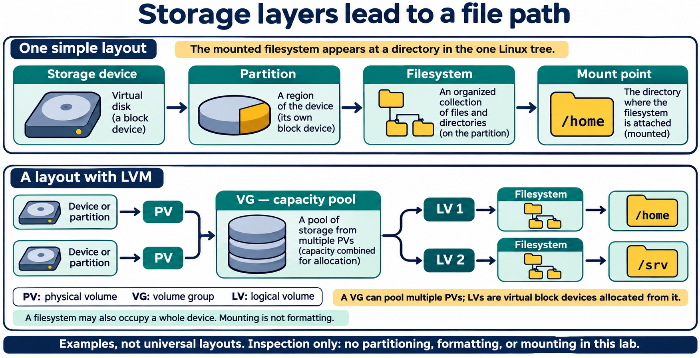
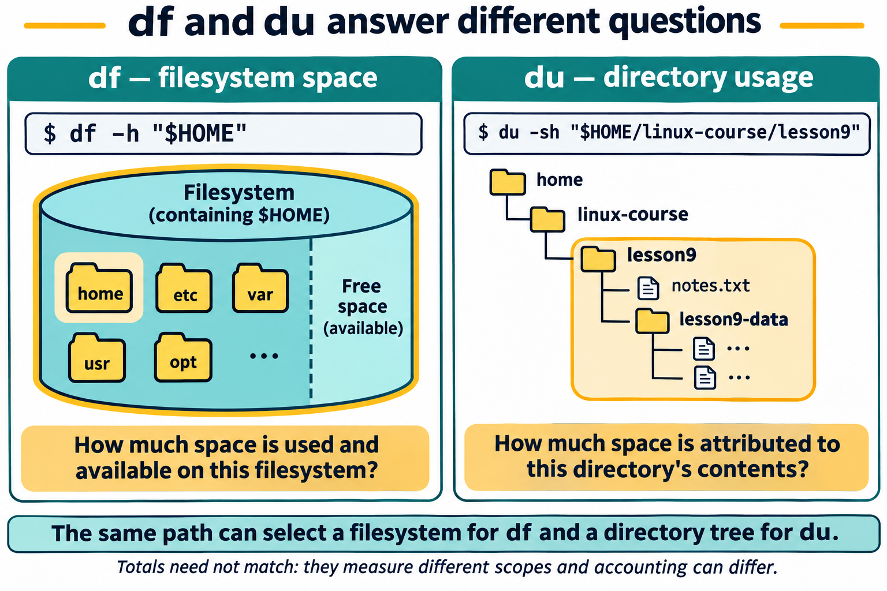
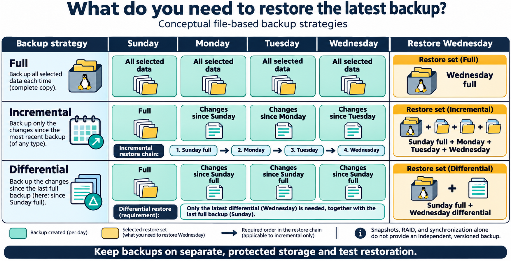
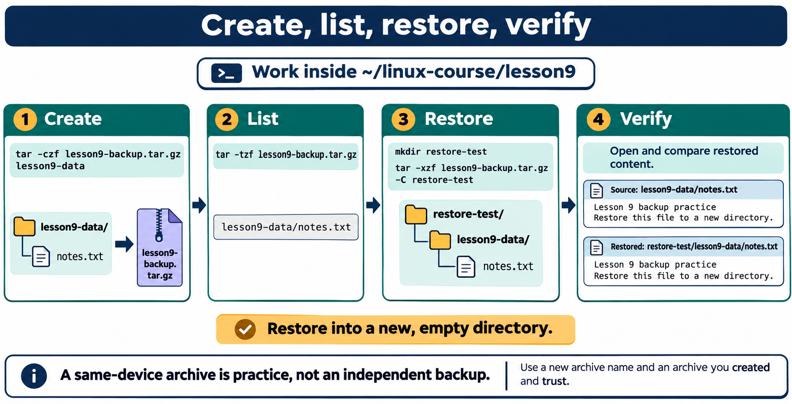

# Lesson 9 — Storage, Filesystems, and Backups

[PowerPoint presentation](Presentation/lesson-09-storage-filesystems-backups.pptx)

## Lesson purpose

Linux presents files through one directory tree, but data may be stored across multiple devices and filesystems. This lesson teaches students to inspect storage without changing it, distinguish filesystem capacity from directory usage, and create and restore a small archive in a practice area. The lab does not partition, format, mount, or unmount devices.

## Learning objectives

By the end of the lesson, students will be able to:

- distinguish a storage device, partition, filesystem, and mount point;
- read basic device and filesystem details using `lsblk` and `blkid`;
- explain how a mounted filesystem joins the Linux directory tree;
- use `df` to inspect filesystem space and `du` to estimate directory usage;
- create, list, and extract a compressed `tar` archive in a practice directory;
- verify archive contents and inspect a restored copy;
- explain how LVM layers logical volumes over storage devices;
- compare common RAID layouts and explain their limits;
- distinguish full, incremental, and differential backup strategies; and
- explain why a backup needs a separate storage destination and a restore check.

## Instructor preparation

Use a disposable Ubuntu Desktop LTS VM or student-owned practice VM. Prepare `~/linux-course/lesson9` and ensure GNU `tar`, `lsblk`, `blkid`, `df`, `du`, and `mount` are available. Provide small, non-sensitive text files. Do not attach removable media for student modification or require administrator privileges. Unprivileged `blkid` may return cached information only; use `lsblk -f` as the primary overview and do not escalate privileges if results are limited.

## Suggested lesson sequence

| Segment | Time |
|---|---:|
| Review FHS and storage vocabulary | 10 min |
| Textbook and read-only demonstrations | 40 min |
| Student lab: inspect, archive, restore, verify | 50 min |
| Knowledge check and backup planning | 20 min |

# Textbook chapter

## 1. From a storage device to a file path

A **storage device** is physical or virtual hardware that retains data, such as an SSD, hard drive, USB drive, or virtual disk. A device may be divided into **partitions**, logical regions of that device. A **filesystem** organizes files, directories, names, and metadata in a storage area. A **mount point** is a directory where a filesystem is attached to the larger Linux directory tree.

These are different layers. A device can contain multiple partitions; a partition can contain a filesystem; and a filesystem can be mounted at a path. Some filesystems are created directly on a whole device. Systems can also use logical volumes, software RAID, encrypted devices, network filesystems, or virtual filesystems, so the visible tree does not always map to one simple disk and partition.

The FHS locations from Lesson 3 help interpret mount points. The root filesystem is mounted at `/`; a separate filesystem might be mounted at `/home`, `/boot`, or elsewhere. While a filesystem is mounted at a directory, that path shows the mounted filesystem’s contents. Files previously visible underneath the mount point are hidden until it is unmounted. Never experiment with mounts on a real system in this course.

## 2. Inspect devices and filesystems without changing them

`lsblk` displays block devices in a tree-like view. Use `lsblk -f` to include filesystem columns such as type, label, UUID, and mount points when available. The output helps distinguish whole disks from partitions and shows mounted paths. Columns and details vary by version and system configuration.

`blkid` reports metadata associated with block devices, commonly filesystem type, label, and UUID. A UUID identifies a filesystem and can be used instead of a device’s temporary name. An unprivileged account may receive only cached, unverified `blkid` information. Do not use `sudo` for this lesson. If results are limited, use `lsblk -f` and continue.

Both commands are for inspection only. Do not create or remove partitions, create filesystems, erase signatures, copy raw device data, or change labels. Commands such as `fdisk`, `parted`, `mkfs`, `wipefs`, and `dd` when directed at a block device are outside this lesson. A typo in a device path can destroy data.

## 2a. Logical volume management (LVM)

Some Linux systems add a flexible storage layer between physical devices and filesystems. LVM organizes this as **physical volumes (PVs)**, **volume groups (VGs)**, and **logical volumes (LVs)**:

```text
storage device or partition → PV → VG (capacity pool) → LV → filesystem → mount point
```

A PV is a device or partition prepared for LVM. A VG combines one or more PVs into a capacity pool. An LV is a virtual block device allocated from that pool; it can then hold a filesystem and be mounted like another block device. This separation can make it easier for an administrator to allocate or resize storage, but changes still require planning, free capacity, compatible filesystems, and verified backups. A volume group may span multiple physical devices, so a failure can affect more data than expected.



**Figure 9.1.** A filesystem makes storage accessible through a mount point. LVM adds physical volumes (PVs), a pooled volume group (VG), and logical volumes (LVs) that can hold filesystems. These are example layouts; filesystems can also occupy whole devices or other storage layers.

An LVM **snapshot** records a point-in-time view of a logical volume using LVM-managed storage. Depending on snapshot type, it may initially share blocks with the original and record later changes. If its reserved space fills, the snapshot can become unusable. A snapshot is useful for some short-term recovery or consistent-copy workflows, but it is not an independent backup: it may share the same devices, storage pool, and failure risks as the source. Snapshot behavior and capacity requirements depend on the LVM type and configuration.

**Thin provisioning** allows logical volumes to be presented with more total capacity than is currently backed by physical storage. This can use space efficiently, but if actual writes consume the pool, the pool can run out of space and affect its volumes. Administrators must monitor and plan capacity. Students only identify LVM layers in inspection output; they do not create, resize, or snapshot volumes.

## 2b. RAID: availability and its limits

**RAID** combines storage devices to provide a chosen balance of performance, usable capacity, and resilience to some device failures. Common layouts include:

| Layout | Basic arrangement | Typical failure protection |
|---|---|---|
| RAID 0 | Data striped across devices | None; one device failure can lose the array |
| RAID 1 | Data mirrored to another device | Can tolerate a member failure, depending on mirror layout |
| RAID 5 | Data striped with distributed parity | Typically one device failure; usually at least three devices |
| RAID 6 | Data striped with dual parity | Typically two device failures; usually at least four devices |
| RAID 10 | Striped set of mirrored pairs | Depends on which members fail; multiple failures can be tolerated in some combinations |

Exact implementation, capacity, and recovery behavior vary. RAID can help keep a system available after certain disk failures, but it does not protect against accidental deletion, malware, fire, theft, or all forms of corruption. A mirrored deletion is still a deletion. RAID is not a backup. Administrators may combine RAID and LVM, but each layer adds design and recovery complexity. This lesson only discusses the concepts; students do not create or alter arrays.

## 3. Filesystems and mount points

A filesystem determines how data and metadata are arranged and how names, directories, permissions, and free space are represented. Linux supports many types. Ubuntu commonly uses ext4 for local filesystems, while removable drives, other operating systems, servers, and specialized workloads may use others. Selection depends on compatibility, reliability, features, and purpose; students do not create filesystems in this lesson.

`mount` with no arguments displays mounted filesystems and their mount points. It can show local disks, virtual filesystems such as `/proc` and `/sys`, network mounts, and other system-managed entries. Do not add a device or directory argument: `mount DEVICE DIRECTORY` attempts to attach a filesystem and changes system state, usually requiring administrative authorization. Do not run `umount` in this course.

Mounting is not formatting. Formatting creates a filesystem and can overwrite data; mounting makes an existing filesystem accessible at a path. Both are outside this lab. Students only observe current configuration.

## 4. Compare filesystem space with directory usage

`df -h` reports used and available space for mounted filesystems in human-readable units. With a path, such as `df -h "$HOME"`, it reports the filesystem containing that path. It answers “how much space is available on this filesystem?” It does not measure only the named directory.

`du -sh directory` summarizes space attributed to files under a directory. It answers “how much space do these files and subdirectories use?” The `-s` option summarizes instead of listing every descendant; `-h` uses human-readable units. Filesystem metadata, reserved blocks, snapshots, hard links, sparse files, compression, and permissions can make `df` and `du` totals differ. Treat `du` as an estimate of directory data, not a complete accounting of physical device use.



**Figure 9.2.** `df` reports space on the filesystem containing a path. `du` estimates usage beneath the selected directory. They answer different questions, and filesystem accounting, metadata, links, snapshots, permissions, and other factors can make their totals differ.

These forms of `df` and `du` are read-only. `du` over a large tree can take time, so keep the lab scope small and avoid scanning `/` or another student’s home directory.

## 5. An archive is not automatically a backup

An **archive** combines selected files and directory structure into one file. A compressed archive can use less space when its contents compress well. `tar` can create, list, and extract archives. The options used here are `-c` to create, `-t` to list, `-x` to extract, `-f` to name the archive, and `-z` to use gzip compression.

```bash
tar -czf lesson9-backup.tar.gz lesson9-data
tar -tzf lesson9-backup.tar.gz
tar -xzf lesson9-backup.tar.gz -C restore-test
```

The first command creates a gzip-compressed archive from `lesson9-data`. The second lists contents without extracting. The third extracts into `restore-test`, which must be a new, empty directory. `-C` tells `tar` to change to that directory before extracting. Use a new archive filename rather than replacing one you need.

An archive on the same device as its source is convenient for practice, but is not an independent backup: device failure, theft, malware, or mistaken deletion could affect both copies. A backup plan includes a separate destination, schedule, access protection, and restore verification. Common schedules include:

- **Full backup:** copies all selected data each time. It is straightforward to restore, but each run can take more time and storage.
- **Incremental backup:** copies data changed since the preceding backup (full or incremental). Each run is usually smaller, but a restore may need the full backup and every later increment in order.
- **Differential backup:** copies data changed since the most recent full backup. Later differentials may grow, but a restore usually needs the full backup and the latest differential.



**Figure 9.3.** A full backup can restore its own selected data. A conventional incremental chain needs the starting full backup and each subsequent increment in order. A differential restore needs the starting full backup and the chosen latest differential. Separate, protected storage and tested restores remain essential for all three.

Tools such as `rsync` can copy and synchronize files, but a synchronized destination is not automatically a versioned backup. Options that remove destination files can propagate an accidental deletion. Choose a separate destination (such as protected external, network, or cloud storage), preserve useful versions, protect sensitive data, and test restores. A common guideline is multiple copies on different types of storage, with at least one copy in a separate location; the plan depends on the value and sensitivity of the data.

## 6. Verify before relying on a backup

List an archive with `tar -tzf` and confirm expected paths appear. Then extract a practice copy into a new, empty directory. Inspect restored files and compare them with the originals. Do not assume an archive is usable merely because its creation command returned to the prompt.



**Figure 9.4.** Create an archive, inspect its stored paths, extract to a new empty directory, and compare restored content with the original. The archived `lesson9-data` directory is preserved beneath `restore-test`. A successful listing alone is not a restore test.

Only extract archives you trust. An archive can contain unexpected paths or files. Extracting into an existing directory can overwrite matching files. In the lab, use an archive students created themselves and a new restore directory; never extract into `/`, a home directory with valuable data, or a system path.

## 7. A careful storage and backup routine

Before a storage operation, identify the device and filesystem, confirm the target path, check whether data already exists there, and understand whether the operation reads or changes anything. For real backups, choose files deliberately, protect sensitive content, store a copy separately from the source, and periodically test a restore. Keep enough version history to recover from accidental deletion or unwanted changes.

This lesson’s process is conservative: inspect device and mount information, measure only the practice directory, create an archive, list it, restore it to a clean test directory, and compare the results. It does not require partitioning, formatting, mounting, unmounting, or handling real user data.

# Guided demonstrations

## Demonstration 1: Read the block-device overview

```bash
lsblk -f
```

Identify disk and partition relationships, then locate filesystem type, UUID, label, and mount-point columns. A row may represent a whole disk, partition, or another block-device layer. Do not infer that every device visible in the VM is safe to modify.

## Demonstration 2: Compare filesystem identifiers

```bash
blkid
```

Identify a filesystem type, label, or UUID if displayed. Ordinary users may see only cached information. Do not add `sudo`; use `lsblk -f` for the main overview.

## Demonstration 3: Observe mounts and space

```bash
mount
df -h "$HOME"
du -sh "$HOME/linux-course/lesson9"
```

`mount` without arguments lists current attachments. `df` reports the filesystem containing the selected path, while `du` estimates space attributed to the practice directory. Do not add device or mount-point arguments to `mount`.

## Demonstration 4: Create, list, and restore an archive

From the parent directory of a disposable folder:

```bash
tar -czf demo-backup.tar.gz demo-data
tar -tzf demo-backup.tar.gz
mkdir demo-restore
tar -xzf demo-backup.tar.gz -C demo-restore
```

Inspect the listing and restored tree. A new empty directory makes the destination predictable and reduces the chance of overwriting other files.

# Student lab: Lesson 9 — Storage, Filesystems, and Backups

## Safety and scope

Use only the disposable course VM and `~/linux-course/lesson9`. Do not use `sudo`, configure LVM or RAID, partition or format storage, mount or unmount anything, edit `/etc/fstab`, run `fdisk`, `parted`, `mkfs`, `wipefs`, or use `dd` on a device. Do not inspect another user’s data or archive an entire home directory. Keep created files and archives in the practice directory. Extract only to a new, empty directory.

## Part A: Inspect devices and filesystem metadata

Run these read-only commands:

```bash
lsblk -f
blkid
```

Record one visible filesystem type and, if displayed, its label or UUID. Identify which path is mounted as `/`. If `blkid` returns little information, note that ordinary-user access may be limited and use `lsblk -f` as your main reference. Do not add `sudo` or options that write changes.

## Part B: Identify mounts and available space

```bash
mount
df -h "$HOME"
```

From the mount listing, find an entry for the filesystem containing the home directory. Record the path and available-space value shown by `df`. If output includes virtual filesystems, identify one and explain why not every mount represents a physical disk.

## Part C: Estimate the practice directory size

Create the workspace if needed, then measure only that bounded directory:

```bash
mkdir -p ~/linux-course/lesson9/lesson9-data
du -sh ~/linux-course/lesson9
```

In one sentence, explain the difference between this directory estimate and the filesystem free-space report from Part B.

## Part D: Create a small data set and archive

Create a text file in the data directory with a text editor, or use these commands to create practice content:

```bash
printf 'Lesson 9 backup practice\n' > ~/linux-course/lesson9/lesson9-data/notes.txt
printf 'Restore this file to a new directory.\n' >> ~/linux-course/lesson9/lesson9-data/notes.txt
```

From `~/linux-course/lesson9`, create an archive with a new name:

```bash
cd ~/linux-course/lesson9
tar -czf lesson9-backup.tar.gz lesson9-data
```

List the archive:

```bash
tar -tzf lesson9-backup.tar.gz
```

Confirm that `lesson9-data/notes.txt` appears. If the archive exists and contains work you need, use another name rather than replacing it.

## Part E: Restore and verify

Create an empty restore directory and extract there:

```bash
mkdir restore-test
tar -xzf lesson9-backup.tar.gz -C restore-test
```

Inspect both files:

```bash
cat lesson9-data/notes.txt
cat restore-test/lesson9-data/notes.txt
```

Confirm that the restored file contains the same two lines as the source. Explain why `tar -tzf` and an actual test extraction provide different kinds of verification.

## Part F: Make a backup plan

For important class files, write down:

1. Which source directory should be included?
2. Where would the separate backup copy be stored?
3. How would you know when the copy was last updated?
4. How would you test that you can restore one file?
5. What would you do to protect sensitive data?

The lab archive stays on the same VM and is not an adequate real-world backup by itself.

For the chosen class files, state whether a full, incremental, or differential schedule fits best. Explain what you would need to restore the latest version under that strategy.

## Lab success criteria

- The student identifies a device, partition, filesystem, and mount point from inspection output.
- The student describes the limits of unprivileged `blkid` without escalating privileges.
- The student distinguishes filesystem capacity from directory usage.
- The student creates and lists an archive in the practice directory.
- The student extracts into a new directory and verifies restored content.
- The student explains why a same-device archive is not an independent backup.
- No storage configuration or system files are changed.

# Knowledge check

1. How does a storage device differ from a filesystem?
2. What is a partition?
3. What is a mount point?
4. What happens to visible contents of a mount-point directory while another filesystem is mounted there?
5. What information can `lsblk -f` show?
6. What metadata does `blkid` report?
7. Why might an unprivileged user’s `blkid` output be limited?
8. What does `mount` with no arguments display?
9. Why should a student not add a device argument to `mount` in this lesson?
10. What question does `df -h` answer?
11. What question does `du -sh directory` answer?
12. Why can `df` and `du` report different amounts?
13. What does the `-c` operation do in `tar`?
14. What does the `-t` operation do?
15. What does the `-x` operation do?
16. What does `-f` specify in a `tar` command?
17. What does `-z` request in these examples?
18. Why should extraction use a new, empty directory?
19. Why does listing an archive not prove that a restore works?
20. Why is an archive on the same device as its source not an independent backup?
21. Name two ways to make a backup plan more reliable.
22. Which storage-changing operations are excluded from this lab?
23. In LVM, what roles do a PV, VG, and LV play?
24. Why is an LVM snapshot not necessarily an independent backup?
25. What risk comes with thin provisioning?
26. What is the key resilience difference between RAID 0 and RAID 1?
27. How many device failures can RAID 5 and RAID 6 typically tolerate?
28. Why is RAID not a substitute for backup?
29. What does a full backup copy?
30. How does an incremental backup differ from a differential backup?
31. Why should a synchronized `rsync` destination not automatically be treated as a versioned backup?

## Answer key

1. A storage device is hardware or a virtual device that holds data; a filesystem organizes data into files, directories, and metadata.
2. A logical division of a storage device.
3. A directory path where a filesystem is attached to the Linux directory tree.
4. The mounted filesystem’s contents appear there, and previous underlying contents are hidden until it is unmounted.
5. Block-device relationships and filesystem details such as type, label, UUID, and mount point when available.
6. Filesystem or swap type and metadata tokens such as labels and UUIDs.
7. `blkid` may return only cached, unverified metadata to unprivileged users.
8. Currently mounted filesystems and their mount points.
9. It attempts to attach a filesystem, changing system state and usually requiring authorization.
10. How much space is used and available on the filesystem containing a path, or mounted filesystems overall.
11. An estimate of space attributed to files beneath the directory.
12. They measure different things; metadata, reserved space, snapshots, links, sparse files, compression, or permissions can affect totals.
13. Creates an archive.
14. Lists archive contents without extracting them.
15. Extracts archive contents.
16. The archive filename.
17. Gzip compression or decompression for the archive operations shown.
18. To avoid overwriting unrelated files and make the extraction location easy to inspect.
19. Listing checks that entries are present; extraction checks that the archive can be read into files that can then be inspected.
20. Device failure, theft, malware, or mistaken deletion could affect both source and archive.
21. Store a copy on separate storage or another location, protect sensitive data, keep useful versions, schedule updates, and test restores.
22. Partitioning, formatting, mounting, unmounting, editing mount configuration, or writing raw data to devices.
23. A PV is prepared storage for LVM; a VG pools PV capacity; an LV is a virtual block device allocated from a VG.
24. It may share the source storage pool or devices and can be affected by the same failure; it also has snapshot-specific capacity limits.
25. Actual writes can exhaust the physical pool even when logical volumes appear to have capacity.
26. RAID 0 has no redundancy; RAID 1 mirrors data and can tolerate a member failure depending on layout.
27. RAID 5 typically tolerates one device failure; RAID 6 typically tolerates two.
28. RAID does not protect against deletion, malware, theft, or other events that affect the whole system or copy.
29. All selected data.
30. Incremental copies changes since the preceding backup; differential copies changes since the last full backup.
31. Synchronization may mirror deletions or unwanted changes and may not preserve earlier versions.

## Exit ticket

In one or two sentences, explain the difference between inspecting a device and modifying it, and name one restore check you would perform.

# Chapter glossary

**Archive:** A file that bundles selected files and directory structure, optionally with compression.  
**Backup:** A separate, recoverable copy of data intended to support restoration after loss or damage.  
**Block device:** A device that provides data in addressable blocks, such as a disk, partition, or virtual disk layer.  
**Differential backup:** A backup of changes since the latest full backup.
**Full backup:** A copy of all selected data.
**Incremental backup:** A backup of changes since the preceding backup.
**Logical volume (LV):** A virtual block device allocated from a volume group.
**Logical volume management (LVM):** A storage layer that organizes physical volumes into volume groups and logical volumes.
**Physical volume (PV):** A device or partition initialized for use by LVM.
**RAID:** A method of combining devices for capacity, performance, and/or resilience.
**Snapshot:** A point-in-time view of a logical volume managed by LVM.
**Thin provisioning:** Allocating logical capacity beyond the physical storage currently assigned.
**Volume group (VG):** A pool formed from one or more LVM physical volumes.
**Filesystem:** A method and on-disk structure for organizing files, directories, metadata, and available space.  
**Filesystem UUID:** An identifier associated with a filesystem, often used independently of a changing device name.  
**Mount point:** A directory where a filesystem is attached to the Linux directory tree.  
**Partition:** A logical region of a storage device.  
**Restore:** Recovering data from an archive or backup into a usable location.  
**Storage device:** Physical or virtual hardware that retains data.  

# Instructor materials

## Instructor notes

- Connect the vocabulary to Lesson 3: `/` is the root mount point, and other filesystems can appear at paths in the same tree.
- Use `lsblk -f` as the main device overview. Device names and layouts vary among physical systems and VMs.
- Explain `blkid` privilege-dependent behavior; do not ask students to run it with `sudo`.
- Emphasize the difference between `df` filesystem capacity and `du` directory usage.
- Demonstrate only `mount` without arguments. Do not demonstrate mounting or unmounting devices in the student environment.
- Use only practice files. Never archive user profiles, authentication data, or real logs.
- Have learners inspect archive contents before extracting and use a new, empty restore directory.
- A successful archive listing is not a substitute for a restore test. Have students open and compare the restored file.
- A same-device archive is not a real independent backup. Keep backup planning conceptual or use instructor-managed lab media.
- Keep commands that write, format, partition, or mount storage out of the hands-on task.
- Use a simple diagram to teach PV → VG → LV; avoid asking students to provision LVM or RAID.
- Emphasize that LVM snapshots share failure risks and RAID protects only against defined device failures; neither replaces independent, tested backups.
- Have students distinguish incremental from differential restore chains and discuss how synchronization differs from versioned backup.

## Suggested slide outline

1. Device, partition, filesystem, and mount point
2. Read-only inspection with `lsblk -f` and `blkid`
3. Mount points in the Linux directory tree
4. Compare filesystem space with directory usage
5. Archive versus backup
6. Create and inspect a compressed `tar` archive
7. Restore to a clean directory and verify
8. LVM: PV, VG, LV, snapshots, and thin provisioning (conceptual)
9. RAID levels and why RAID is not backup
10. Full, incremental, and differential backup strategies
11. Build a separate, recoverable backup plan

## Commands introduced

`lsblk -f`, `blkid`, `mount` (list current mounts only), `df -h`, `du -sh`, and GNU `tar` with create (`-c`), list (`-t`), extract (`-x`), filename (`-f`), gzip (`-z`), and destination-directory (`-C`) options. All device and filesystem inspection examples are read-only.

## Instructor references

- [Red Hat Enterprise Linux 9: Configuring and managing logical volumes](https://docs.redhat.com/en/documentation/red_hat_enterprise_linux/9/html/configuring_and_managing_logical_volumes/) — LVM concepts, snapshots, and thin provisioning.
- [Linux kernel: Multiple devices (RAID) support](https://docs.kernel.org/admin-guide/md.html) — Linux software RAID overview and operational cautions.
- [rsync manual](https://rsync.samba.org/ftp/rsync/rsync.1.html) — synchronization behavior and options such as deletion; use carefully.

- [lsblk(8)](https://man7.org/linux/man-pages/man8/lsblk.8.html), [blkid(8)](https://man7.org/linux/man-pages/man8/blkid.8.html), and [mount(8)](https://man7.org/linux/man-pages/man8/mount.8.html) — util-linux behavior and cautions.
- [GNU Coreutils: df](https://www.gnu.org/software/coreutils/manual/html_node/df-invocation.html) and [GNU Coreutils: du](https://www.gnu.org/software/coreutils/manual/html_node/du-invocation.html) — filesystem and directory usage reporting.
- [GNU tar manual](https://www.gnu.org/software/tar/manual/tar.html) — archive creation, listing, and extraction.

