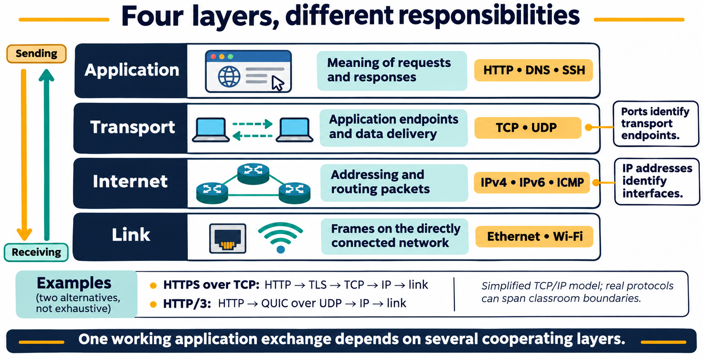
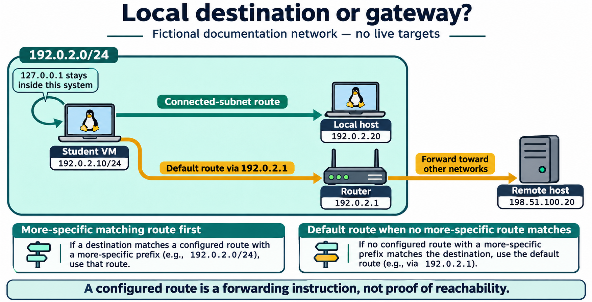

# Lesson 10 — Networking Fundamentals

## Lesson purpose

Linux systems communicate over local networks and the Internet through network interfaces, addresses, routes, transport protocols, and application services. This lesson gives students a practical model of those layers and a safe sequence for investigating connectivity. The lab inspects the current system and sends only limited diagnostic requests to instructor-approved destinations; it does not change network settings or scan other systems.

## Learning objectives

By the end of the lesson, students will be able to:

- describe the roles of a network interface, IP address, subnet, route, DNS resolver, port, and service;
- distinguish link, network, transport, and application responsibilities;
- inspect interfaces, addresses, and routes with `ip`;
- use a limited `ping` test and explain why no reply does not prove a host is down;
- resolve a hostname with `getent hosts` or `resolvectl query`;
- inspect local listening sockets with `ss`;
- make a safe HTTP header request with `curl -I`; and
- follow a layered process to distinguish local, routing, DNS, and application failures.

## Instructor preparation

Use an Ubuntu Desktop LTS VM or student-owned practice VM on a network where basic inspection is permitted. No administrator privileges or configuration changes are needed. Choose an instructor-approved public HTTPS endpoint and, if appropriate, the VM's default gateway for the limited connectivity check. Network policies may block ICMP, external DNS, or Internet access; plan a fallback demonstration or provide representative output. Remind learners not to publish private addresses, Wi-Fi names, MAC addresses, or screenshots that expose personal network details. Do not ask students to scan, probe, or connect to systems without authorization.

## Suggested lesson sequence

| Segment | Time |
|---|---:|
| Network model and vocabulary | 20 min |
| Guided read-only demonstrations | 35 min |
| Student lab: layered connectivity investigation | 45 min |
| Knowledge check and reflection | 20 min |

# Textbook chapter

## 1. A layered view of communication

A network exchange involves multiple responsibilities. A useful introductory model is the **TCP/IP model**: link, Internet, transport, and application. The names and boundaries vary between models, and real protocols do not always fit a classroom diagram perfectly, but layers help us ask where a failure may be occurring.

| Layer | Example responsibility | Examples |
|---|---|---|
| Link | Move frames on a directly connected network | Ethernet, Wi-Fi |
| Internet | Address and route packets between networks | IPv4, IPv6, ICMP |
| Transport | Deliver data to an application endpoint | TCP, UDP |
| Application | Define the meaning of a request and response | DNS, HTTP, SSH |

A web request uses all of these: a link carries frames; IP gets packets to the destination network; TCP or QUIC provides transport; and HTTP describes the web request. DNS may first translate a hostname into an IP address. If a later layer works, it often implies some lower-layer communication worked for that specific exchange, but the reverse is not guaranteed.



**Figure 10.1.** Application, transport, Internet, and link responsibilities cooperate in a network exchange. Ports identify transport endpoints and IP addresses identify interfaces. The examples show HTTPS over TCP and HTTP/3 over QUIC/UDP; the four-layer model is a simplified guide rather than an exhaustive protocol map.

## 2. Interfaces, addresses, and local networks

A **network interface** is a system's connection to a network. It may be a physical Ethernet or Wi-Fi adapter, a virtual adapter in a VM, a loopback interface, or a software-created interface. Interface names vary, so never assume a specific name such as `eth0` or `wlan0`.

An **IP address** identifies an interface at the Internet layer. IPv4 addresses are 32 bits and commonly displayed as four decimal numbers; IPv6 addresses are 128 bits and written in hexadecimal groups. An address is interpreted with a prefix length, such as `/24`, that indicates which bits identify the network and which identify an address within it. Addresses and prefixes are usually assigned automatically by DHCP or configured by an administrator. A link-local address can be useful on a local link but does not by itself demonstrate Internet access.

The **loopback** interface, usually shown as `lo` with address `127.0.0.1` and/or `::1`, lets a system communicate with itself. A loopback test checks local network-stack behavior, not the physical adapter, gateway, or Internet connection.

The `ip` command from iproute2 can display network state. These forms are for inspection:

```bash
ip link
ip address
ip route
```

`ip link` lists interfaces and link state; `ip address` shows assigned addresses and prefixes; `ip route` shows routing entries. An interface may be administratively up but lack a usable address, or have an address while the upstream network is unavailable. Output is only a snapshot of current state. The `ip` tool can also change configuration, so use only the exact display forms introduced here. Do not run `ip link set`, `ip address add/delete`, or `ip route add/delete` in the student lab.

## 3. Subnets, routes, and gateways

A **subnet** is an IP network described by an address and prefix. A host decides whether a destination is on a directly connected network or must be reached through a **router**. A **route** describes a destination network and the next step for reaching it. The **default route** is used when no more-specific route matches; it commonly points to a local **default gateway**, which forwards traffic to other networks.

Use `ip route` to inspect routes. The output often includes a line beginning with `default via`, but a default route does not prove that the gateway or Internet is reachable. Routing can fail because of a missing route, an unavailable gateway, a broken local link, upstream filtering, or a remote problem. A VM's network may be virtualized or NATed, so its displayed gateway need not be a physical router in the room.



**Figure 10.2.** A connected-subnet route serves the local example; traffic with no more-specific matching route uses the default gateway. Loopback remains within the system. A route describes where to send traffic, not whether delivery will succeed.

## 4. Name resolution and DNS

People use names such as `www.example.com`; network connections ultimately use IP addresses. **Name resolution** is the process that maps a name to an address (and sometimes performs reverse lookups). **DNS** is the distributed naming system commonly used for this purpose. The system may also consult local configuration such as `/etc/hosts`, caches, or other Name Service Switch sources. Therefore, a successful lookup does not necessarily prove that a DNS packet reached a public DNS server.

Use `getent hosts NAME` to ask the system's configured host lookup path for a result. On Ubuntu systems using systemd-resolved, `resolvectl query NAME` can show resolver details; `resolvectl` may not be installed or active in every distribution or network configuration. These commands query a name; they do not permanently change resolver settings. A failure can indicate a misspelled or nonexistent name, unavailable resolver, policy restriction, or network issue.

A useful comparison is to look up a known name and then make a request to an approved service. If a name fails to resolve but a known IP-layer test works, investigate name resolution. Avoid assuming that a single public IP address is a universal or permanently reliable diagnostic target.

## 5. Ports, TCP, UDP, and services

An IP address identifies a network interface, while a **port** helps identify an application endpoint on that host. TCP and UDP use port numbers; a **socket** is an endpoint used by a program for communication. TCP provides a connection-oriented byte stream with delivery and ordering behavior. UDP sends datagrams without TCP's connection and delivery guarantees. Applications choose the transport and define their own behavior on top of it.

A server process may listen on a local address and port while a client connects to it. A service listening only on loopback is generally reachable from that same system but not through its network interface. A listener bound to a network address may be reachable by other systems if routing and firewall policy allow it. A port number alone does not prove what application is running or whether remote access is permitted.

`ss` displays socket information. For example, `ss -tuln` lists TCP and UDP sockets in listening state, with numeric addresses and ports. It is a local inspection command; it is not a network scanner. A service can be absent from this listing if it is not listening, uses a different transport, or uses a socket type not selected by the options.

## 6. Test reachability with care

`ping` sends ICMP echo requests and reports replies and timing when they arrive. A bounded command such as `ping -c 4 DESTINATION` sends four requests and exits. Use only a loopback address, the instructor-approved gateway, or another approved host.

A reply indicates that ICMP echo traffic succeeded to that destination at that moment. No reply is inconclusive: a host, firewall, network, or policy may block or rate-limit ICMP while allowing application traffic. Conversely, a ping reply does not prove that a specific web or SSH service is available. `ping` is one signal in a diagnostic sequence, not a final connectivity verdict. Do not run unbounded pings or ping broadcast addresses.

## 7. Check application access with `curl`

`curl` transfers data using a URL and supports many protocols. In this lesson, use it only with the instructor-approved HTTPS endpoint. `curl -I --max-time 10 https://HOST/PATH` requests response headers using HTTP HEAD when supported and stops waiting after ten seconds; it avoids printing a page body, but it still contacts the server and may reveal the client's network address to that service. Use HTTPS and follow the course or network's acceptable-use rules.

A successful connection and an HTTP response show that name resolution (if a hostname was used), routing, transport, TLS, and an HTTP server all worked well enough for that request. A `404` response means the server was reached but the requested resource was not found; it is different from a DNS lookup failure or connection timeout. Some servers do not support HEAD, so a `405 Method Not Allowed` may indicate a method limitation rather than a general network outage. `--max-time 10` bounds how long curl waits for the transfer. `curl` does not treat every HTTP error status as a transfer failure by default; inspect the response status and error text rather than collapsing all outcomes into “online” or “offline.”

## 8. A layered troubleshooting sequence

Record the symptom and time, then test one layer at a time. Start locally and move outward:

1. **Interface and address:** Is the expected interface present and up? Does it have a plausible address and prefix? Use `ip link` and `ip address`.
2. **Route:** Is there a route to the destination or a default route? Use `ip route`.
3. **Local stack or gateway:** Does loopback respond? If authorized, does the gateway respond? Use a bounded `ping`; remember ICMP may be filtered.
4. **Name resolution:** Does the system resolve the approved hostname? Use `getent hosts` or, where available, `resolvectl query`.
5. **Application and port:** Does the approved application respond? Use `curl -I --max-time 10` for the approved HTTPS endpoint. Use `ss -tuln` only to inspect local listeners.


**Figure 10.3.** Inspect local state, routes, reachability, name lookup, and the application response. Each check establishes only part of the path: ICMP can be filtered, name lookup can use cached or local data, and an HTTP error status still represents an application response. Record uncertainty alongside evidence.

This is a reasoning aid, not a guarantee that every test is independent. A failure at one stage narrows possibilities but may have multiple causes. For example, an interface can be up while authentication to Wi-Fi has failed; a gateway can be reachable while an external route is broken; DNS can succeed from cache while the resolver is currently unavailable; and a web service can be down while the rest of the network works. Gather evidence, state what each test establishes, and avoid changing configuration until the cause and authorized remedy are understood.

# Guided demonstrations

## Demonstration 1: Inspect interfaces and addresses

```bash
ip link
ip address
```

Identify loopback and one non-loopback interface, if present. Note link state and whether an address is assigned. Do not copy private details into public course materials.

## Demonstration 2: Read the routing table

```bash
ip route
```

Locate any default route and explain that its presence does not prove end-to-end access.

## Demonstration 3: Make a bounded reachability check

```bash
ping -c 4 127.0.0.1
```

Explain the request count, replies, timing, and packet-loss summary. If using a gateway, confirm the target is the intended local gateway first and that the instructor permits the check.

## Demonstration 4: Compare lookup paths

```bash
getent hosts example.com
```

On a system where systemd-resolved is available, compare with:

```bash
resolvectl query example.com
```

Output may differ because of cache, local configuration, resolver availability, address family, and network policy.

## Demonstration 5: Inspect local listening sockets and make an HTTPS request

```bash
ss -tuln
curl -I --max-time 10 https://example.com
```

Use a network-approved endpoint. Explain that an HTTP status such as `200`, `301`, `403`, or `404` is an application response; the exact result can vary. Some endpoints or proxies may not accept a HEAD request.

# Student lab: Lesson 10 — Diagnose a Connectivity Path

## Safety and scope

Use the course VM or your authorized practice system. This lab observes network state and sends a few bounded requests only to `127.0.0.1`, an instructor-approved gateway, and an instructor-approved HTTPS endpoint. Do not scan address ranges, probe classmates' devices, guess ports, capture other users' traffic, change interface or route settings, edit resolver configuration, or use `sudo`. Do not publish identifying network output. If policy or connectivity blocks an external check, record the limitation and use instructor-provided results.

## Part A: Inspect local interfaces

```bash
ip link
ip address
```

Record the interface names and whether each is up. Identify loopback and one other interface if available. For the non-loopback interface, note whether an IPv4 or IPv6 address is shown. You may redact the address in submitted work; describe its broad type instead (for example, private IPv4, global IPv6, or link-local).

## Part B: Inspect routes

```bash
ip route
```

Record whether a default route appears. If it does, identify the gateway and interface privately in your notes; redact them in any shared report. Explain what traffic uses a default route and why its presence alone does not establish Internet connectivity.

## Part C: Test local networking

```bash
ping -c 4 127.0.0.1
```

Record whether replies arrived and what the result tells you. If the instructor approves, repeat against the current default gateway. If ICMP is filtered, mark the test inconclusive instead of diagnosing the whole network as offline.

## Part D: Resolve an approved hostname

```bash
getent hosts example.com
```

If `resolvectl` is available and used in your class, also run:

```bash
resolvectl query example.com
```

Record whether the name returned one or more addresses. Explain that results may be affected by caching, local hosts configuration, IPv4/IPv6, and local policy.

## Part E: Inspect sockets and request an approved service

```bash
ss -tuln
curl -I --max-time 10 https://example.com
```

For `ss`, identify one listening socket if any, without attempting to connect to it. For `curl`, record the HTTP response status or explain the error layer suggested by the result. Do not treat a failed HEAD request as proof that all network access is unavailable; the server may not support that method. If the instructor specifies another endpoint, substitute it exactly.

## Part F: Write an evidence-based diagnosis

Create a short report answering:

1. Was a non-loopback interface present and up?
2. Was an address assigned? Was a default route shown?
3. Which reachability tests replied, failed, or were inconclusive?
4. Did name resolution return an address?
5. Did the approved application endpoint return an HTTP response?
6. What is the narrowest conclusion supported by your evidence? What remains unknown?

Do not write “the Internet is down” based on one failed ping. Distinguish “name resolution failed,” “ICMP did not receive a reply,” “the HTTP request received status ___,” and “this test was blocked by policy.”

## Lab success criteria

- The student reads interface, address, and route output accurately.
- The student explains the limited meaning of a ping result.
- The student performs name lookup and identifies possible lookup-path limitations.
- The student distinguishes an HTTP response from a transport or name-resolution failure.
- The written diagnosis separates observation from inference and identifies uncertainty.
- No network configuration is changed and no unauthorized hosts are contacted.

# Knowledge check

1. What are the four layers in the TCP/IP model used in this lesson?
2. What is the role of a network interface?
3. What does an IP address identify?
4. What does `/24` indicate when it follows an IPv4 address?
5. What is the purpose of the loopback interface?
6. What information does `ip link` display?
7. What information does `ip address` display?
8. What does `ip route` show?
9. What is a default route?
10. What does a default gateway do?
11. What is DNS used for?
12. Why might `getent hosts` succeed without querying a public DNS server?
13. What does `resolvectl query` do on a system using systemd-resolved?
14. What is a port used for?
15. How does TCP generally differ from UDP?
16. What does `ss -tuln` display?
17. What protocol does `ping` use for its echo request and reply?
18. Why does a failed ping not prove a host or service is unavailable?
19. What does `curl -I` request from an HTTP server?
20. What can an HTTP 404 response tell you that a DNS failure cannot?
21. If a hostname lookup fails but an IP-layer test succeeds, which area should you investigate next?
22. Why should students avoid scanning a subnet during this lab?
23. A default route is present, but `curl` times out. What does the route alone prove?
24. Which layer is most directly described by HTTP?
25. Why should a report distinguish observations from conclusions?

## Answer key

1. Link, Internet, transport, and application.
2. It connects the system to a network; it can be physical, virtual, loopback, or software-defined.
3. It identifies an interface at the Internet layer so packets can be addressed and routed.
4. The first 24 bits identify the network portion of the prefix; the remaining address bits are for addresses within that subnet.
5. It lets the system communicate with itself; it does not test an external adapter or network.
6. Network interfaces and link-related state.
7. Addresses and prefixes assigned to interfaces.
8. Routing entries that determine where packets for destinations are sent.
9. A route used when no more-specific route matches.
10. It forwards traffic from the local network toward other networks.
11. Translating names to addresses and supporting related name lookups.
12. The system may use a local hosts file, cache, or another configured Name Service Switch source.
13. It queries the systemd-resolved name-resolution service for a name or address.
14. It identifies an application endpoint on a host for transport protocols such as TCP or UDP.
15. TCP is connection-oriented and provides ordered reliable byte-stream delivery; UDP sends datagrams without those TCP guarantees.
16. Local listening TCP and UDP sockets with numeric addresses and ports.
17. ICMP echo messages.
18. ICMP may be blocked or rate-limited even when other traffic works; ping does not test a particular application service.
19. It requests response headers using HTTP HEAD when supported, without requesting the normal response body.
20. The hostname resolved and an HTTP server returned a response, but the requested resource was not found.
21. Name resolution, including local resolver configuration, cache, and DNS availability.
22. It is outside the authorized scope, can affect others' systems, and is unnecessary for the learning objective.
23. Only that a default routing entry is configured; it does not prove the gateway, upstream network, DNS, or service is working.
24. The application layer.
25. So readers can tell what was directly measured from what is inferred and what remains uncertain.

## Exit ticket

Describe a short sequence of checks you would use if a website hostname fails to load. For each check, state what its result would and would not establish.

# Chapter glossary

**Default gateway:** A router used to forward traffic toward networks without a more-specific local route.  
**Default route:** The route selected when no more-specific route matches a destination.  
**DNS (Domain Name System):** A distributed system that provides name-to-data lookups, commonly hostname-to-address lookup.  
**IP address:** A network-layer address assigned to an interface.  
**Loopback:** A local interface and address range used by a system to communicate with itself.  
**Network interface:** A physical or logical connection through which a system sends and receives network traffic.  
**Port:** A transport-layer number used to identify an application endpoint on a host.  
**Route:** A rule or table entry that describes how to forward packets toward a destination.  
**Socket:** A communication endpoint used by a process.  
**Subnet:** An IP network described by an address prefix.  
**TCP:** A connection-oriented transport protocol that provides an ordered byte stream.  
**UDP:** A transport protocol that sends datagrams without TCP's connection and delivery guarantees.  

# Instructor materials

## Instructor notes

- Link this lesson to Lesson 5 (processes), Lesson 8 (text output), and Lesson 9 (system/storage layers) as appropriate.
- Keep the layer model introductory; emphasize how it supports troubleshooting rather than rote memorization.
- Use `ip link`, `ip address`, and `ip route` in display form only. The `ip` command can alter state when given other subcommands.
- Avoid collecting students' full network output. Private IPs, public addresses, MAC addresses, Wi-Fi names, and routes can reveal personal or institutional details.
- Tell students that network policy may block ICMP, DNS, or external HTTPS. Supply a prepared output transcript when live access is unavailable.
- Keep `ping` bounded with `-c`; never demonstrate broadcast or subnet-wide probes.
- Use only a course-approved HTTPS endpoint with `curl -I --max-time 10`. Explain that the request contacts the server and may be logged.
- Keep `ss` focused on local listening sockets. Do not turn this exercise into service discovery or port scanning.
- Teach diagnosis as evidence and uncertainty: a failed check narrows the possibilities but rarely identifies one cause alone.

## Suggested slide outline

1. TCP/IP layers and how one exchange uses several protocols
2. Network interfaces, addresses, prefixes, and loopback
3. Subnets, routes, and the default gateway
4. DNS and the system's name-lookup path
5. Ports, sockets, TCP, UDP, and services
6. Bounded `ping` tests and their limits
7. HTTP response checks with `curl -I`
8. A layered troubleshooting workflow and evidence-based reporting

## Commands introduced

`ip link`, `ip address`, `ip route`, `ping -c`, `getent hosts`, `resolvectl query` (where available), `ss -tuln`, and `curl -I --max-time 10` against an instructor-approved HTTPS endpoint. Examples use inspection commands or limited diagnostic requests; no network settings are changed.

## Instructor references

- [RFC 1122: Requirements for Internet Hosts — Communication Layers](https://www.rfc-editor.org/rfc/rfc1122.html) — Internet host communication layers and IP behavior.
- [RFC 1034: Domain Names — Concepts and Facilities](https://www.rfc-editor.org/rfc/rfc1034.html) — DNS concepts and design.
- [ip(8)](https://man7.org/linux/man-pages/man8/ip.8.html), [ping(8)](https://man7.org/linux/man-pages/man8/ping.8.html), [ss(8)](https://man7.org/linux/man-pages/man8/ss.8.html), and [getent(1)](https://man7.org/linux/man-pages/man1/getent.1.html) — Linux networking commands.
- [resolvectl](https://www.freedesktop.org/software/systemd/man/latest/resolvectl.html) — systemd-resolved query and resolver inspection.
- [curl manual](https://curl.se/docs/manpage.html) — URL transfers and HTTP behavior.
